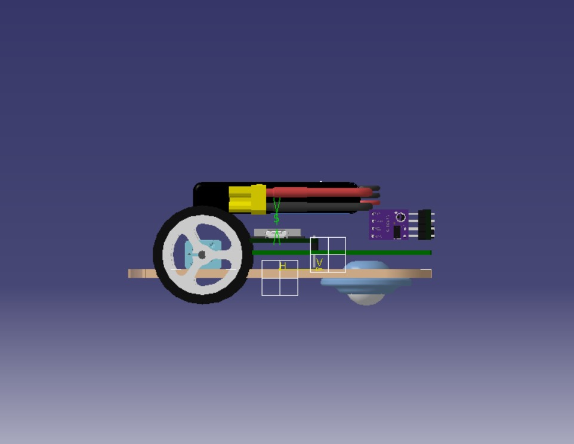
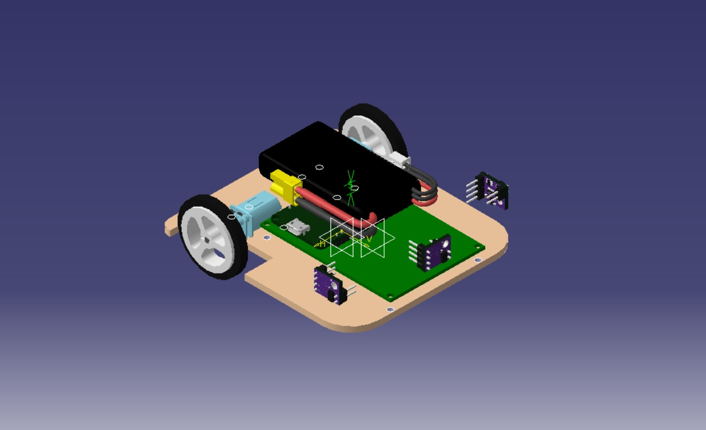
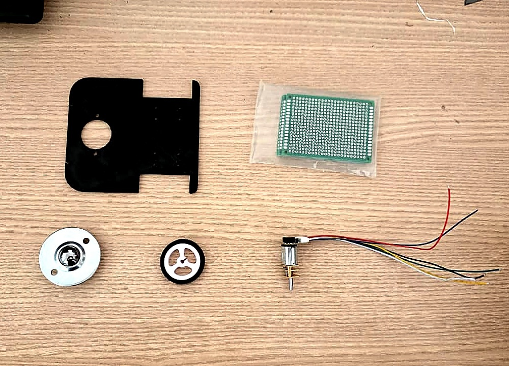
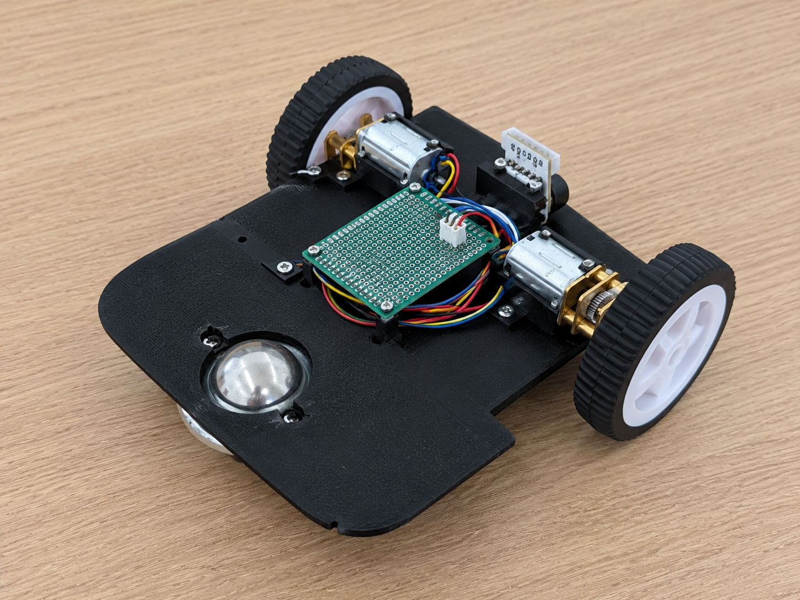
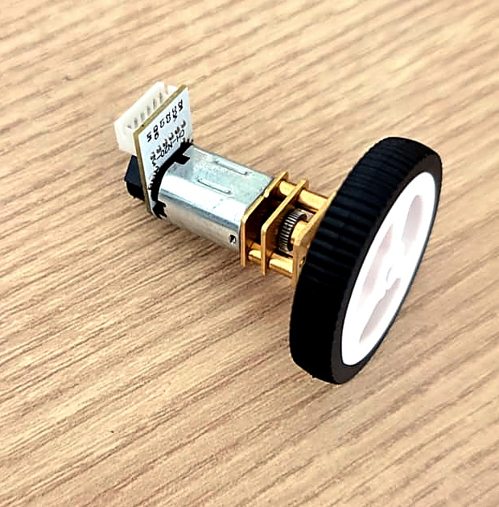
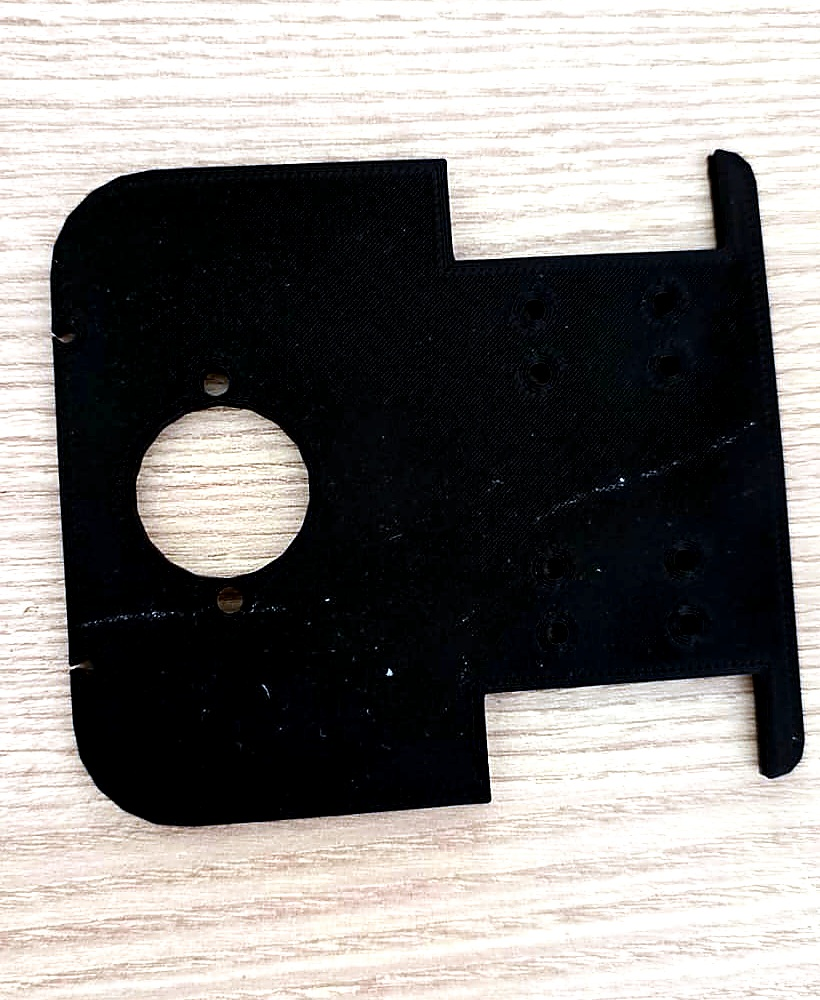
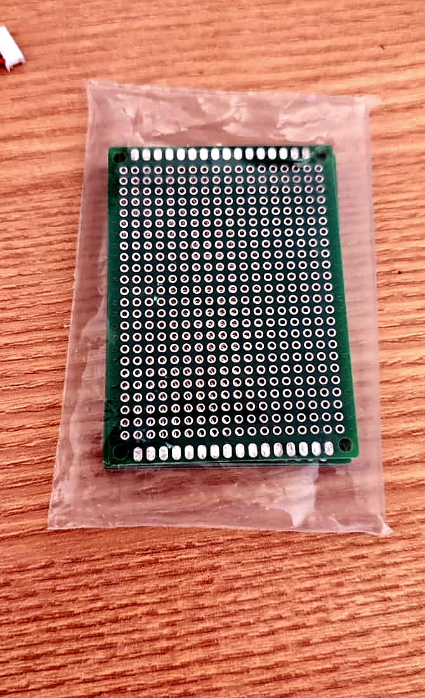
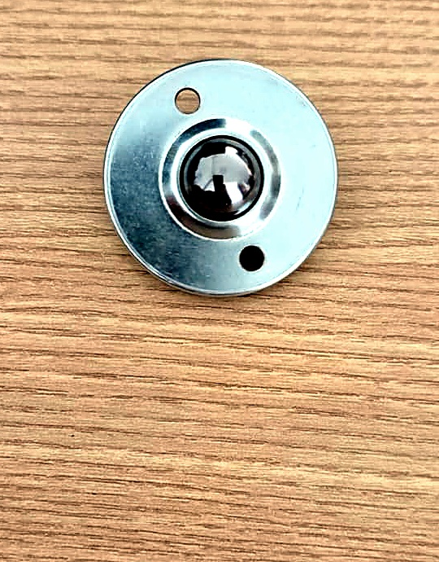

# Testes de Estrutura

Este documento reúne os registros dos testes realizados para avaliar a estrutura do Micromouse, incluindo os critérios esperados, os resultados obtidos, os responsáveis e as observações de cada verificação. As imagens complementam os registros ao apresentar os componentes da estrutura, o chassi e os elementos utilizados na montagem.

## 1. Registro dos testes

| ID | Descrição | Data de Início | Data de Conclusão | Responsável | Resultados Esperados | Resultados Obtidos | Aprovação Interna (S/N) | Aprovação do Orientador (S/N) | Observações |
|:---:|---|---|---|---|---|---|:---:|:---:|---|
| 1.1 | **Análise de Deflexão (CAD)** | 14/10/2026 | 16/10/2026 | Murilo | Deformação máxima (*flecha*) menor que 0,50 mm sob carga estática. | Deformação de 0,32 mm no centro. | S | | Simulação FEA aprovada para espessura de 3 mm em PLA. |
| 1.2 | **Teste de Carga Estática** | 22/10/2026 | 23/10/2026 | Jeferson | Manutenção do vão livre sem flambagem do chassi. | Suportou o dobro do peso operacional sem deformar. | S | | Teste realizado com peso equivalente à bateria e à placa perfurada. |
| 1.3 | **Ajuste Dimensional (*Fit Test*)** | 24/10/2026 | 24/10/2026 | Geovana | Parafusos e motores N20 encaixando nas furações. | Encaixe firme, sem rachaduras nas paredes de PLA. | S | | Validação da retração térmica planejada no CAD. |
| 1.4 | **Teste de Torção Manual** | 24/10/2026 | 24/10/2026 | Júlio | Absorção de esforços torcionais sem delaminação das camadas. | Estrutura rígida sem trincas nas bordas. | S | | Uso de 4 perímetros garantiu boa resistência mecânica. |
| 1.5 | **Queda Livre Controlada** | 24/10/2026 | 24/10/2026 | Murilo | Resistência a pequenos impactos sem estilhaçar. | Sem danos aparentes após queda de 15 cm. | S | | Simula batidas leves nas paredes do labirinto. |
| 1.6 | **Validação de Temperatura dos Motores** | 24/10/2026 | 24/10/2026 | Jeferson | Temperatura abaixo de 35 °C. | Temperatura estabilizada em aproximadamente 38 °C. | S | | Resultado acima do critério estabelecido; aprovação a confirmar. |
| 1.7 | **Planicidade e Nivelamento do Piso do Labirinto** | 23/10/2026 | 23/10/2026 | Geovana | Chão plano em MDF de 12 mm, sem ondulações ou degraus entre as placas. | Desvio menor que 0,50 mm nas junções. | S | | Garante que o *ball caster* e as rodas rolem sem travar. |
| 1.8 | **Dimensões das Células e Paredes do Labirinto** | 23/10/2026 | 23/10/2026 | Júlio | Corredores de 168 mm de largura e paredes com 50 mm de altura. | Células com 168 ± 1 mm. | S | | Valida o espaço de folga lateral para o chassi. |

## 2. Registro Fotográfico da Estrutura

### Figura 0 — Modelo CAD

O modelo CAD apresenta a concepção da estrutura do Micromouse e serve como referência para a fabricação e o posicionamento dos componentes.

### Figuras 1 e 2 — Componentes da estrutura avulsos e posicionados

A Figura 1 apresenta os componentes separados, permitindo observar individualmente os elementos utilizados na montagem. A Figura 2 mostra os componentes posicionados na estrutura do Micromouse, auxiliando na compreensão de sua disposição em relação ao chassi.

### Figuras 3 e 4 — Motor N20 com encoder e chassi em PLA

A Figura 3 apresenta o conjunto do motor N20 com encoder e roda, responsável pela movimentação do robô. A Figura 4 mostra o chassi fabricado em PLA, cuja geometria e furações servem de base para a fixação e o posicionamento dos componentes.

### Figuras 5 e 6 — Placa perfurada e *ball caster*

A Figura 5 apresenta a placa perfurada utilizada como suporte para a montagem dos componentes eletrônicos. A Figura 6 mostra o *ball caster*, elemento de apoio que auxilia o deslocamento do robô junto às rodas motrizes.
