# Testes de Energia

!!! warning "Execução parcial em 24/10/2026"
    Os testes foram feitos em 24/10/2026, no laboratório da faculdade, sem a LiPo e sem os reguladores de 5 V e 3,3 V montados. A fonte de bancada fez o papel da bateria e dos reguladores, seguindo o [roteiro adaptado](#execucao-em-24102026-roteiro-adaptado). Ficaram pendentes a curva de tensão da LiPo (2.1), a regulação (2.3), o bloqueio e a queda no diodo (2.4) e o divisor (2.5), que serão repetidos com a LiPo e a placa montada.

São cinco testes, os essenciais para confirmar com medição o que o [projeto conceitual de energia](4.2%20-%20Projeto%20conceitual%20de%20energia.md) calculou: quanto cada componente consome, quanto tempo a bateria sustenta o robô e se as tensões e as proteções se comportam como previsto. Os testes 2.3, 2.4 e 2.5 são medidos durante a descarga do 2.1, a cada 10 min, para caber numa única ida ao laboratório.

Tabela 1: Matriz de testes de energia

| **ID** | **Descrição** | **Data de Início** | **Data de Conclusão** | **Responsável** | **Resultados Esperados** | **Resultados Obtidos** | **Aprovação Interna (S/N)** | **Aprovação do Orientador (S/N)** | **Observações** |
|:------:|---------------|--------------------|-----------------------|-----------------|--------------------------|------------------------|:---------------------------:|:--------------------------------:|-----------------|
| 2.1 | Curva de descarga da LiPo com os motores girando (RNF02, RNF03) | 24/10/2026 | 24/10/2026 | Giovana (execução), João Marcos (análise) | Por pelo menos 30 min, a tensão fica acima do corte de 7,0 V; a corrente média fica até 0,56 A (0,43 A do 4.2 mais 30%) e a autonomia estimada passa de 30 min | Emulado com a fonte de bancada a 6,01 V direto nos dois motores, girando livres, por 5 min: a corrente caiu de 54 para 51 mA (média de 52 mA, 26 mA por motor), e os motores não esquentaram. A corrente estimada na bateria, com o ESP32 transmitindo, é de 0,15 A, e a autonomia estimada é de 208 min | Pendente |  | Sem a LiPo, a tensão da bateria não foi medida, e com as rodas livres e sem o peso do robô a corrente fica bem abaixo da de operação. Os 30 min não foram feitos por haver uma fonte só. Fica para a repetição com a LiPo. Figura 8 |
| 2.2 | Consumo de cada componente (RNF03) | 24/10/2026 | 24/10/2026 | Giovana (execução), João Marcos (análise) | A corrente medida de cada componente fica até 30% acima da prevista no 4.2 (Tabela 1); o motor travado fica abaixo de 1 A, de modo que os dois juntos ficam abaixo do hold de 2,0 A do PTC | Motor N20 a 6,01 V: 26 a 30 mA girando livre e pico de 211 mA com o eixo travado por 2 s (o multímetro ficou em torno de 165 mA). ESP32 pelo VIN a 5,32 V: 42 mA com o código simples e 118 mA transmitindo. Todos abaixo do previsto. O ToF não apareceu na leitura da fonte (o conjunto com o ESP32 deu os mesmos 42 mA) | S (parcial) |  | Tabela 3. O motor travado, mesmo somando os dois (0,42 A), fica bem abaixo do hold de 2,0 A do PTC. O ToF e o encoder ficam para medir com o multímetro no 3V3. Figuras 3 a 7 |
| 2.3 | Regulação das linhas de 5 V e 3,3 V (RF02) | 24/10/2026 | 24/10/2026 | Giovana (execução), João Marcos (análise) | Do início ao fim da descarga, 5 V entre 4,75 e 5,25 V e 3,3 V entre 3,14 e 3,47 V | Não executado | — | | Os reguladores não estavam montados; a fonte entregou os 5,32 V e os 6,01 V direto. Fica para a integração |
| 2.4 | Proteção contra inversão de polaridade e queda do diodo (RNF04) | 24/10/2026 | 24/10/2026 | Giovana (execução), João Marcos (análise) | Com a entrada invertida nada liga; ligado certo, a queda no SS34 fica entre 0,3 e 0,4 V | Fonte a 5,53 V com o ESP32 como carga. Segundo a execução, com a entrada invertida o SS34 bloqueou a corrente e, na polaridade certa, conduziu. Nas fotos, a fonte marca 0,289 A com a entrada invertida e 0,293 A na polaridade certa | Pendente |  | A corrente da foto invertida (Figura 1) é quase igual à da ligação certa; com o diodo bloqueando, ela ficaria perto de zero. Aguardando a confirmação da execução; se preciso, repetir com a fonte limitada a 0,10 A, anotando a corrente nos dois sentidos. A queda no diodo não foi medida; o firmware segue com os 0,35 V do 4.2. Figuras 1 e 2 |
| 2.5 | Divisor de tensão da leitura da bateria (RF04) | 24/10/2026 | 24/10/2026 | Giovana (execução), João Marcos (análise) | A razão entre a tensão depois do diodo e a saída do divisor fica em 3,20 ± 2% em toda a descarga | Não executado | — | | Divisor 22 kΩ / 10 kΩ (4.2, seção 6.1). Depende do 2.1 com a LiPo |

Fonte: [João Marcos](https://github.com/JJOAOMARCOSS) e [Giovana Martins](https://github.com/Giih-martins), 2026.

Tabela 2: Cobertura dos requisitos de Energia

| Requisito | Testes |
|---|---|
| RF02 Regulação das tensões de operação | 2.3 |
| RF04 Medição do nível de carga | 2.4, 2.5 |
| RNF02 Autonomia de operação | 2.1 |
| RNF03 Dimensionamento da capacidade da fonte | 2.1, 2.2 |
| RNF04 Proteções elétricas da fonte | 2.2, 2.4 |

Fonte: [João Marcos](https://github.com/JJOAOMARCOSS) e [Giovana Martins](https://github.com/Giih-martins), 2026.

Os requisitos que dependem do robô montado (RF01 alimentação autônoma, RF03 seleção entre as fontes, RF05 sinalização, RF06 troca e recarga e RF07 fixação da fonte) e o alerta e o corte por subtensão feitos pelo firmware são verificados nos [testes de integração](7.5%20-%20Testes%20de%20integração.md).

## Procedimentos

**Equipamentos:** dois multímetros (um para a corrente, em série, e outro para as tensões), cronômetro, a LiPo 2S de 650 mAh carregada no IMAX B3, os dois motores N20 e a ponte H TB6612FNG.

**Segurança:** a LiPo nunca é descarregada abaixo de 7,0 V. Se a tensão chegar a 7,0 V, o teste para na hora. A inversão de polaridade (2.4) é feita com o pacote de pilhas AA ou com a fonte de bancada limitada a 100 mA, nunca com a LiPo. O motor travado (2.2) fica no máximo 2 s parado, para não aquecer.

### Execução em 24/10/2026: roteiro adaptado

No dia do teste só havia o regulador step-up, e a LiPo não tinha chegado. Por isso a fonte de bancada emulou as tensões que os reguladores e a bateria entregariam, e cada componente foi ligado direto nela:

- **Polaridade (2.4):** fonte a cerca de 5 V (5,53 V no display) com o ESP32 como carga, ligada invertida por no máximo 3 s e depois na polaridade certa.
- **Consumo (2.2):** um motor N20 direto na fonte a 6,01 V, como se estivesse ligado na bateria, com o multímetro em série medindo só a corrente do motor: primeiro girando livre, para o consumo médio, e depois com o eixo segurado por 2 s, para o pico; o ESP32 pelo VIN a 5,32 V, com um código simples e com um código que transmite; o ToF ligado no pino 3V3 do ESP32.
- **Descarga emulada (2.1):** os dois N20 direto a 6,01 V, com limite de 2,0 A, girando livres, com a corrente anotada a cada minuto. O teste térmico de 30 min não foi feito, porque havia uma fonte só e ela era usada pelos outros testes. Os motores rodaram 5 min sem esquentar, e os 30 min ficam para a repetição com a LiPo, se for preciso.

### 2.1 Curva de descarga da LiPo com os motores girando

1. Carregar a LiPo no IMAX B3 até 8,4 V, com balanceamento, e anotar a tensão em repouso.
2. Montar: LiPo → multímetro em série (escala de 10 A) → diodo SS34 → ponte H → dois motores, com as rodas livres. Se a placa da Eletrônica já estiver pronta, ligar o robô inteiro pela placa.
3. Acionar os motores pela ponte H com o PWM limitado a 71% (Tabela 8 do 4.2), para não passar dos 6 V dos motores. Com a ESP32 ligada, o consumo dela entra junto.
4. Disparar o cronômetro e, **a cada 1 min**, anotar o tempo, a tensão da bateria e a corrente.
5. **A cada 10 min** (0, 10, 20, 30...), anotar também a tensão depois do diodo, a saída do divisor e, se os reguladores estiverem montados, as linhas de 5 V e de 3,3 V. Essas são as leituras dos testes 2.3, 2.4 e 2.5.
6. Seguir por pelo menos 30 min (três tentativas de 10 min). Se der tempo, continuar até 7,0 V para medir a autonomia real.
7. Anotar qualquer coisa fora do normal na coluna de observação (motor esquentando, reinício da ESP32, cheiro, ruído).

#### Alternativa sem a LiPo: fonte de bancada

Se a LiPo não chegar a tempo, a fonte de bancada faz o papel da bateria, com dois canais:

- **Canal 1 (bateria):** começa em 8,4 V, com limite de 2,0 A, e alimenta o SS34, o divisor, o regulador de 5 V com a ESP32 e o de 3,3 V. A tensão é baixada em degraus que seguem a curva típica de uma LiPo 2S (8,40; 8,20; 8,04; 7,90; 7,80; 7,70; 7,62; 7,54; 7,46; 7,36; 7,00 V), cada degrau equivalendo a 10% da carga (65 mAh). A duração de cada degrau sai da corrente média dos 5 primeiros minutos: $\Delta t\,[\text{min}] = 3900 / I\,[\text{mA}]$.
- **Canal 2 (motores):** fixo em 6,0 V, ligado direto nos dois motores, sem ponte H. É a tensão nominal do N20 e equivale aos 71% de PWM com 8,4 V, então não precisa de firmware para girar os motores.

As correntes dos dois canais são anotadas separadas (`corrente_A` e `corrente_motores_A`). A corrente que sairia da bateria é calculada pela potência dos motores:

$$I_{bateria} = I_{circuito} + I_{motores} \cdot \frac{6{,}0\ \text{V}}{V_{bateria}}$$

Nesse caso a curva de tensão pelo tempo é emulada: a corrente, a regulação, o diodo e o divisor são medidos, e a autonomia sai da corrente média. Como a fonte não estraga abaixo de 7,0 V, dá para seguir até 6,5 V e ver até onde os reguladores seguram e quando o firmware alerta e corta. Quando a LiPo chegar, o teste 2.1 é repetido com ela.

### 2.2 Consumo de cada componente

1. Medir em separado, com o multímetro em série na alimentação de cada um:
    - um motor girando livre, pela ponte H a 71%;
    - um motor com a roda segurada, por no máximo 2 s, na escala de 10 A;
    - a ESP32 pelo VIN a 5 V, ligada sem Bluetooth conectado e depois transmitindo;
    - um sensor ToF e um encoder a 3,3 V.
2. Anotar a tensão de cada um no momento da medição.
3. Se o robô estiver montado, medir também a corrente total pela LiPo em operação.

### 2.3 Regulação das linhas de 5 V e 3,3 V

Feito durante o 2.1: a cada 10 min, medir as saídas do buck-boost (5 V) e do LDO (3,3 V) com a carga ligada. Se os reguladores ainda não estiverem montados, o teste fica para a integração.

### 2.4 Proteção contra inversão de polaridade e queda do diodo

1. Com as pilhas AA ou com a fonte de bancada limitada a 100 mA, ligar a entrada invertida por poucos segundos e verificar que nada liga e que a corrente fica perto de zero.
2. Desligar e ligar na polaridade certa.
3. Durante o 2.1, a cada 10 min, medir a tensão antes e depois do SS34. A diferença é a queda do diodo naquela corrente.

### 2.5 Divisor de tensão da leitura da bateria

Feito durante o 2.1: a cada 10 min, medir a tensão depois do diodo e a saída do divisor (o ponto que vai ao ADC). A página calcula a razão entre as duas.

## Resultados

### Como registrar os dados

As leituras vão em dois arquivos, que podem ser editados direto no GitHub ou numa planilha salva como CSV, com `;` entre as colunas:

- `docs/dados/energia/descarga-lipo.csv`: uma linha por minuto do teste 2.1, com as leituras de 10 em 10 min nas colunas extras. A coluna `corrente_motores_A` só é usada com a fonte de bancada; se ela estiver preenchida, o gráfico avisa que a descarga foi emulada;
- `docs/dados/energia/consumo-componentes.csv`: a corrente e a tensão medidas de cada componente do teste 2.2. As correntes previstas já estão preenchidas.

Ao salvar, os gráficos e as tabelas abaixo são refeitos. Basta conferir os números e preencher as colunas de resultado e de aprovação da Tabela 1.

### Contas feitas a partir das leituras

Com as leituras $V_k$ (V) e $I_k$ (A) no tempo $t_k$, a página calcula, entre cada par de leituras seguidas (regra dos trapézios):

$$E = \sum_k \frac{V_k I_k + V_{k+1} I_{k+1}}{2}\,(t_{k+1} - t_k) \qquad Q = \sum_k \frac{I_k + I_{k+1}}{2}\,(t_{k+1} - t_k)$$

em que $E$ é a energia consumida (J, com o tempo em segundos) e $Q$ é a carga usada (mAh, com o tempo em horas e a corrente em mA). A autonomia estimada usa a corrente média $\bar{I}$ e os 80% da capacidade que podem ser usados sem passar do corte (4.2, seção 4.1):

$$t_{autonomia} = \frac{0{,}80 \times 650\ \text{mAh}}{\bar{I}}$$

No teste 2.2, a potência de cada componente é $P = V \cdot I$, e a diferença para o previsto é $(I_{medida} - I_{prevista}) / I_{prevista}$. A comparação usa a margem de 30% adotada no dimensionamento (4.2, Tabela 4).

### 2.1 Curva de descarga

Sem a LiPo, só a corrente dos motores foi registrada. A corrente que sairia da bateria é estimada pela potência dos motores e do ESP32 transmitindo (118 mA a 5,32 V, do 2.2), com o rendimento de 85% da ponte H e dos reguladores (4.2, seção 2), sobre a tensão nominal de 7,4 V:

$$I_{bateria} = \frac{I_{motores} \cdot 6{,}01\ \text{V} + I_{ESP32} \cdot 5{,}32\ \text{V}}{7{,}4\ \text{V} \times 0{,}85} = \frac{0{,}0524 \times 6{,}01 + 0{,}118 \times 5{,}32}{6{,}29} \approx 0{,}15\ \text{A}$$

Com esses 0,15 A, os 80% da carga (520 mAh) durariam cerca de 208 min. O número serve só como limite de baixo: girando livres, sem o peso do robô e sem a ponte H, cada motor puxou 26 mA, contra os 150 mA de cruzeiro do 4.2, e o motor travado deu 211 mA, contra os 800 mA previstos. Até a repetição com a LiPo e o robô montado, o dimensionamento continua usando os 0,43 A do 4.2, que ficam do lado da segurança.

Carregando…

Tabela 3: Consumo previsto e medido de cada componente

Carregando…

Fonte: [João Marcos](https://github.com/JJOAOMARCOSS) e [Giovana Martins](https://github.com/Giih-martins), 2026.

### Evidências

Registros feitos pela Giovana durante a execução. Nas fotos, o display da fonte de bancada mostra a corrente (A) e a tensão (V) entregues; quando aparece, o multímetro está em série, na escala de mA (o sinal negativo é só o sentido das pontas). As Figuras 3 e 4 são quadros do vídeo do teste do motor.

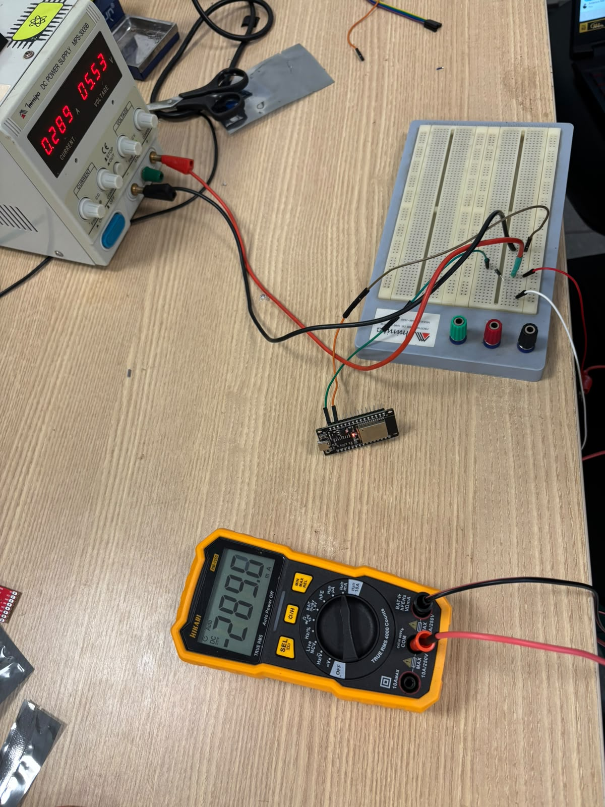{ width="420" }

Figura 1: Entrada invertida no teste de polaridade, 0,289 A na fonte (2.4)

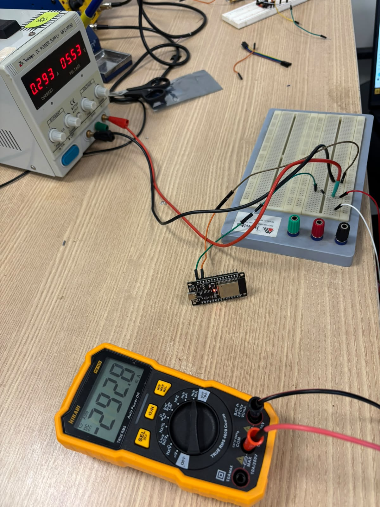{ width="420" }

Figura 2: Entrada na polaridade certa, 0,293 A na fonte (2.4)

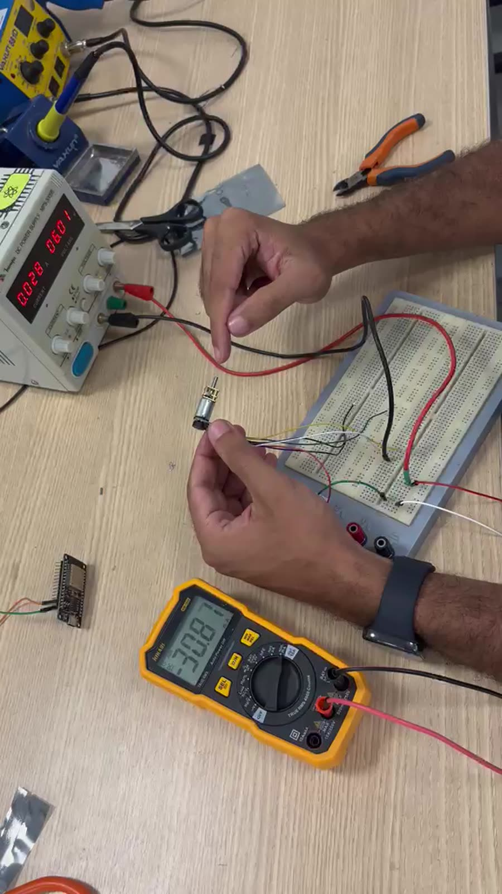{ width="420" }

Figura 3: Um motor N20 girando livre a 6,01 V, 0,028 A na fonte (2.2)

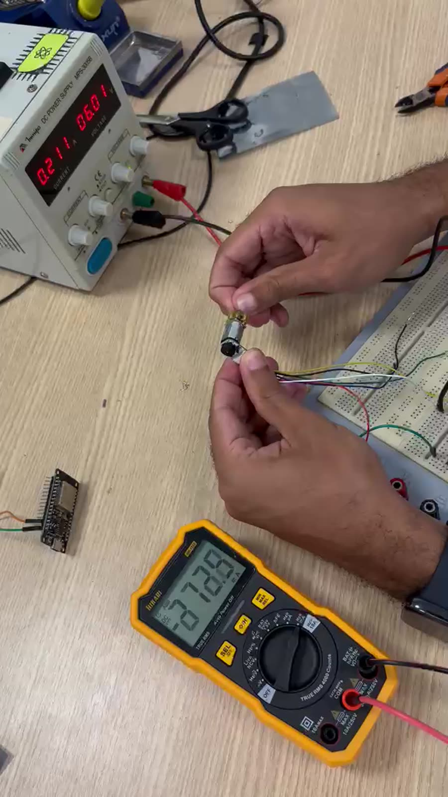{ width="420" }

Figura 4: Um motor N20 com o eixo travado, pico de 0,211 A na fonte (2.2)

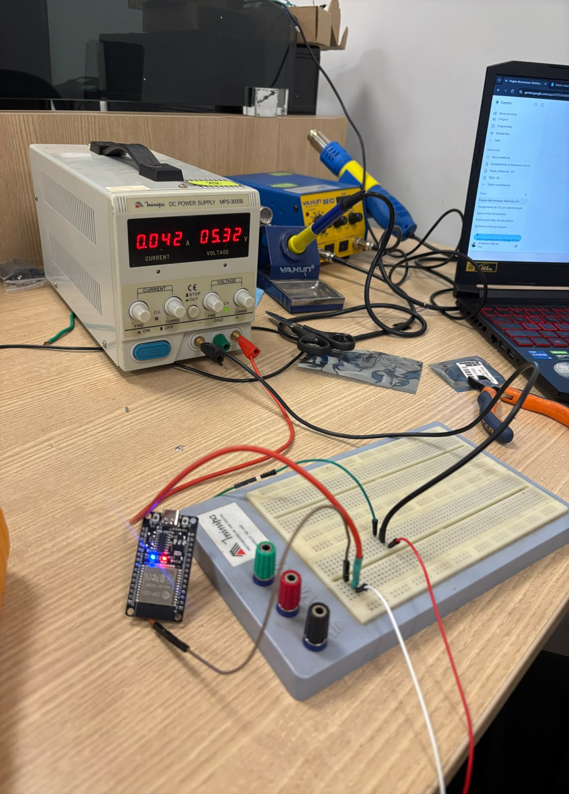{ width="420" }

Figura 5: ESP32 pelo VIN a 5,32 V com o código simples, 0,042 A (2.2)

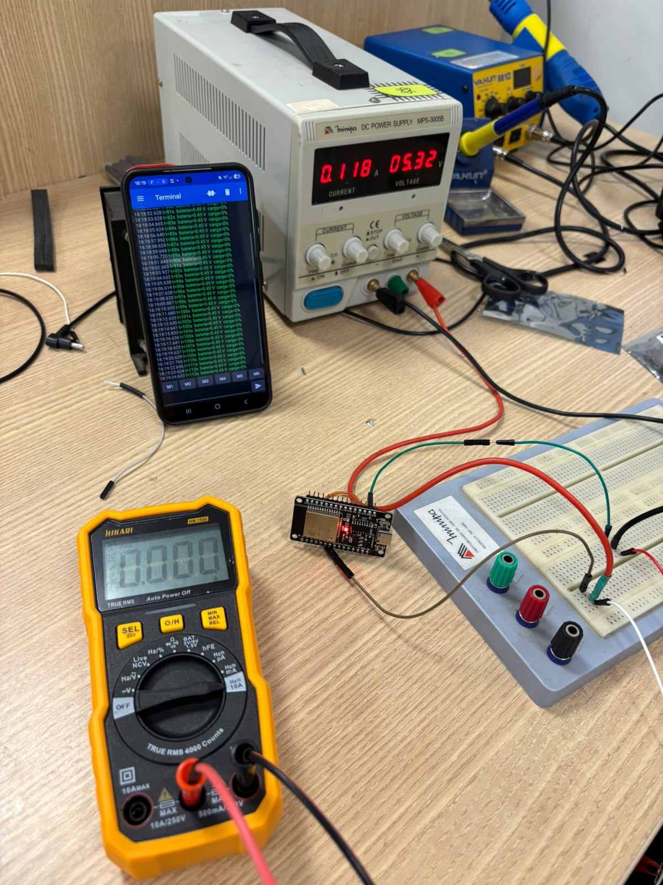{ width="420" }

Figura 6: ESP32 transmitindo para o celular, 0,118 A (2.2)

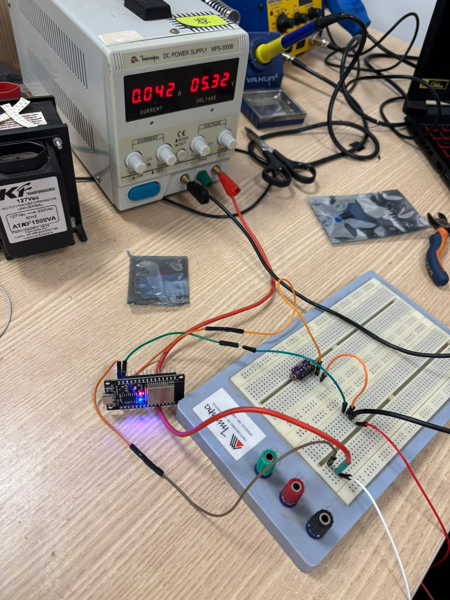{ width="420" }

Figura 7: ESP32 com o ToF ligado no pino 3V3, 0,042 A no conjunto (2.2)

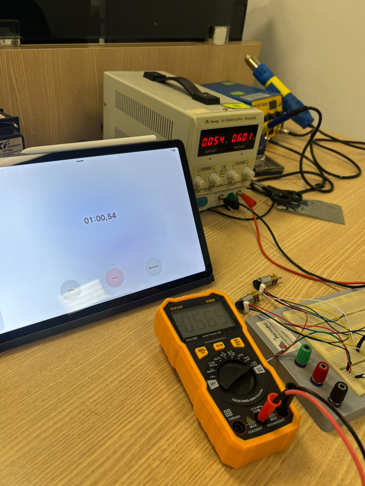
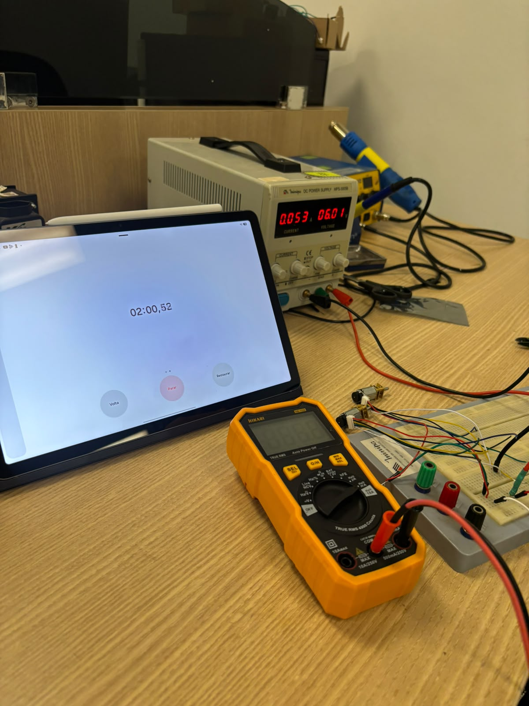
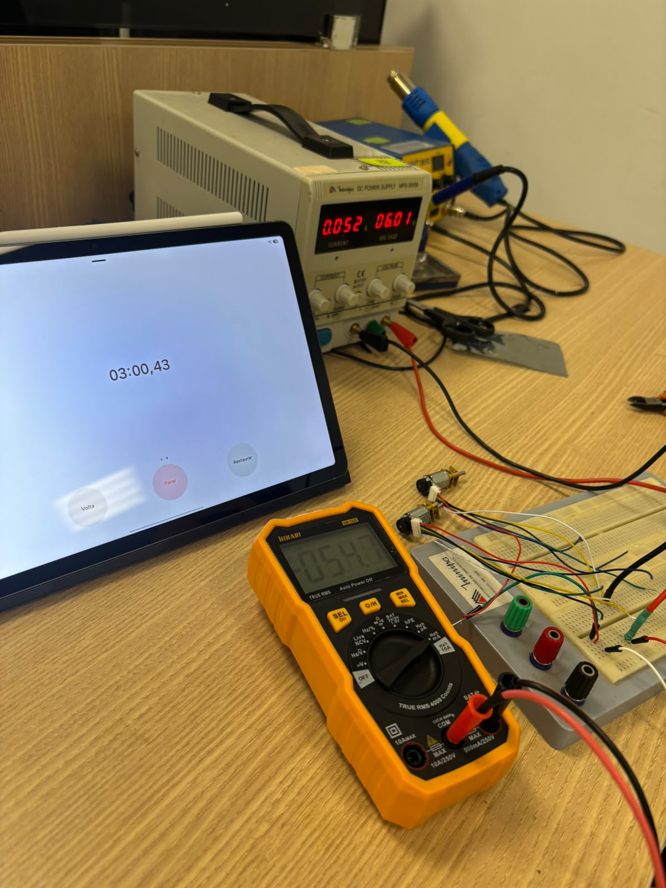
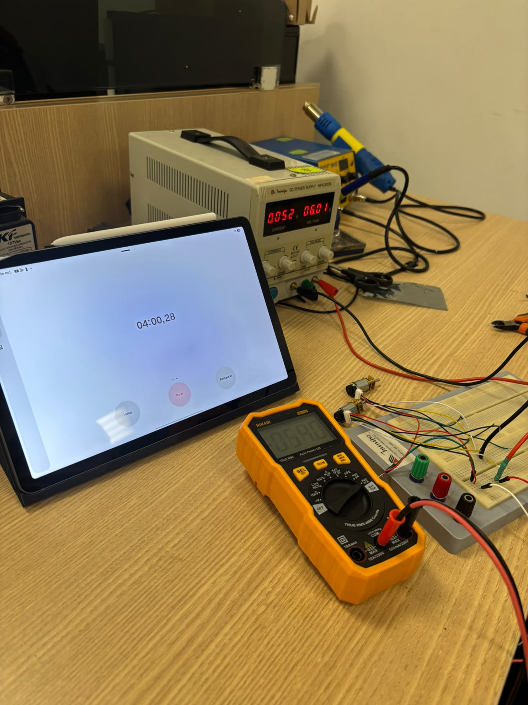
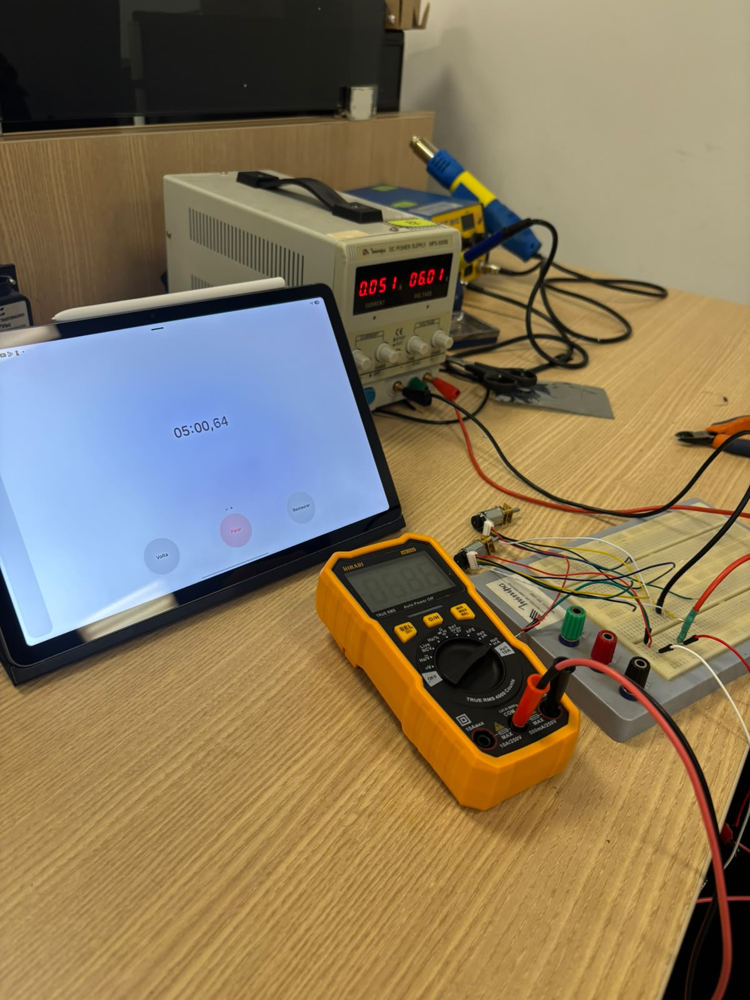

Figura 8: Os dois motores a 6,01 V, de 1 a 5 min: 0,054, 0,053, 0,052, 0,052 e 0,051 A (2.1)

## Histórico de Versões

| Versão | Data | Descrição | Autor(es) | Revisor(es) | Detalhes da revisão |
| :----: | :--: | --------- | ----------- | ------ | :---: |
| 1.0 | 17/10/2026 | Planejamento dos testes de energia: um teste por requisito (RF01 a RF07 e RNF01 a RNF04), testes previstos no projeto conceitual, procedimentos e numeração de 2.1 a 2.16 corrigida [#167](https://github.com/fcte-pi1/2026_2_PI1_Grupo01_Juliana/issues/167). | [João Marcos Moraes de Andrade](https://github.com/JJOAOMARCOSS), [Giovana Martins de Brito](https://github.com/Giih-martins) | — | — |
| 1.1 | 22/10/2026 | Lista reduzida aos cinco testes essenciais, a pedido da professora: curva de descarga com os motores girando, consumo de cada componente, regulação, polaridade e divisor, medidos numa única ida ao laboratório; gráfico e contas gerados a partir das leituras em CSV. | [João Marcos Moraes de Andrade](https://github.com/JJOAOMARCOSS), [Giovana Martins de Brito](https://github.com/Giih-martins) | — | — |
| 1.2 | 22/10/2026 | Alternativa com fonte de bancada para o teste 2.1, caso a LiPo não chegue: curva de tensão emulada em degraus, motores num canal à parte a 6,0 V e coluna `corrente_motores_A` no CSV. | [João Marcos Moraes de Andrade](https://github.com/JJOAOMARCOSS), [Giovana Martins de Brito](https://github.com/Giih-martins) | — | — |
| 1.3 | 24/10/2026 | Resultados da execução de 24/10/2026 com o roteiro adaptado (fonte de bancada no lugar da LiPo e dos reguladores): polaridade, consumo do ESP32 e do ToF e corrente dos motores por 5 min, com a corrente da bateria e a autonomia estimadas pela potência. | [João Marcos Moraes de Andrade](https://github.com/JJOAOMARCOSS), [Giovana Martins de Brito](https://github.com/Giih-martins) | — | — |
