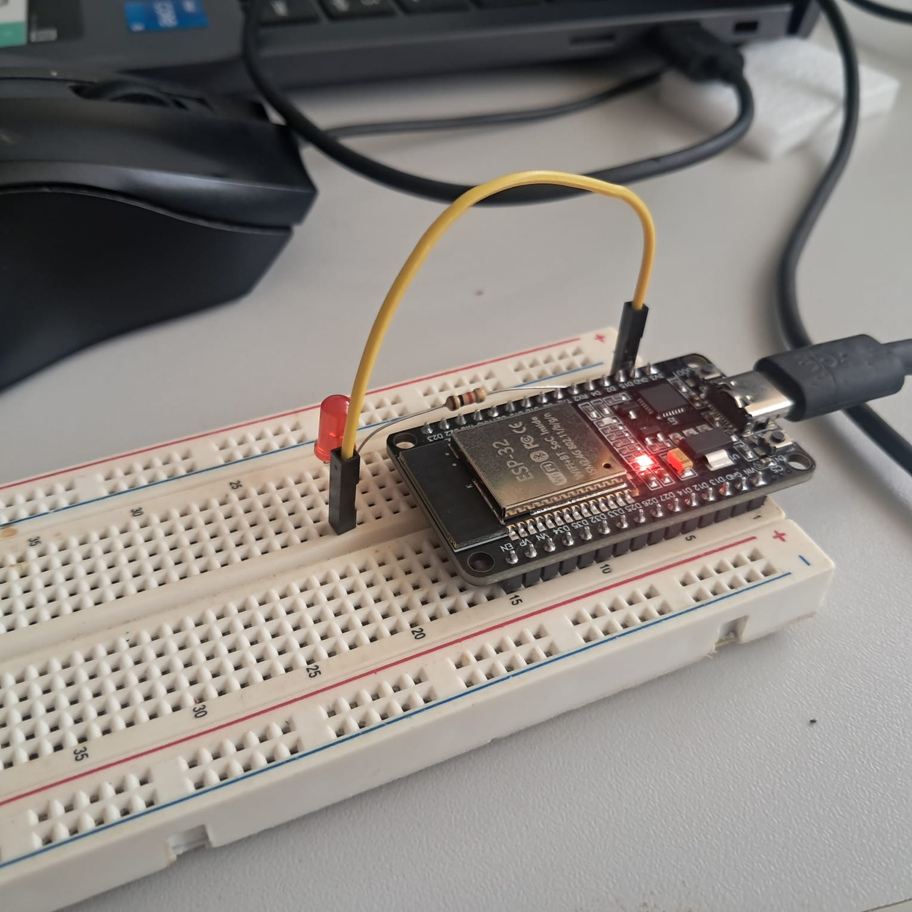
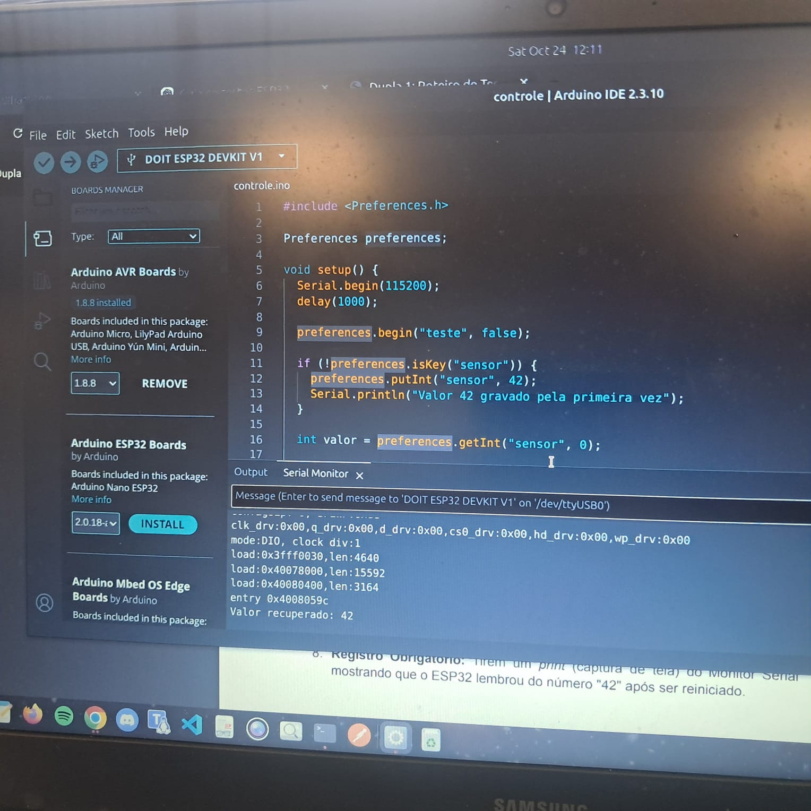
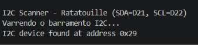
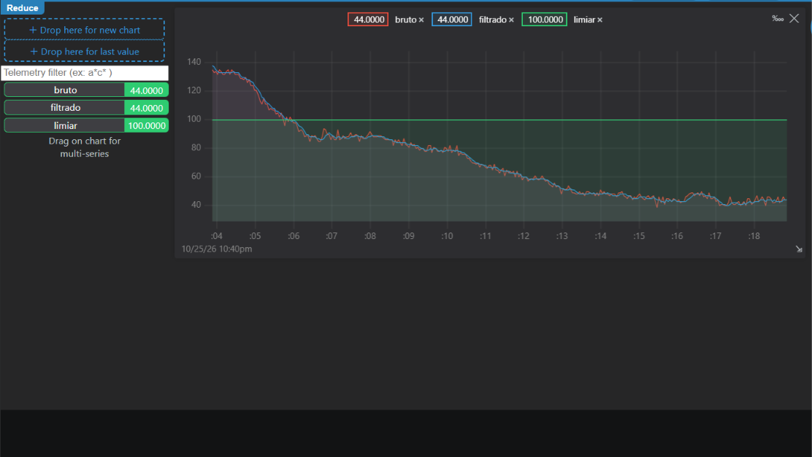
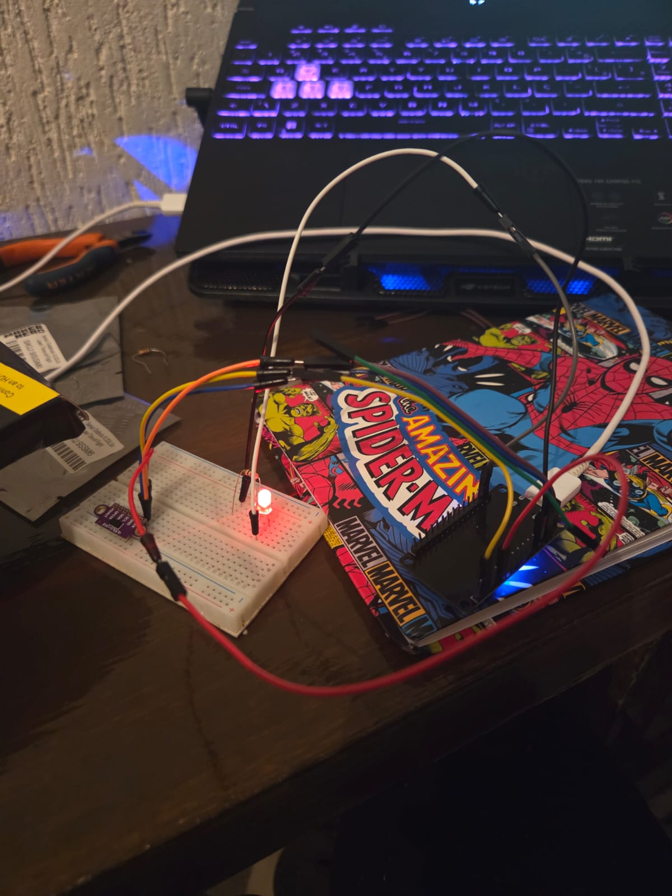
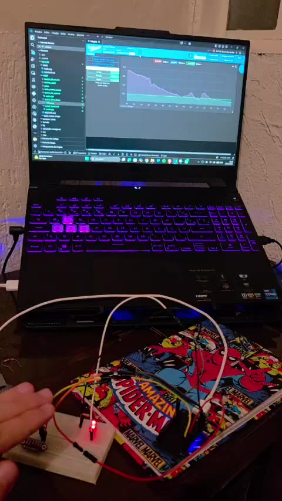
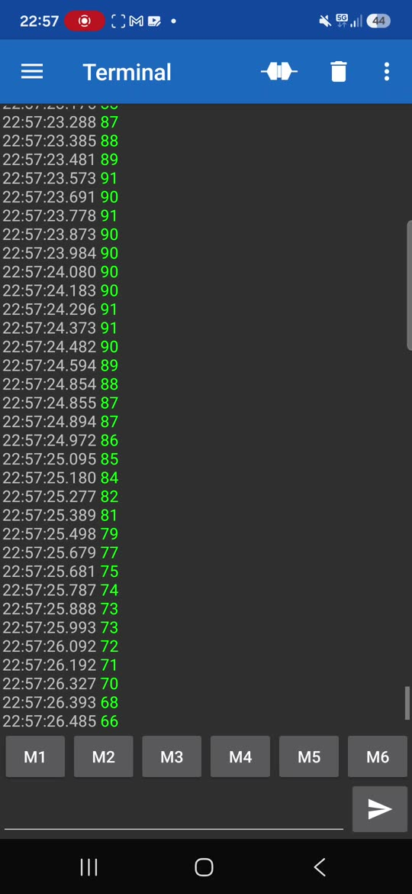

# Testes de Hardware

## 1. Introdução

Este documento reúne os procedimentos, resultados e evidências dos testes realizados para verificar o funcionamento dos componentes de hardware do projeto. Os registros são organizados por caso de teste para facilitar a consulta, a avaliação dos resultados e a relação com os requisitos documentados na matriz de rastreabilidade.

## 2. Objetivo geral

Verificar o funcionamento dos componentes e subsistemas de hardware por meio de testes definidos, documentando os resultados obtidos e suas evidências para apoiar a validação do projeto e a integração com os demais subsistemas.

## 3. Matriz de resultados dos testes

| **ID** | **Descrição** | **Data de início** | **Data de conclusão** | **Responsável** | **Resultados esperados** | **Resultados obtidos** | **Aprovação interna (S/N)** | **Aprovação do orientador (S/N)** | **Observações** |
|:---:|---|:---:|:---:|---|---|---|:---:|:---:|---|
| [3.1](#teste-31--acionamento-do-led) | Acionamento de LED externo pelo GPIO 2 | 24/10/2026 | 24/10/2026 | Ana Victória e João Vitor | O LED deve alternar entre ligado e desligado em intervalos de um segundo. | O LED externo piscou conforme esperado. | S | N | — |
| [3.2](#teste-32--persistencia-na-memoria-nvs) | Armazenamento e recuperação de valor na memória Flash NVS | 24/10/2026 | 24/10/2026 | Ana Victória e João Vitor | O valor inteiro `42` deve ser recuperado após desconectar e reconectar a placa. | O Monitor Serial exibiu `Valor recuperado: 42` após a reinicialização. | S | N | — |
| [3.3](#teste-33--scanner-i2c-do-vl53l0x) | Scanner I2C do sensor VL53L0X (ELE-09) | 25/10/2026 | 25/10/2026 | Marcus e Fábio | O scanner deve identificar o VL53L0X no endereço `0x29` em varreduras consecutivas. | O endereço `0x29` foi encontrado em 10 varreduras seguidas. | S | — | Teste de bancada da Dupla 3; firmware separado da aplicação do robô. |
| [3.4](#teste-34--media-movel-e-led-no-limiar-de-100-mm) | Média móvel das leituras ToF e acionamento de LED no limiar de 100 mm (ELE-09) | 25/10/2026 | 25/10/2026 | Marcus e Fábio | A média móvel das últimas cinco leituras deve suavizar as medições; o LED deve acender abaixo de 100 mm e apagar acima desse limiar. | O LED respondeu ao limiar conforme esperado. O gráfico da Teleplot mostrou as curvas bruta e filtrada; a variação entre leituras seguidas caiu de 2,4 mm (bruta) para 0,75 mm (filtrada). | S | — | Teste de bancada da Dupla 3; limiar de 100 mm (10 cm). |
| [3.5](#teste-35--telemetria-bluetooth-a-10-hz) | Telemetria da distância filtrada por Bluetooth a 10 Hz (ELE-09) | 25/10/2026 | 25/10/2026 | Marcus e Fábio | O ESP32 deve transmitir as leituras filtradas a cada 100 ms para o celular pareado. | O celular recebeu 33 leituras em 3,2 s, com intervalo médio de 0,10 s (10 Hz); os valores acompanharam a aproximação do obstáculo, de 2000 mm para menos de 100 mm. | S | — | Bluetooth clássico (SPP), dispositivo `Ratatuli_ToF`; teste feito com Android. |

## 4. Casos de teste

### Teste 3.1 – Acionamento do LED

#### Objetivo

Verificar o acionamento de um LED externo conectado ao GPIO 2 do ESP32.

#### Procedimento

1. Configurar a Arduino IDE para a placa DOIT ESP32 DEVKIT V1.
2. Montar o circuito com o LED externo e um resistor de 1 kΩ, conforme o roteiro de testes.
3. Carregar o programa que alterna o GPIO 2 entre os estados ligado e desligado, com intervalo de um segundo.
4. Observar visualmente o funcionamento do LED.

#### Resultado esperado

O LED deve alternar entre ligado e desligado em intervalos de um segundo durante a execução do programa.

#### Resultado obtido

O LED externo piscou conforme esperado durante a execução do programa.

#### Evidências

**Fotografia da montagem do circuito**

**Vídeo do teste**

<iframe width="100%" height="400" src="https://www.youtube.com/embed/5dkOZjNTrVo" title="Teste de acionamento do LED no ESP32" frameborder="0" allow="accelerometer; clipboard-write; encrypted-media; gyroscope; picture-in-picture; web-share" allowfullscreen></iframe>

[Assistir ao vídeo no YouTube](https://youtu.be/5dkOZjNTrVo)

### Teste 3.2 – Persistência na memória NVS

#### Objetivo

Verificar se o ESP32 consegue armazenar um valor inteiro na memória não volátil NVS e recuperá-lo após a reinicialização da placa.

#### Procedimento

1. Utilizar a biblioteca `Preferences.h`.
2. Abrir o namespace `teste`.
3. Verificar se a chave `sensor` existe e, caso ainda não exista, gravar o valor inteiro `42`.
4. Ler o valor armazenado e exibi-lo no Monitor Serial, configurado para 115200 baud.
5. Desconectar o cabo USB por aproximadamente cinco segundos e reconectar a placa.
6. Verificar o valor recuperado após a reinicialização.

#### Resultado esperado

O valor inteiro `42` deve permanecer armazenado e ser recuperado após a desconexão e reconexão do ESP32.

#### Resultado obtido

O Monitor Serial exibiu `Valor recuperado: 42` após a reinicialização da placa.

#### Evidência

A imagem a seguir é uma fotografia do Monitor Serial mostrando o valor recuperado.

**Vídeo do teste**

<iframe width="100%" height="400" src="https://www.youtube.com/embed/AieJohDwDdQ" title="Teste de acionamento do LED no ESP32" frameborder="0" allow="accelerometer; clipboard-write; encrypted-media; gyroscope; picture-in-picture; web-share" allowfullscreen></iframe>

[Assistir ao vídeo no YouTube](https://youtu.be/AieJohDwDdQ?si=cIB98gVduJcmT3dc)

### Teste 3.3 – Scanner I2C do VL53L0X

#### Objetivo

Verificar se o ESP32 detecta o sensor ToF VL53L0X no barramento I2C.

#### Procedimento

1. Alimentar o VL53L0X em 3,3 V e conectar GND, SDA ao D21 e SCL ao D22 do ESP32.
2. Executar o ambiente `ele09_teste1` e abrir o Monitor Serial a 115200 baud.
3. Observar o endereço encontrado em varreduras consecutivas do barramento.

#### Resultado esperado

O scanner deve encontrar o VL53L0X no endereço I2C `0x29` em todas as varreduras.

#### Resultado obtido

O endereço `0x29` foi encontrado em 10 varreduras seguidas, confirmando a comunicação entre o ESP32 e o sensor.

#### Evidências

As capturas do Monitor Serial mostram o endereço `0x29` nas varreduras:

### Teste 3.4 – Média móvel e LED no limiar de 100 mm

#### Objetivo

Verificar a suavização das leituras do VL53L0X por média móvel e o acionamento do LED conectado ao D2 quando a distância filtrada fica abaixo de 100 mm.

#### Procedimento

1. Manter as ligações do sensor do Teste 3.3 e conectar o LED ao D2 por um resistor de 1 kΩ.
2. Executar o ambiente `ele09_teste2` e conectar a Teleplot à porta serial a 115200 baud.
3. Aproximar e afastar um obstáculo do sensor, observando as curvas bruta e filtrada, o limiar de 100 mm e o estado do LED.

#### Resultado esperado

A média das últimas cinco leituras deve reduzir as oscilações das medições. O LED deve acender quando a distância filtrada for menor que 100 mm e apagar quando for maior ou igual a esse valor.

#### Resultado obtido

O LED acendeu abaixo de 10 cm e apagou acima do limiar. No gráfico, as curvas bruta e filtrada acompanharam a aproximação do obstáculo, com a curva filtrada mais estável: a variação entre leituras seguidas caiu de 2,4 mm para 0,75 mm.

#### Evidências

O gráfico da Teleplot apresenta as leituras brutas e filtradas e a referência de 100 mm. As fotografias registram a montagem do sensor e do LED durante o teste.

### Teste 3.5 – Telemetria Bluetooth a 10 Hz

#### Objetivo

Verificar a transmissão da distância filtrada pelo Bluetooth clássico do ESP32 a uma taxa de 10 Hz.

#### Procedimento

1. Manter as ligações do sensor e do LED usadas no Teste 3.4 e executar o ambiente `ele09_teste3`.
2. Parear um celular Android com o dispositivo `Ratatuli_ToF`.
3. Abrir o aplicativo Serial Bluetooth Terminal e observar os valores e seus horários.

#### Resultado esperado

O celular deve receber a distância filtrada em intervalos de aproximadamente 100 ms, equivalentes a 10 leituras por segundo.

#### Resultado obtido

O celular recebeu 33 leituras em 3,2 s, com intervalo médio de 0,10 s. Os valores acompanharam a aproximação do obstáculo, desde 2000 mm até menos de 100 mm.

#### Evidência

## 5. Considerações finais

Os testes 3.1 e 3.2 foram executados em 24/10/2026, e os testes de bancada do ELE-09 (3.3, 3.4 e 3.5) em 25/10/2026. Os cinco apresentaram os resultados esperados e receberam aprovação interna. A aprovação do orientador dos testes do ELE-09 não foi informada.

Os testes do ELE-09 foram realizados por Marcus e Fábio em programas de bancada independentes do firmware principal. Eles não alteram a HAL nem o ambiente `esp32_sim` e não fazem parte do roteiro de integração. Os testes auxiliares da equipe (`bateria_serial`, `bateria_bluetooth` e `pisca`) também ficam fora destes resultados. Os vídeos de evidência não foram incluídos no repositório devido ao tamanho dos arquivos.

Para concluir a rastreabilidade, ainda é necessário associar os testes 3.1 e 3.2 aos identificadores dos requisitos correspondentes na matriz oficial.
