# Testes de Software

## Matriz de casos de teste

| **ID** | **Descrição** | **Data de Início** | **Data de Conclusão** | **Responsável** | **Resultados Esperados** | **Resultados Obtidos** | **Observações** |
|:------:|---------------|--------------------|-----------------------|-----------------|--------------------------|------------------------|-----------------|
| 4.1 | Validação de mensagens de telemetria | 25/10/2026 | 25/10/2026 | Christopher | 100% das malformadas descartadas; serviço segue respondendo | 33 de 33 malformadas descartadas com 422 e nada gravado (35 de 35 testes aprovados) | Evidência na Figura 1 |
| 4.2 | Regras de tentativas e recusa | 26/10/2026 | 26/10/2026 | Amanda de Moura | T01–T13, E01–E08 e R01–R06; recusa sem mudar estado válido | Abertura em `running` 1/3, retomada, recusa e cancelamento na 3ª (45 de 45 testes aprovados) | `iniciada_em` da execução sem asserção. Figura 2 |
| 4.3 | Encerramento manual e interrupção pendente | 25/10/2026 | 25/10/2026 | Christopher | `failed` com `encerrado_operador` e `interromper` na serial em até 1 s | `interromper` com mediana de 98 ms e máx. de 195 ms (`tel` a 5 Hz); 5 de 5 aprovados | Com `tel` a 1 Hz o tempo sobe (ver complemento). Figura 3 |
| 4.4 | Perda de link e estouro de 10 min | 26/10/2026 | 26/10/2026 | Amanda de Moura | `link_lost` até 1 s após 10 s sem sinal; `time_exceeded` até 1 s após 600 s; 9 s de silêncio não dispara | Disparo dentro de 1 s nos dois limites; reconexão aos 9 s mantém `running` (17 de 17 testes aprovados) | Entre tentativas, os 10 min não cancelam a execução. Figura 4 |
| 4.5 | Consumo, velocidade, tempo e comparação | 26/10/2026 | 26/10/2026 | Amanda de Moura | Consumo em mV e p.p.; velocidade por células de 18 cm; tempo pelo relógio do backend; variação contra o melhor tempo | 3 células = 0,54 m e 0,18 m/s em 3 s; 8400→7800 mV = 600 mV e 45 p.p. (22 de 22 testes aprovados) | Sem soma entre tentativas nem refino por ToF. Figura 5 |
| 4.6 | Persistência da execução e unicidade da tentativa | 26/10/2026 | 26/10/2026 | Amanda de Moura | Execução e tentativa relidas do banco; uma só tentativa aberta; `tentativa_id` único | Gravação e releitura corretas; segunda tentativa aberta rejeitada pelo banco (10 de 10 testes aprovados) | Campos finais da falha sem teste nesta suíte. Figura 6 |
| 4.7 | Carga de 10 msg/s | 25/10/2026 | 25/10/2026 | Christopher | p95 abaixo de 100 ms por 60 s, sem atraso acumulado | 600 mensagens em 60 s, 0 erros; p95 de 27,3 ms; atraso acumulado de 4,0 ms | API e Postgres em Docker Compose. Evidência na Figura 7 |
| 4.8 | Stream SSE da execução em andamento | 26/10/2026 | 26/10/2026 | Amanda de Moura | Evento em até 1 s após o registro; quem entra no meio recebe o trajeto; `Last-Event-ID` sem duplicar | Entrega em menos de 1 s; reenvio em ordem e sem duplicar (24 de 24 testes aprovados) | O stream não filtra pelo status da tentativa. Figura 8 |
| 4.9 | Acompanhamento em tempo real e health-check | 26/10/2026 | 26/10/2026 | Amanda de Moura | Telemetria na tela em até 2 s, com a unidade recebida; health-check em bloco separado; aviso após 5 s sem dados | Célula A3, 7810 mV e 210 mm/s em menos de 2 s; bloco Health-check visível (37 de 37 testes aprovados) | Pílula "Atualizado há X s" e o bloco no detalhe sem teste direto. Figura 16 |
| 4.10 | Labirinto e trajeto | 24/10/2026 | 24/10/2026 | João Marcos | Trajeto e célula de falha iguais ao roteiro simulado | Células, paredes e falha iguais aos 3 roteiros do simulador (9 de 9 testes aprovados) | Execução manual na `dev` (ver complemento). Figuras 17 a 21 |
| 4.11 | Histórico, filtro e detalhe (Front↔Back) | 24/10/2026 | 24/10/2026 | João Marcos | Lista, filtro e detalhe conferidos contra o banco | Lista, filtros e detalhe iguais à API (34 de 34 testes aprovados) | Melhoria sugerida no complemento. Figuras 22 a 24 |
| 4.12 | Navegação em simulação | 25/10/2026 | 25/10/2026 | Christopher | 20 ou mais labirintos 4x4/8x4/12x4 resolvidos, 0 sucessos falsos | 24 de 24 labirintos em sucesso, 0 `sucesso_falso` (6 de 6 testes aprovados) | US40 só na navegação (ver complemento). Figura 10 |
| 4.13 | Detecção de paredes com HAL simulada | 23/10/2026 | 23/10/2026 | Luiza e Christopher | 50 de 50 casos simulados corretos (presente, ausente e com ruído) | 53 de 53 casos corretos, 45 sintéticos e 8 de ponta a ponta (20 de 20 testes aprovados) | Evidência na Figura 11 |
| 4.14 | Motores, encoders e PID com modelo simulado | 23/10/2026 | 23/10/2026 | Luiza e Christopher | Erro de velocidade de até 5%; `stuck` detectado | Velocidade a até 5% da referência; `stuck` em 1000 ms (11 de 11 testes aprovados) | Na branch do PR [#238](https://github.com/fcte-pi1/2026_2_PI1_Grupo01_Juliana/pull/238) (integrado em 26/10). Figura 12 |
| 4.15 | Bateria com tensões simuladas | 23/10/2026 | 23/10/2026 | Luiza e Christopher | Conversão para % e `low_battery` corretos nas duas fontes | Percentual, alerta e `low_battery` corretos nas 2 fontes (13 de 13 testes aprovados) | Evidência na Figura 13 |
| 4.16 | Telemetria pela serial até a API (via ponte) | 25/10/2026 | 26/10/2026 | Christopher | 10 min sem perda; downlink só com os 3 comandos do contrato v1 | 3.852 linhas recebidas e 3.852 respostas 200; 0 falhas; nenhum comando no downlink | Dados simulados (ver complemento). Figura 9 |

### Rastreabilidade dos casos

Histórias de usuário (US), casos de uso (UC) e requisitos de cada caso.

| **ID** | **Histórias de usuário** | **Casos de uso** | **Requisitos** |
|:------:|--------------------------|------------------|----------------|
| 4.1 | US10 | UC06 | RF08, RNF-B09 |
| 4.2 | US07, US12, US18, US19, US20, US21, US30, US31 | UC01, UC02, UC03, UC09, UC20, UC31 | RF10, RF16, RF17, RF18, RF19, RF29, RF38 |
| 4.3 | US17, US22, US32 | UC04, UC05, UC10, UC30 | RF15, RF30, RF39 |
| 4.4 | US23, US24 | UC12.1, UC12.2 | RF31, RF32, RNF-B08 |
| 4.5 | US13, US14, US15, US16 | UC08, UC19 | RF11, RF12, RF13, RF14 |
| 4.6 | US19, US25 | UC05 | RF17, RF33 |
| 4.7 | US10, US11 | UC06, UC07 | RF08, RF09, RNF-B11 |
| 4.8 | US08 | UC13 | RF06, RNF-B04 |
| 4.9 | US01, US04, US05 | UC13, UC18 | RF01, RF04, RF05, RNF-B01, RNF-B02 |
| 4.10 | US06, US11, US17, US29 | UC07, UC11, UC17 | RF09, RF15, RF37 |
| 4.11 | US02, US03, US09, US16, US26, US27, US28 | UC14, UC15, UC16, UC19 | RF02, RF03, RF07, RF14, RF34–RF36 |
| 4.12 | US39, US40, US41 | UC21, UC23, UC25, UC26 | RF26, RF27, RF28 |
| 4.13 | US33 | UC24 | RF20 |
| 4.14 | US34, US35, US45 | UC23, UC28 | RF21, RF22 |
| 4.15 | US36 | UC29 | RF23 |
| 4.16 | US10, US32, US37 | UC06, UC27, UC30 | RF24, RNF-B06, RNF-B07 |

### Complemento dos resultados obtidos

Detalhes dos resultados que não aparecem na tabela nem nas seções de evidências.

- **4.3:** com a `tel` a 1 Hz (robô parado), a mediana foi de 537 ms e o máximo de 1157 ms: o comando sai na resposta à próxima `tel`, então o tempo depende do período dela. Nas rotas `encerrar-tentativa` e `encerrar`, o `interromper` se repetiu a cada `tel` até a `falha` com origem `web` do robô e parou depois dela.
- **4.7:** latência com p50 de 21,5 ms e máxima de 58,0 ms; p95 de 28,5 ms na janela inicial (10 s) e de 26,9 ms na final.
- **4.10:** execução manual na `dev` em 1428f2b, antes do PR [#239](https://github.com/fcte-pi1/2026_2_PI1_Grupo01_Juliana/pull/239); com a `dev` atual o simulador não roda mais pela tela ([#249](https://github.com/fcte-pi1/2026_2_PI1_Grupo01_Juliana/issues/249)).
- **4.11:** melhoria sugerida: mostrar um número curto no lugar do UUID da execução ([#248](https://github.com/fcte-pi1/2026_2_PI1_Grupo01_Juliana/issues/248)).
- **4.12:** o tipo do labirinto que o robô leria no DIP switch (US40) é passado direto à navegação; a leitura das vias na placa fica para o robô montado.
- **4.16:** o downlink esperado são os comandos do contrato v1 (`interromper`, `largar` e `health_check`); o esperado foi atualizado porque o contrato passou a ter `largar` e `health_check`. Os dados são simulados: o simulador de telemetria em porta serial virtual faz o papel da ESP32 pela USB, e o firmware real fica para a [#217](https://github.com/fcte-pi1/2026_2_PI1_Grupo01_Juliana/issues/217) e o FIRM-11. 3.853 linhas enviadas pelo simulador e 3.852 recebidas pela ponte (a primeira é descartada ao abrir a porta), com conteúdo e ordem idênticos. Com a tentativa aberta (600 s, encerrada por `time_exceeded`), 2.926 `tel` e 731 `passo` recebidos e todos gravados, além dos 8 itens do health-check; 1 `tel` na fronteira de 50 ms ficou fora da contagem.

## Histórias de usuário e protótipos

As 45 histórias de usuário (US) do [backlog do software](4.4%20-%20Projeto%20conceitual%20de%20software.md#backlog-do-software) e a tela do [protótipo](4.4%20-%20Projeto%20conceitual%20de%20software.md#prototipo) de cada uma. O protótipo tem as mesmas 12 telas para os labirintos 4x4, 8x4 e 12x4, numeradas assim: 1 Início, 2 Health-check, 3 Em execução, 4 Concluída, 5 Execução recusada, 6 Sem comunicação, 7 Encerrar execução, 8 Encerrada como falha, 9 Retomar tentativa, 10 Retomada (tentativa 2), 11 Concluída após retomada e 12 Falha sem retomada.

A situação vem da leitura do código da `dev` em 26/10/2026, comparando cada critério de aceitação do backlog com o que existe e com o que os testes afirmam. A coluna Observação traz o caso da matriz que verifica a história e, quando houver, o que falta no código ou nos testes. O roteiro de integração (7.5) verificará as histórias que dependem do robô montado:

- **Implementada:** o critério existe no código e é exercitado por teste automatizado.
- **Simulada:** no firmware, a lógica existe e é testada no PC com a HAL simulada; o driver real e a validação no robô montado ficam para FIRM-10 e FIRM-11.
- **Parcial:** parte do critério não existe no código; o que falta está na coluna Observação.
- **Pendente:** não implementada.

"—" indica história sem interface (back-end e firmware). "Sem tela" indica história com interface implementada no front, mas sem tela no protótipo (histórico e detalhe das execuções).

| **US** | **História** | **Tela do protótipo** | **Situação** | **Observação** |
|:------:|--------------|:---------------------:|:------------:|----------------|
| US01 | Acompanhar a telemetria durante e após a execução | 3, 4 | Implementada | Caso 4.9 |
| US02 | Ver os dados de uma execução finalizada | 4, 8, 11, 12 | Implementada | Caso 4.11 |
| US03 | Consultar o histórico de execuções | Sem tela | Implementada | Caso 4.11 |
| US04 | Ver a execução em andamento e o tempo desde a última atualização | 3, 6 | Implementada | Caso 4.9; pílula "Atualizado há X s" sem teste direto |
| US05 | Ver o health-check em área separada | 2 | Implementada | Caso 4.9; bloco no detalhe da execução sem teste |
| US06 | Ver o trajeto sobre o labirinto | 3, 4, 8 | Implementada | Caso 4.10 |
| US07 | Ver a tentativa (n/3) e retomar após falha | 3, 9, 10, 12 | Implementada | Caso 4.2 |
| US08 | Disponibilizar os dados da execução em andamento | 3 | Implementada | Caso 4.8; o stream não filtra pelo status da tentativa |
| US09 | Disponibilizar os dados das execuções anteriores | Sem tela | Implementada | Caso 4.11 |
| US10 | Receber a telemetria do Micromouse | — | Implementada | Caso 4.1, 4.7, 4.16 |
| US11 | Registrar a sequência de células visitadas | 4 | Implementada | Caso 4.7, 4.10 |
| US12 | Iniciar nova execução informando o labirinto | 1 | Implementada | Caso 4.2; `iniciada_em` sem teste |
| US13 | Calcular o consumo de bateria | 3, 4 | Implementada | Caso 4.5 |
| US14 | Calcular a velocidade média | 3, 4 | Implementada | Caso 4.5; sem refino por ToF e encoders |
| US15 | Calcular o tempo da tentativa e da execução (limite de 10 min) | 3, 11 | Implementada | Caso 4.5; soma entre tentativas sem teste |
| US16 | Comparar o tempo com o melhor já registrado | 4 | Implementada | Caso 4.5, 4.11 |
| US17 | Registrar a célula e o motivo da falha | 8, 12 | Implementada | Caso 4.3, 4.10; `observacao` sem teste de persistência |
| US18 | Registrar o status de tentativas e execuções | 3, 4, 8 | Implementada | Caso 4.2 |
| US19 | Identificar cada tentativa de forma única | — | Implementada | Caso 4.2, 4.6; unicidade só pela chave primária |
| US20 | Recusar nova tentativa com outra aberta | 5 | Implementada | Caso 4.2 |
| US21 | Avisar quando uma execução é recusada | 5 | Implementada | Caso 4.2 |
| US22 | Encerrar manualmente a tentativa | 7, 8 | Implementada | Caso 4.3 |
| US23 | Detectar perda de comunicação | 6 | Implementada | Caso 4.4 |
| US24 | Encerrar a execução aos 10 minutos | 3 | Parcial | Caso 4.4; não cancela aos 10 min entre tentativas |
| US25 | Gravar os dados finais no banco | — | Implementada | Caso 4.6; campos finais das falhas sem teste |
| US26 | Consultar as execuções de um labirinto | Sem tela | Implementada | Caso 4.11 |
| US27 | Consultar as execuções de todos os labirintos | Sem tela | Implementada | Caso 4.11 |
| US28 | Consultar todos os dados de uma execução | Sem tela | Implementada | Caso 4.11 |
| US29 | Armazenar as paredes detectadas | 3, 4 | Implementada | Caso 4.10 |
| US30 | Retomar após falha de componente | 9, 10 | Implementada | Caso 4.2 |
| US31 | Retomar após falha de trajeto ou encerramento manual | 9, 10, 11 | Implementada | Caso 4.2 |
| US32 | Enviar ao robô os comandos do contrato | 7 | Implementada | Caso 4.3, 4.16; só `interromper` testado até a serial |
| US33 | Detectar paredes com os sensores ToF | — | Simulada | Caso 4.13 |
| US34 | Controlar avanço, curva e parada | — | Parcial | Caso 4.14; a aplicação não aciona as rodas (FIRM-05) |
| US35 | Calcular a velocidade a partir dos encoders | — | Parcial | Caso 4.14; velocidade não chega à telemetria (fixa em 0) |
| US36 | Monitorar nível e consumo da bateria | — | Simulada | Caso 4.15 |
| US37 | Transmitir a telemetria ao sistema web | — | Parcial | Caso 4.16; Bluetooth real inexistente; sai pela serial USB |
| US38 | Sinalizar o estado por LED e buzzer | — | Parcial | Roteiro 7.5; LED só pisca; buzzer não é usado |
| US39 | Detectar a chegada ao objetivo | — | Simulada | Caso 4.12 |
| US40 | Selecionar o labirinto no DIP switch | — | Pendente | Roteiro 7.5; tipo fixo em 4x4 (`ROBO_TIPO_LABIRINTO`) |
| US41 | Registrar a posição e o trajeto | — | Parcial | Caso 4.12; sem lista ordenada no firmware; trajeto vem dos `passo` |
| US42 | Fazer o health-check antes da execução | — | Parcial | Roteiro 7.5; verifica bateria e ToF; motores e encoders sem teste |
| US43 | Parar e apagar a memória pelo botão BOOT | — | Pendente | Roteiro 7.5; o botão não é lido pela aplicação |
| US44 | Gravar mapa e estado em memória não volátil | — | Simulada | Roteiro 7.5; driver NVS real sem teste |
| US45 | Detectar travamento automaticamente | — | Parcial | Caso 4.14; a aplicação não usa `vel_travado()`; `stuck` é sem saída |

## Evidências dos testes do back-end

Os casos 4.1 a 4.8 e o 4.16 rodam com o `pytest` em `src/backend`, contra a API e o Postgres de teste (ver o [README do back-end](https://github.com/fcte-pi1/2026_2_PI1_Grupo01_Juliana/tree/dev/src/backend#readme)). O 4.9 roda com o Vitest no front.

### 4.1 Validação de mensagens de telemetria

O arquivo `tests/integracao/test_mensagens_malformadas.py` envia 33 mensagens malformadas, uma por regra do contrato, e confere que cada uma volta com 422 sem gravar nada. Um teste extra manda uma rajada intercalada de válidas e malformadas e confere que o serviço segue respondendo. Resultado: 35 de 35 aprovados.

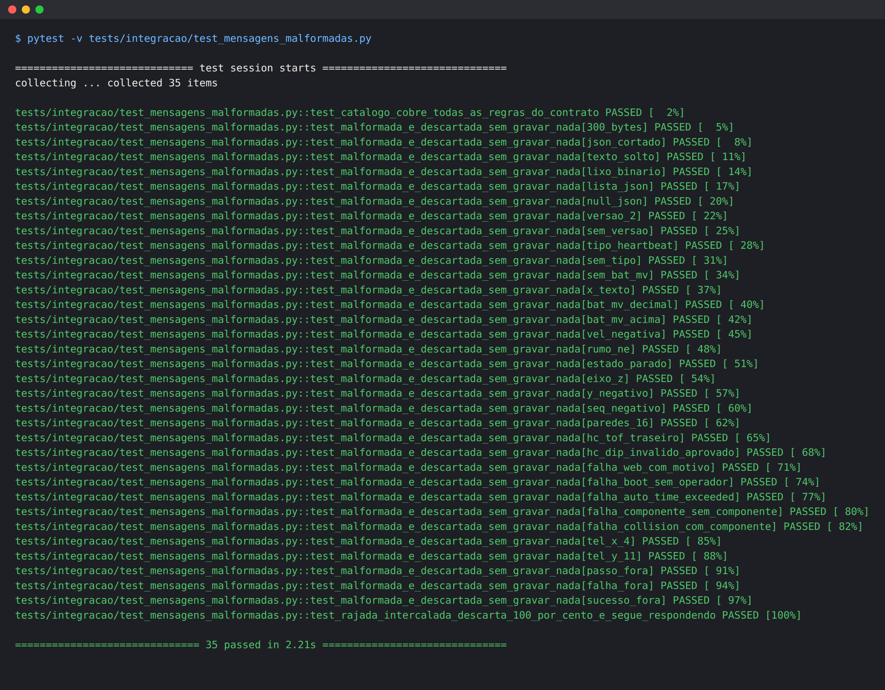

Figura 1: Execução da suíte test_mensagens_malformadas (4.1)

### 4.2 Regras de tentativas e recusa

O arquivo `tests/integracao/test_transicoes_execucao.py` cobre a tabela de transições do BACK-03 (T01–T13, E01–E08 e R01–R06). Nova execução abre a tentativa 1 já em `running` e manda `largar`. Retomar depois de falha de trajeto abre a tentativa 2. Health-check reprovado, expirado (acima de 7 min) ou com o tipo do DIP diferente recusa a abertura. A terceira falha, o estouro de tempo e uma nova execução cancelam a execução anterior. Retomar com tentativa aberta, com a execução já encerrada ou com as três tentativas usadas devolve recusa sem mudar o estado válido. Resultado: 45 de 45 aprovados. A suíte não afirma o campo `iniciada_em` da execução.

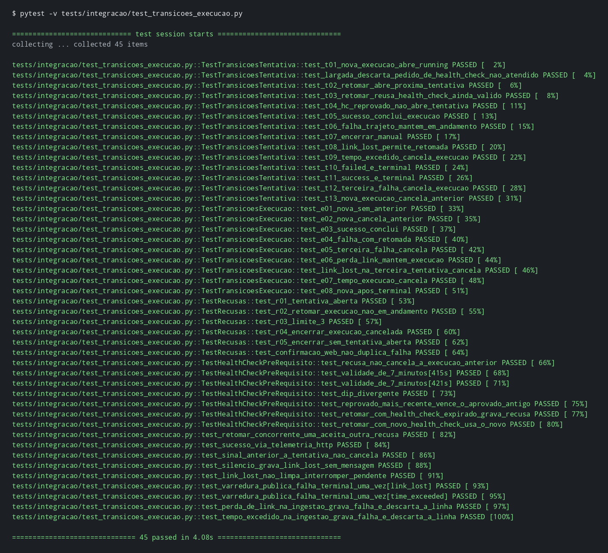

Figura 2: Execução da suíte test_transicoes_execucao (4.2)

### 4.3 Encerramento manual e interrupção pendente

O arquivo `tests/integracao/test_encerramento_ate_a_serial.py` encerra a tentativa pela API e mede o tempo até o `interromper` ser escrito na serial. Com a `tel` a 5 Hz, a mediana foi de 98 ms e o máximo de 195 ms em 20 encerramentos. Com a `tel` a 1 Hz, a mediana foi de 537 ms e o máximo de 1157 ms, porque o comando sai na resposta à próxima `tel`. Resultado: 5 de 5 aprovados.

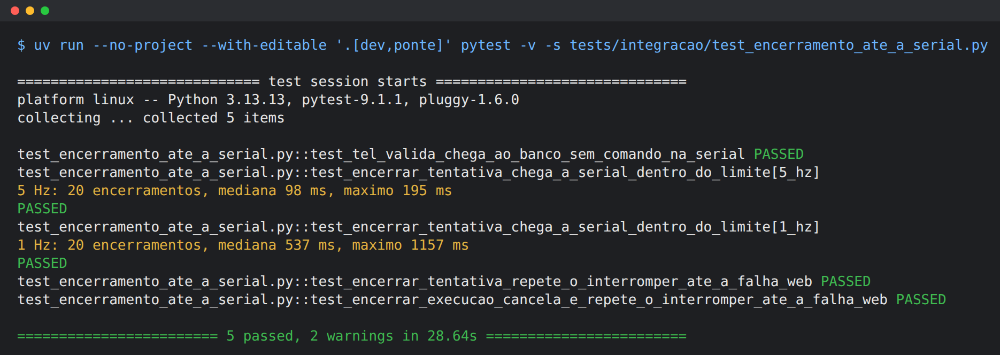

Figura 3: Execução do teste test_encerramento_ate_a_serial (4.3)

### 4.4 Perda de link e estouro de 10 min

Os arquivos `tests/integracao/test_monitores_relogio.py` e `tests/unit/test_monitor_conexao.py` avançam um relógio falso, sem esperar 10 s nem 10 min de verdade. O `link_lost` sai até 1 s depois dos 10 s sem sinal, e a execução da tentativa 1 segue `em_andamento`. Com o robô falando o tempo todo, o `time_exceeded` sai até 1 s depois dos 600 s e a execução vai a `cancelada`. Três silêncios de 9 s, cada um seguido de uma mensagem, não disparam. Mensagem anterior à tentativa não conta, e a tentativa aberta antes do boot da API tem uma janela para reconectar. Resultado: 17 de 17 aprovados.

O limite de 10 min é conferido com a tentativa aberta. No intervalo entre uma falha e a retomada, sem tentativa `running`, o relógio da execução não cancela aos 10 min (US24).

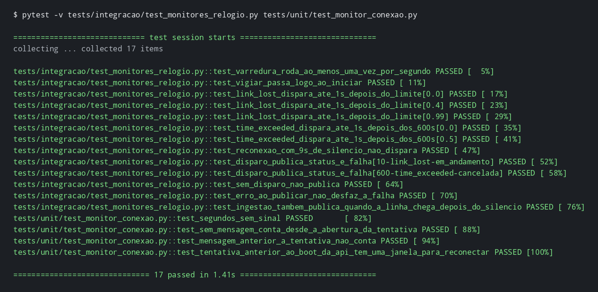

Figura 4: Execução das suítes de link e de tempo (4.4)

### 4.5 Consumo, velocidade, tempo e comparação

A suíte unitária `tests/unit/test_calculo_metricas.py` e a de integração `tests/integracao/test_metricas_telemetria.py` conferem o cálculo (BACK-04):

- **Distância e velocidade:** 3 células valem 0,54 m; em 3 s a média é 0,18 m/s. Revisita conta e a largada não: o percurso com uma volta, em 20 s, dá 0,027 m/s.
- **Consumo:** de 8400 mV para 7800 mV são 600 mV e 45 p.p. na curva da LiPo; de 6400 mV para 5600 mV são 50 p.p. na curva das pilhas AA. O consumo parcial atualiza a cada `tel`.
- **Tempo:** conta da largada, não do health-check, e usa o relógio do backend mesmo com a ponte duas horas defasada. No sucesso, a tentativa e a execução fecham com 30 s.
- **Comparação:** 30 s contra um melhor de 40 s dá −25%. Sem histórico, ou com melhor zero ou negativo, a variação fica vazia.

Resultado: 22 de 22 aprovados. A velocidade usa o tamanho da célula, sem refino pela posição dentro dela (ToF e encoders). O tempo total conferido é o de uma tentativa; a soma entre tentativas, intervalos incluídos, não entra nesta suíte.

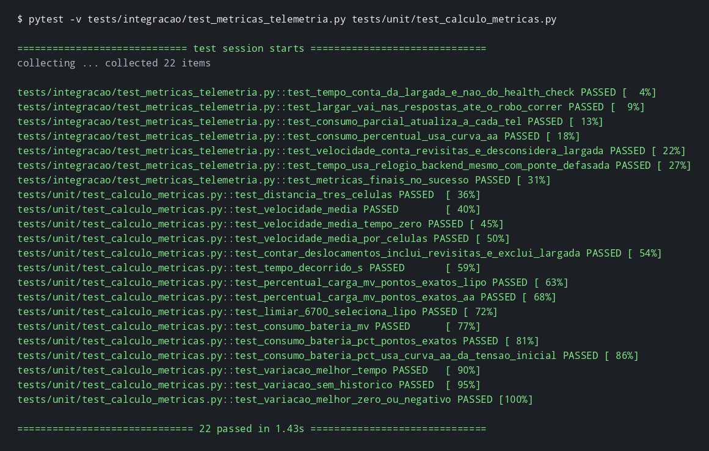

Figura 5: Execução das suítes de cálculo de métricas (4.5)

### 4.6 Persistência da execução e unicidade da tentativa

O arquivo `tests/integracao/test_repositorio.py` grava a execução e a tentativa e as relê do Postgres. A tentativa volta com o mesmo `tentativa_id`. As tentativas saem ordenadas pelo `attempt_index`. Duas tentativas `running` na mesma execução quebram a restrição do banco; depois de a anterior fechar, a próxima aberta é aceita. O melhor tempo de cada labirinto ignora `failed` e, sem `success`, volta vazio. Resultado: 10 de 10 aprovados.

A unicidade conferida é a da chave primária. Célula, motivo e observação da falha não são afirmados nesta suíte.

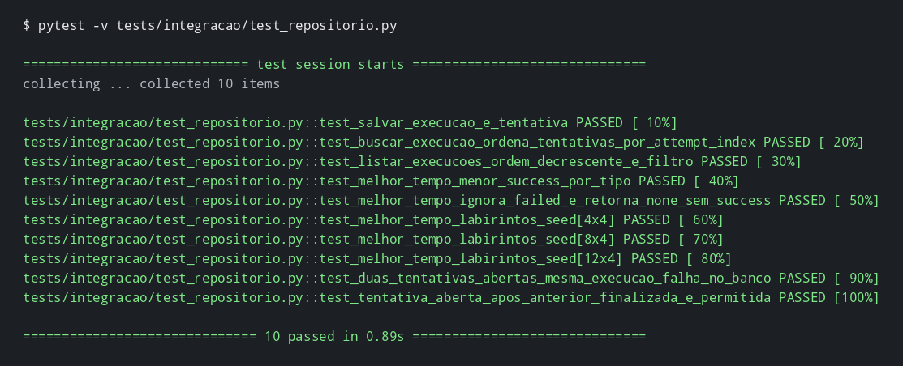

Figura 6: Execução da suíte test_repositorio (4.6)

### 4.7 Carga de 10 msg/s

O arquivo `tests/integracao/test_carga_telemetria.py` e o script de carga mandam 600 mensagens em 60 s (300 `tel` e 300 `passo`) e medem a latência de cada resposta. O p95 total foi de 27,3 ms, abaixo do limite de 100 ms, e o p95 por janela de 10 s ficou estável ao longo do ensaio.

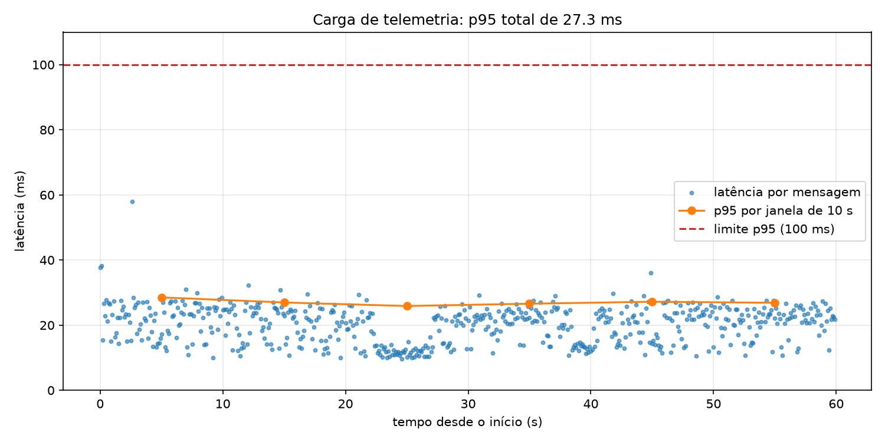

Figura 7: Latência da carga de telemetria, com p95 por janela de 10 s (4.7)

### 4.8 Stream SSE da execução em andamento

Os arquivos `tests/integracao/test_stream_sse.py` e `tests/integracao/test_contrato_stream.py` abrem o fluxo da execução:

- Quem entra no meio recebe o trajeto inteiro, em ordem e sem passo repetido. `Last-Event-ID` reenvia só os seguintes; valor inválido reenvia tudo.
- O trajeto atravessa as tentativas da mesma execução. Execução encerrada reenvia o trajeto e fecha o fluxo.
- Do registro no banco até o evento sair, a entrega fica abaixo de 1 s (fatia do backend no RNF-B04). Falha ao publicar não desfaz a gravação.
- `link_lost` e o encerramento manual publicam a falha retomável depois do commit. Encerrar a execução publica a falha que fecha o stream.
- Os frames seguem o contrato: só o `passo` traz o id da linha, e a telemetria publicada leva mV, porcentagem e rumo.

Resultado: 24 de 24 aprovados. O evento sai para a execução esteja a tentativa `running` ou já encerrada: o stream não filtra pelo status da tentativa.

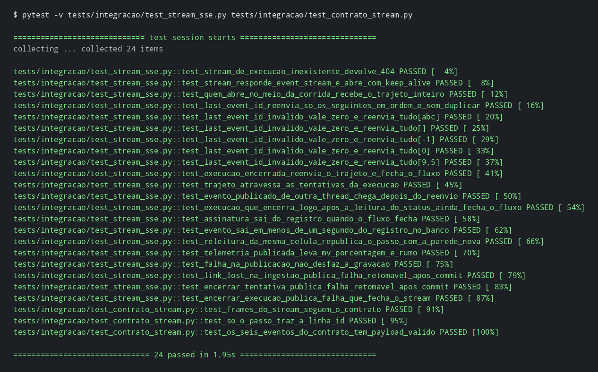

Figura 8: Execução das suítes do stream SSE (4.8)

### 4.16 Telemetria pela serial até a API

O ensaio de 631,8 s passa o simulador de telemetria por uma porta serial virtual, a ponte e a API. O gráfico compara, em janelas de 10 s, as mensagens enviadas pelo simulador, recebidas pela ponte (RX) e gravadas no banco. A curva das gravadas cai antes das outras no fim porque a tentativa foi encerrada por `time_exceeded` aos 600 s.

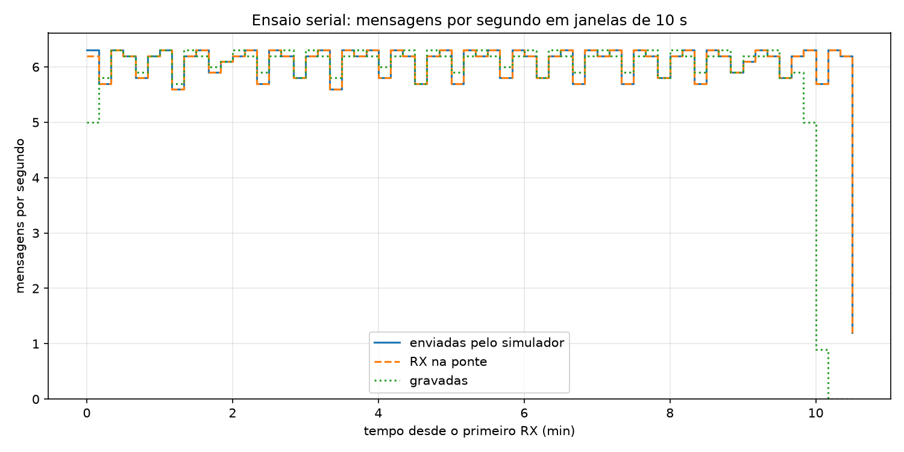

Figura 9: Ensaio serial, com as mensagens por segundo enviadas, recebidas e gravadas (4.16)

## Evidências dos testes de firmware

Os testes 4.12 a 4.15 rodam no PC com o [Unity](https://github.com/ThrowTheSwitch/Unity) pelo PlatformIO. Os de 4.13 a 4.15 usam a HAL simulada no lugar dos sensores e dos motores (`-D HAL_SIMULADA`) e o mundo simulado (`lib/simulacao/sim_mundo.c`), enquanto o 4.12 usa o simulador de corrida (`lib/simulador/sim_corrida.c`), que lê o labirinto de um arquivo, entrega à navegação as paredes da célula em que o robô está e executa a ação que ela devolve. O mundo simulado faz o papel do robô: posição, paredes do labirinto, leituras dos ToF com ruído de semente fixa, motores com atraso de primeira ordem e encoders. Os erros de leitura do 4.12 também usam semente fixa. Assim os resultados se repetem a cada execução. Os comandos rodam dentro de `src/firmware` (ver o [README do firmware](https://github.com/fcte-pi1/2026_2_PI1_Grupo01_Juliana/tree/dev/src/firmware#comandos)).

### 4.12 Navegação em simulação

A suíte `test_navegacao_labirintos` roda a navegação de verdade (`nav_passo`, FIRM-02) nos labirintos de `simulador-navegacao/labirintos`: 4 de 4x4, 4 de 8x4 e 4 de 12x4, cada um nas versões `-dir` e `-esq` (espelhadas), num total de 24. Cada corrida termina em um destes resultados: `sucesso` (declarou sucesso na célula de objetivo), `sucesso_falso` (declarou sucesso fora dela), `sem_caminho`, `colisao` ou `limite` (passou do limite de passos).

- **Sucesso em todos os labirintos** (`test_todos_os_labirintos_terminam_em_sucesso`): sem erros de leitura, as 24 corridas precisam dar `sucesso`. Resultado: 24 em sucesso e 0 `sucesso_falso`, acima dos 20 pedidos.
- **Chegada ao objetivo e trajeto** (`test_trajeto_vai_da_largada_ao_objetivo_por_celulas_vizinhas`, US39 e US41): a lista de células anotada a cada passo começa na largada (0, 0), cada célula é vizinha da anterior, a quantidade de células distintas bate com o relatório da corrida e a última é o canto oposto, onde o robô declarou o sucesso.
- **Versões espelhadas** (`test_versoes_espelhadas_dao_o_mesmo_trajeto`): no referencial do robô, as versões `-dir` e `-esq` de cada labirinto dão o mesmo trajeto.
- **Leituras erradas:** cada labirinto corre com as sementes 1 a 50 (1200 corridas), conferindo a parede da frente com 3 amostras. Com 1% de leituras erradas, 1200 de 1200 dão sucesso (meta de 100%); com 5%, 1197 de 1200 (99,75%, meta de 95%). Nenhuma corrida termina em `limite` ou `sucesso_falso`.
- **Retomada** (`test_estado_copiado_no_meio_da_corrida_da_o_mesmo_trajeto`, FIRM-08): copiar o estado da navegação em qualquer passo da corrida e seguir com a cópia dá o mesmo trajeto e o mesmo resultado.

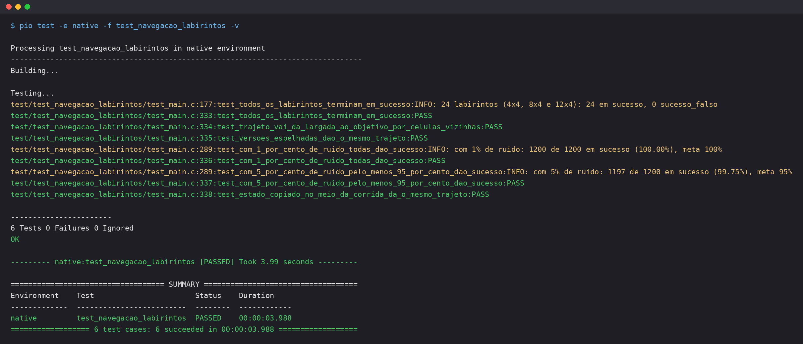

Figura 10: Execução da suíte test_navegacao_labirintos (4.12)

### 4.13 Detecção de paredes com HAL simulada

A suíte `test_sensores` confere o filtro dos ToF e a decisão de parede (FIRM-03):

- **45 casos sintéticos** (`test_45_casos_sinteticos`): sequências de leituras de um sensor (frente, esquerda ou direita) com parede presente, ausente, com ruído de ±15 mm e oscilando na faixa da histerese. Para cada caso, o teste confere se a decisão final é a esperada.
- **8 casos de ponta a ponta** no mundo simulado: paredes da largada, célula aberta dos lados com ruído, paredes estáveis com ruído, pico isolado que não pode virar parede, parede da frente ao chegar no fim do corredor e as três situações da leitura lateral (no centro da célula, ao entrar nela e tarde demais).
- Os demais testes cobrem a mediana, a tolerância a falhas de leitura, a taxa de 20 Hz dos três sensores, o autoteste da largada e a sequência do XSHUT.

Resultado: 53 de 53 casos corretos, acima dos 50 pedidos.

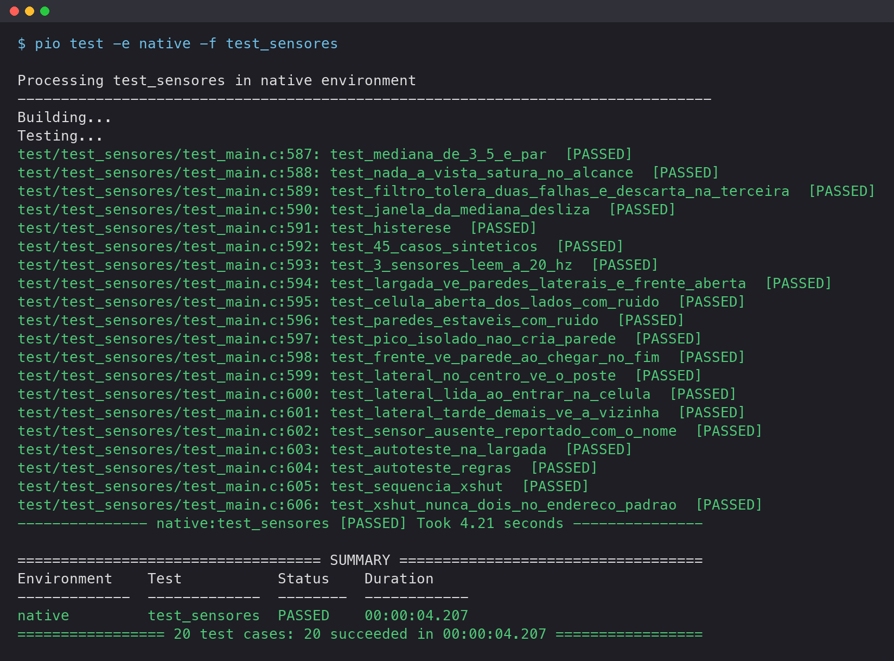

Figura 11: Execução da suíte test_sensores (4.13)

### 4.14 Motores, encoders e PID com modelo simulado

A suíte `test_velocidade` (FIRM-04) testa o PID de velocidade por roda, que roda a 200 Hz, contra o motor simulado:

- **Convergência:** com referências de 400 mm/s, 200 mm/s e −300 mm/s (ré), a malha roda 500 ms e depois a velocidade medida pelos encoders em 200 ms precisa ficar a até 5% da referência nas duas rodas.
- **Stuck:** com o encoder travado (`sim_travar_encoder`) e PWM ativo, a falha precisa sair em exatamente `MOTOR_TRAVADO_MS` (1000 ms), com as duas rodas ou só uma travada. Antes disso, nada pode ser marcado; depois, a ponte H fica desligada, mesmo após o reset.
- **Segurança:** motores parados e ponte H em standby no boot e no reset, malha agindo só a cada 5 ms, sem `stuck` falso com a roda girando ou com referência zero.

O limite de PWM pela tensão da bateria (6 V no motor) é conferido à parte, na suíte `test_ponte_h`.

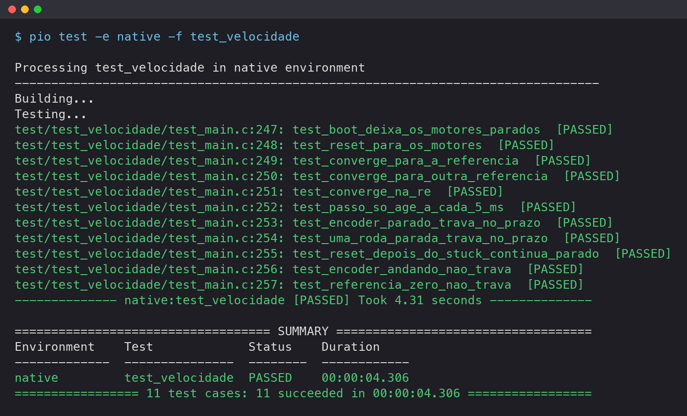

Figura 12: Execução da suíte test_velocidade (4.14)

### 4.15 Bateria com tensões simuladas

A suíte `test_bateria` (FIRM-06) passa tensões simuladas pela mesma conversão usada na placa:

- **LiPo 2S:** 8,4 V dá 100% e nível normal; 7,4 V dá alerta; 7,01 V ainda é alerta; 6,9 V é `low_battery`. Uma LiPo que cai abaixo do limiar das pilhas continua sendo tratada como LiPo.
- **Pilhas AA:** 6,0 V dá 80% e nível normal; 5,2 V continua normal; abaixo de 5,0 V é `low_battery`.
- **Limites exatos** de alerta e corte nas duas fontes, interpolação do percentual pela curva de descarga, média móvel de 16 leituras e tensão na ponte H sem a queda do diodo.

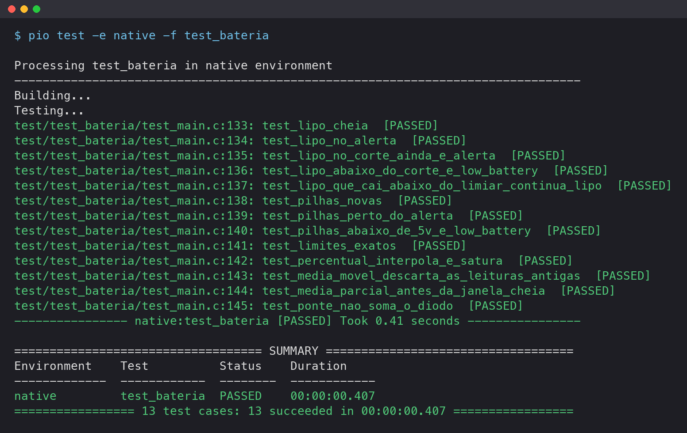

Figura 13: Execução da suíte test_bateria (4.15)

## Testes unitários e de integração do firmware

Toda a suíte do firmware roda no ambiente `native_cov`, que compila os mesmos testes do `native` com `--coverage`. A cobertura é medida com o [gcovr](https://gcovr.com). Dos arquivos medidos, ficam de fora só os drivers reais da ESP32 (`lib/hal/esp32/hal_*`), que só compilam na placa e serão testados com o robô montado (FIRM-10). Os testes de integração são os que juntam módulos pelo mundo simulado: navegação completa em labirintos 4x4, 8x4 e 12x4 (`test_navegacao_labirintos`), simulador de corrida (`test_simulador`), sensores de ponta a ponta (`test_sensores`) e HAL simulada (`test_hal_sim`).

Resultado na `dev` (26/10/2026): **245 de 245 testes aprovados** e **95,4% das linhas** cobertas (95,7% das funções e 87,1% dos desvios), acima da meta de 80%. A suíte já inclui os PRs do FIRM-04 ([#238](https://github.com/fcte-pi1/2026_2_PI1_Grupo01_Juliana/pull/238), integrado em 26/10) e do FIRM-08 ([#239](https://github.com/fcte-pi1/2026_2_PI1_Grupo01_Juliana/pull/239), integrado em 24/10).

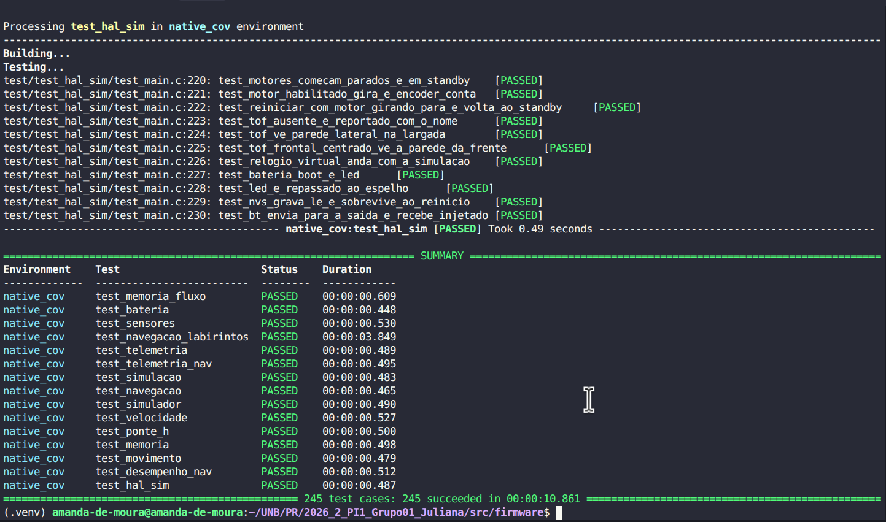

Figura 14: Resumo da suíte de testes do firmware (pio test -e native_cov)

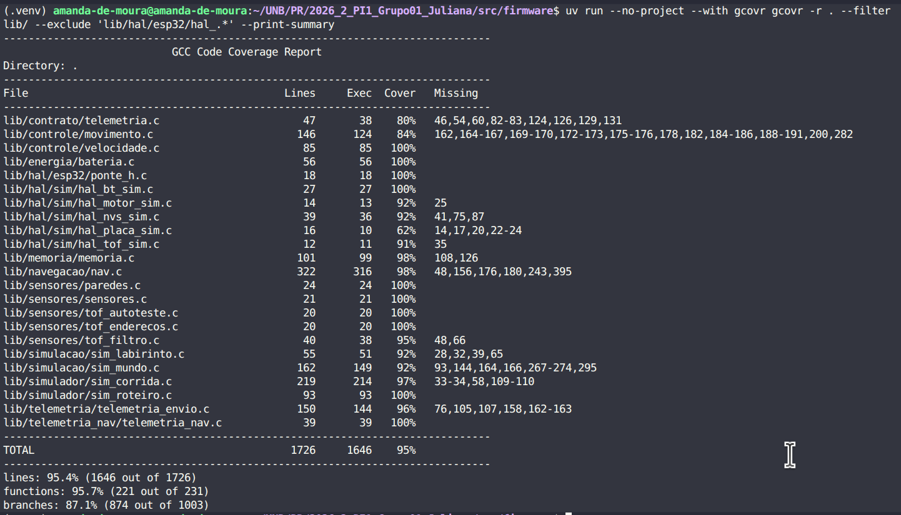

Figura 15: Cobertura do firmware por arquivo (gcovr)

## Evidências dos testes do front-end

O caso 4.9 roda na suíte do Vitest, com o MSW no lugar da API. Os testes 4.10 e 4.11 foram feitos de dois jeitos. No primeiro, a cadeia real: o [simulador de telemetria](https://github.com/fcte-pi1/2026_2_PI1_Grupo01_Juliana/tree/dev/src/simulador-telemetria) manda os roteiros por HTTP para a API (`docker compose` em `src/backend`, com banco vazio), e o front roda sem mock (`VITE_API_MOCK=false npm run dev`). Cada tela foi comparada com a resposta da API para a mesma execução. Essa parte rodou em 24/10/2026 sobre a `dev` no commit 1428f2b. No segundo, a suíte do Vitest repete as mesmas conferências sem backend, para rodar em toda mudança.

Duas regras da API mudam o jeito de rodar à mão: a execução só abre com um health-check válido (7 min), e a tentativa cai por `link_lost` depois de 10 s sem sinal do robô. Por isso o simulador precisa começar logo depois de **Nova execução**, e a retomada, logo depois da falha. No roteiro de colisão, a pausa entre as tentativas foi aumentada de 5 s para 9 s para dar tempo de retomar.

Depois disso, o PR [#239](https://github.com/fcte-pi1/2026_2_PI1_Grupo01_Juliana/pull/239) fez a API encerrar a tentativa aberta quando chega o health-check de um boot novo do robô. O simulador começa a correr logo depois do health-check, sem esperar o `largar`, então com a `dev` atual a tentativa aberta pela tela cai antes de receber os passos ([#249](https://github.com/fcte-pi1/2026_2_PI1_Grupo01_Juliana/issues/249)). A parte automática não depende disso e continua passando.

### 4.9 Acompanhamento em tempo real e health-check

O arquivo `src/testes/front03.test.tsx` acompanha a execução pelo SSE (FRONT-03):

- A telemetria nomeada aparece em menos de 2 s: célula A3, 7810 mV e 210 mm/s, sem converter a unidade nem arredondar o valor (RNF-B01, RNF-B02).
- O health-check chega num bloco com título próprio e continua visível com a tentativa em `running`. Resultado parcial ou reprovado não é mostrado como aprovado.
- Depois de 5 s sem dados a tela avisa que está sem dados do robô e tira o aviso quando chega uma amostra nova.
- No sucesso, a tela reconsulta os dados finais e mantém a última célula, a bateria e a velocidade. Uma execução já encerrada, aberta pela URL, também restaura célula, bateria e health-check.

Resultado: 37 de 37 aprovados. A pílula "Atualizado há X s" não tem teste direto: o que a suíte cobre é o aviso aos 5 s. O bloco de health-check na página de detalhe, fora do ao vivo, também não entra aqui.

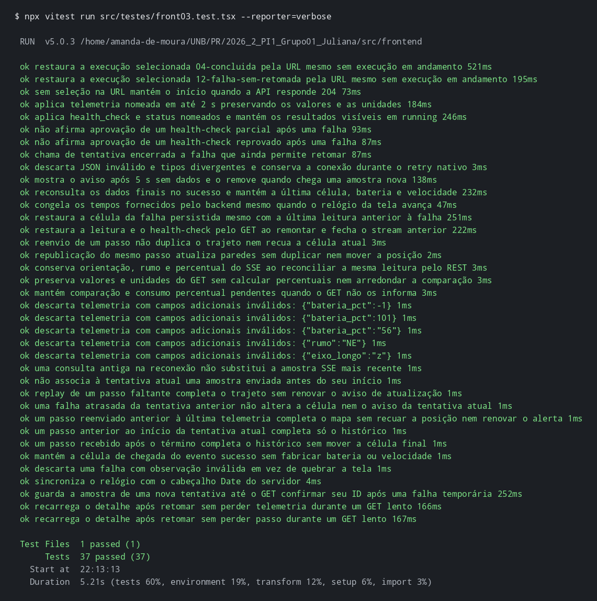

Figura 16: Execução da suíte de acompanhamento em tempo real (4.9)

### 4.10 Labirinto e trajeto

Foram usados os três roteiros 4x4 do simulador:

- **`sucesso-4x4`:** A1 → A2 → A3 → A4 → B4 → C4 → C3, terminando em sucesso. A tela desenha uma linha só, com o robô em C3, as paredes de cada célula iguais às do roteiro e nenhuma célula de falha (Figura 17).
- **`colisao-retomada`:** a T1 bate em B4, que fica vermelha com `FALHA T1`, e o cartão da falha mostra B4, "Colisão com parede" e "Detectada automaticamente". Depois da retomada, a T2 chega a C3. Os filtros T1 e T2 separam as duas tentativas (Figuras 18 e 19).
- **`falha-componente`:** a T1 para em A4 com o motor direito em falha. A célula fica vermelha, o robô aparece em vermelho ("· falhou") e o cartão mostra "Falha de componente · Componente: Motor direito" (Figura 20).

O teste automático `src/testes/caso410Trajeto.test.tsx` lê os mesmos três arquivos de `src/simulador-telemetria/roteiros`, monta a resposta da API do jeito que o backend grava e confere, para cada roteiro, a ordem das células na linha do trajeto, os lados com parede em cada célula, o destaque da falha e o cartão. Se alguém mudar um roteiro ou o desenho do labirinto, o teste acusa (Figura 21).

Na execução manual, o roteiro `colisao-retomada` ainda fazia a T2 começar de novo em A1, mas a US31 e o ADR-012 dizem que a retomada parte da célula da falha. A tela já seguia a regra: marca `RETOMADA` em B4, enquanto a linha da T2 sai de A1 (Figura 19). O PR [#239](https://github.com/fcte-pi1/2026_2_PI1_Grupo01_Juliana/pull/239) corrigiu o roteiro, e a T2 agora recomeça em B4. Como o teste automático lê o roteiro, ele já confere a versão nova.

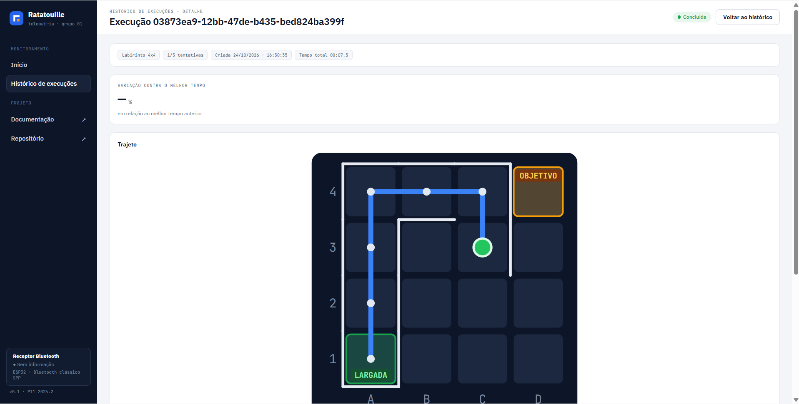

Figura 17: Detalhe da execução do roteiro sucesso-4x4 (4.10)

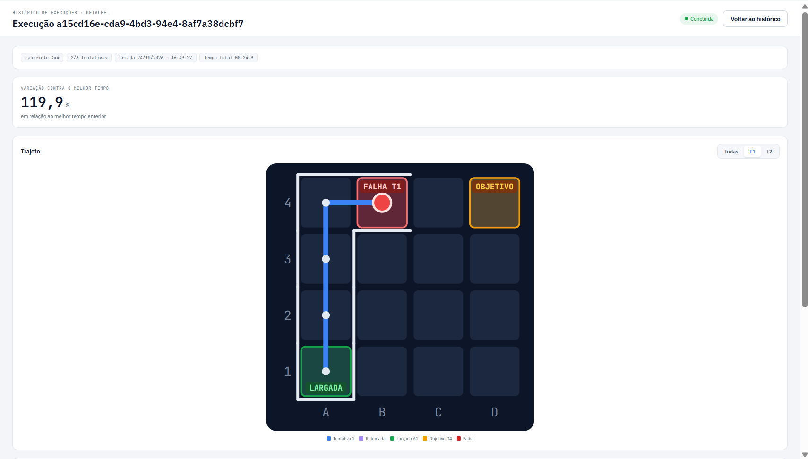

Figura 18: Colisão em B4 na tentativa 1, filtro T1 (4.10)

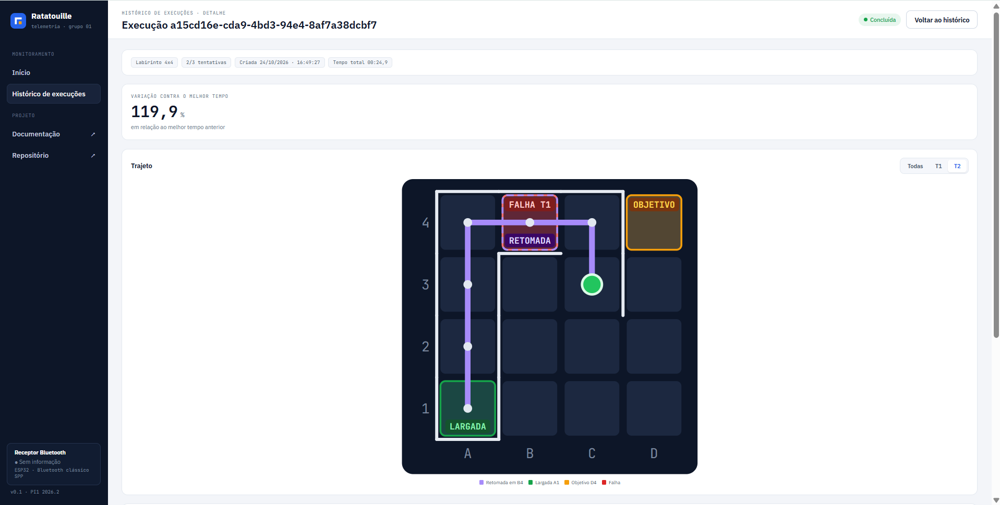

Figura 19: Tentativa 2 depois da retomada, filtro T2 (4.10)

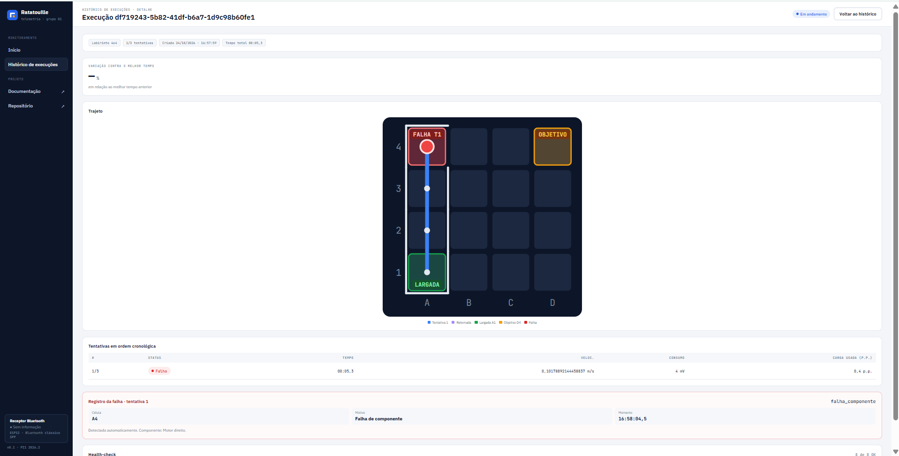

Figura 20: Falha de componente em A4 (4.10)

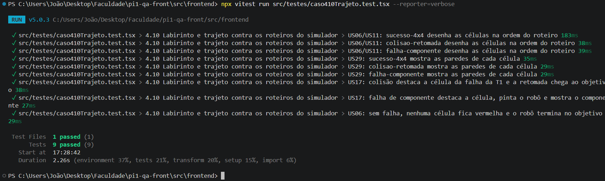

Figura 21: Teste automático do 4.10 contra os roteiros do simulador

### 4.11 Histórico, filtro e detalhe

Depois dos roteiros, o banco tinha 7 execuções 4x4: 3 concluídas e 4 canceladas (as que caíram por `link_lost` ou foram encerradas). A tela de histórico foi comparada linha a linha com `GET /execucoes`:

- **Lista:** mesma ordem (da mais recente para a mais antiga), mesmo status, tentativas, tempo total e velocidade média. A velocidade aparece com todas as casas que a API manda, como pede o RNF-B01 (sem arredondamento que altere o valor), e as execuções sem velocidade na API aparecem com "—" (Figura 22).
- **Filtro:** 4x4 e Todos mostram as 7; 8x4 e 12x4 ficam vazios, como `GET /execucoes?tipo_labirinto=8x4` e `12x4`.
- **Detalhe:** na execução da colisão, a tabela mostra 1/3 Falha (00:06,1, 5 mV, 0,5 p.p.) e 2/3 Sucesso (00:16,5, −2 mV, −0,2 p.p.), e a variação contra o melhor tempo é 119,9%, os mesmos valores de `GET /execucoes/{id}` (Figura 23).

Os testes `front06.test.tsx` e `rotas.test.tsx` cobrem o mesmo fluxo com o MSW: lista decrescente com paginação do backend, filtro por labirinto, detalhe com as três tentativas, métricas, variação e trajeto por tentativa (Figura 24).

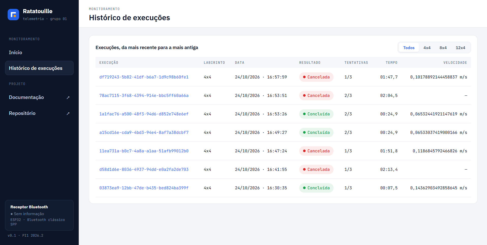

Figura 22: Histórico com as execuções gravadas no banco (4.11)

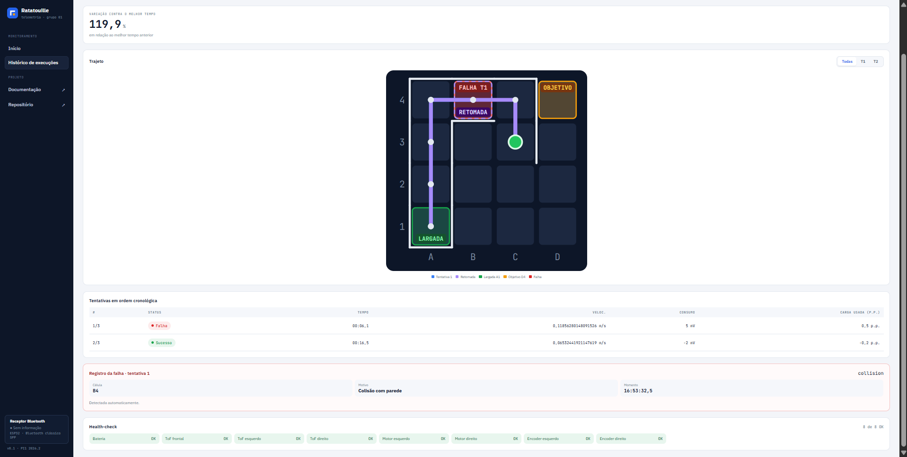

Figura 23: Detalhe com trajeto, tentativas, falha e health-check (4.11)

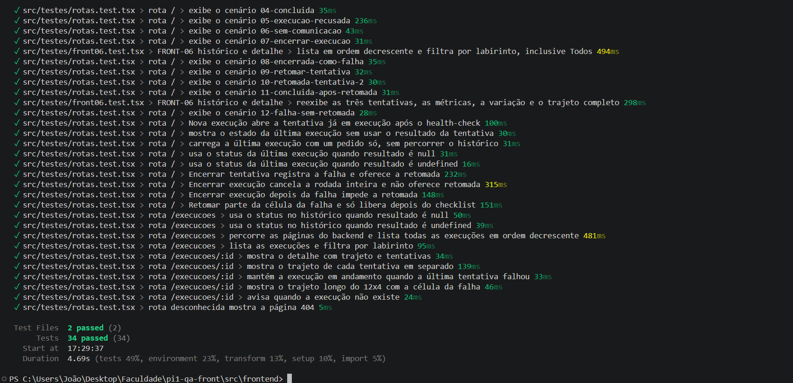

Figura 24: Testes automáticos do histórico e do detalhe (4.11)

### Pontos encontrados

Nenhum deles reprova os casos 4.10 e 4.11, porque a tela mostra o que a API grava. Ficam registrados para correção:

- **UUID no lugar do número da execução:** a API não manda `numero` (o campo é opcional no front e só os mocks o preenchem), então o título do detalhe e a lista mostram o UUID inteiro. Nenhum requisito pede o número, mas o UUID dificulta a leitura do histórico ([#248](https://github.com/fcte-pi1/2026_2_PI1_Grupo01_Juliana/issues/248)).
- **Consumo negativo:** a T2 da colisão tem consumo de −2 mV. O simulador volta a bateria para 7,9 V a cada boot, e a bateria inicial da tentativa vem da última leitura do boot anterior. No robô real, a LiPo também pode subir alguns mV parada, e nem a API nem o front tratam esse caso ([#247](https://github.com/fcte-pi1/2026_2_PI1_Grupo01_Juliana/issues/247)).
- **Simulador sem esperar o `largar`:** com a `dev` atual, a tentativa aberta pela tela cai por "reinício do robô" quando chega o health-check do simulador ([#249](https://github.com/fcte-pi1/2026_2_PI1_Grupo01_Juliana/issues/249)).
- **Objetivo dos roteiros:** o `sucesso-4x4` e a T2 do `colisao-retomada` terminam em C3, e não no objetivo D4 do 4x4 (US39), e mesmo assim a API aceita o sucesso ([#246](https://github.com/fcte-pi1/2026_2_PI1_Grupo01_Juliana/issues/246)).

## Testes unitários do front-end

A suíte do front roda com o [Vitest](https://vitest.dev) e o Testing Library, com o MSW no lugar da API. A cobertura é medida pelo provider v8 (`npm run test:cobertura` em `src/frontend`), com meta de 80% das linhas configurada no `vite.config.ts`. Ficam de fora só os arquivos que não vão para o build: os testes, os mocks do MSW, o `main.tsx` e os tipos gerados da API.

Resultado (26/10/2026): **230 de 230 testes aprovados** e **97,2% das linhas** cobertas (94,3% das instruções, 94,1% das funções e 90,4% dos desvios), acima da meta de 80%.

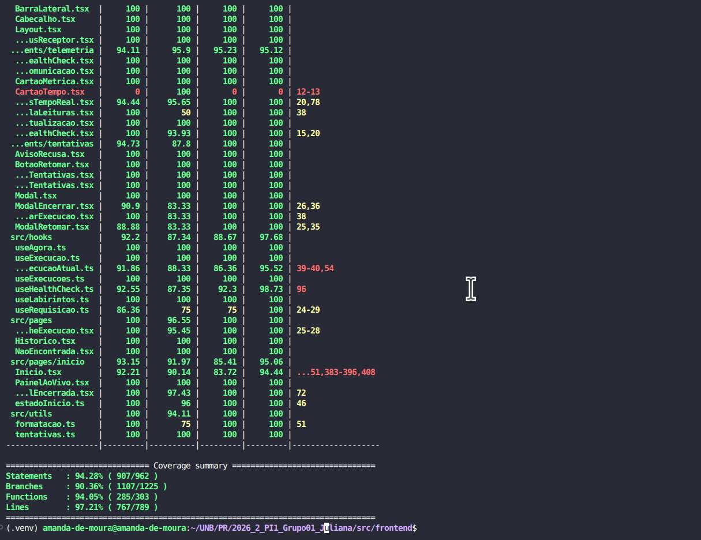

Figura 25: Cobertura do front-end por arquivo (vitest run --coverage)

## Testes unitários e de integração do back-end

A suíte do back-end roda com o `pytest` em `src/backend`, contra o Postgres de teste, e a cobertura é medida com o `pytest-cov` sobre os pacotes `app`, `ponte` e `contrato`, com meta de 80% das linhas (`--cov-fail-under=80`). Os testes de integração são os que passam pela API e pelo banco (`tests/integracao`), como a ingestão de telemetria, as rotas de execução, o stream SSE e a ponte serial. Os unitários (`tests/unit`) cobrem os serviços, o repositório e a ponte isoladamente.

Resultado (26/10/2026): **467 de 467 testes aprovados** e **96,79% das linhas** cobertas (2.121 instruções, 68 não cobertas), acima da meta de 80%. O relatório lista só os arquivos abaixo de 100%; os outros 38 arquivos têm cobertura completa.

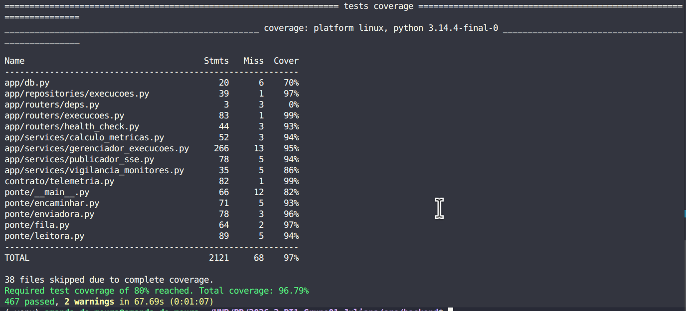

Figura 26: Cobertura do back-end e da ponte, arquivos abaixo de 100% (pytest --cov)

## Testes E2E (sistema)

Os testes E2E rodam com o [Playwright](https://playwright.dev) em `src/frontend/e2e/us-conectado.spec.ts`, pela interface gráfica, contra a cadeia real: o simulador de navegação do firmware e o simulador de telemetria mandam as mensagens por HTTP para a API (`docker compose` em `src/backend`, com Postgres), e o front roda sem mock (`VITE_API_MOCK=false`). Cada teste confere a tela e, em seguida, o que a API gravou. Para repetir, com a API no ar em `http://127.0.0.1:8000`, rode `npm run test:e2e:conectado` em `src/frontend`.

Resultado (26/10/2026): **10 de 11 testes aprovados** em 2,0 min.

O roteiro abaixo guia os testes automatizados: cada caso tem um teste em `us-conectado.spec.ts` cujo título começa com o ID do caso. As telas são as do [protótipo](#historias-de-usuario-e-prototipos).

| **ID** | **Fluxo** | **Histórias de usuário** | **Telas** | **Resultado esperado** | **Resultado** |
|:------:|-----------|--------------------------|:---------:|------------------------|:-------------:|
| E2E-01 | Execução completa com sucesso: health-check, Nova execução e conclusão | US01, US04, US06, US08, US10, US11, US12, US14, US15, US18, US20, US25 | 1, 2, 3, 4 | A tela mostra a tentativa 1/3, o trajeto e o tempo desde a última atualização; com a tentativa aberta, o Retomar é recusado (409); ao chegar a D4, a execução fica concluída, com os dados gravados | Aprovado |
| E2E-02a | Nova execução bloqueada sem health-check válido (DIP divergente e reprovado) | US12, US21 | 2, 5 | A tela mostra o motivo e bloqueia a Nova execução; a API recusa com 409; nada é criado | Aprovado |
| E2E-02b | Nova execução com uma execução em andamento cancela a anterior | US12, US18 | — | A anterior fica `cancelada` e a tentativa `failed`; a nova abre a tentativa 1/3 em `running` | Aprovado |
| E2E-03 | Encerramento manual e retomada na célula da falha | US17, US19, US22, US31 | 7, 8, 9, 10 | Tentativa 1 `failed` com motivo e célula; a retomada abre a tentativa 2/3 na mesma execução, com `tentativa_id` próprio e o trajeto preservado | Aprovado |
| E2E-04 | Falha de componente e retomada | US30 | 8, 9, 10 | Falha registrada com o componente; a retomada abre nova tentativa e conta no limite | **Reprovado** |
| E2E-05 | Três falhas manuais esgotam as tentativas | US07, US22 | 12 | Depois da 3ª falha, o botão de retomar some e a execução fica `cancelada` | Aprovado |
| E2E-05b | Execução cancelada não oferece retomada | US07 | 12 | Cancelada a execução, a tela não oferece o Retomar | Aprovado |
| E2E-06 | Perda de comunicação (10 s sem telemetria) | US07, US23 | 6, 8 | Tentativa `failed` por `link_lost` na última célula; a execução segue `em_andamento` e a tela oferece o Retomar | Aprovado |
| E2E-07 | Estouro do limite de 10 min | US24 | — | Execução cancelada por `time_exceeded` | Não realizado |
| E2E-08 | Histórico, filtro por labirinto e detalhe das três tentativas | US02, US03, US09, US13, US16, US17, US26, US27, US28 | Sem tela | Lista e filtro batem com o banco; o detalhe reexibe trajeto, tentativas e a variação contra o melhor tempo | Aprovado |
| E2E-09 | Paredes enviadas pelo robô no desenho do labirinto | US29 | 3 | A máscara gravada é a enviada e cada parede aparece no lado certo da célula | Aprovado |
| E2E-10 | Health-check pela web: 30 s sem resposta do robô | US05, US32 | 2 | O pedido sem resposta libera nova solicitação e não abre tentativa | Aprovado |

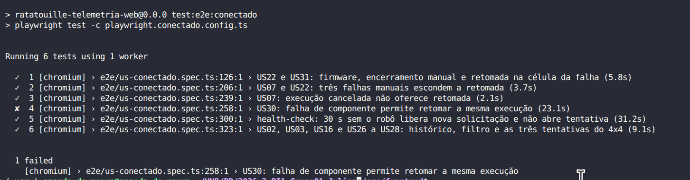

Figura 27: Execução dos testes E2E com o back-end real (npm run test:e2e:conectado), primeira rodada, com os seis testes originais

O teste da US30 reprova por causa do simulador de telemetria, não do front. Ele reproduz o roteiro `falha-componente` com um `boot` novo, e o simulador começa a correr logo depois do health-check, sem esperar o `largar`. Desde o PR [#239](https://github.com/fcte-pi1/2026_2_PI1_Grupo01_Juliana/pull/239), a API entende o health-check de um `boot` maior como reinício do robô e encerra a tentativa aberta como `link_lost`. Na execução, a tela mostrou "link_lost em A1" no lugar de `falha_componente` em A4, e o log da API registrou `tel`, `passo` e `falha` descartados por "nenhuma tentativa aberta". É o problema da [#249](https://github.com/fcte-pi1/2026_2_PI1_Grupo01_Juliana/issues/249), ainda aberta; a US30 fica sem E2E aprovado até ela ser resolvida.

O E2E-07 não foi realizado. Ele exigiria subir uma segunda API com o limite de tempo reduzido, e esse comportamento fica coberto no nível de integração, com relógio simulado, pelo caso 4.4. Nem esse caso nem o E2E cobrem o cancelamento aos 10 minutos entre duas tentativas, comportamento que o back-end ainda não tem (US24).
