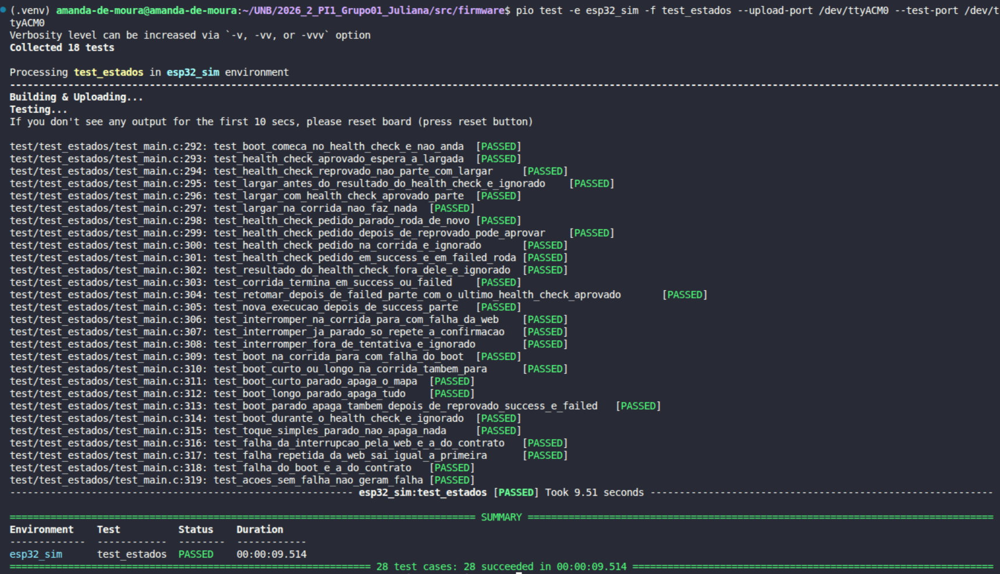
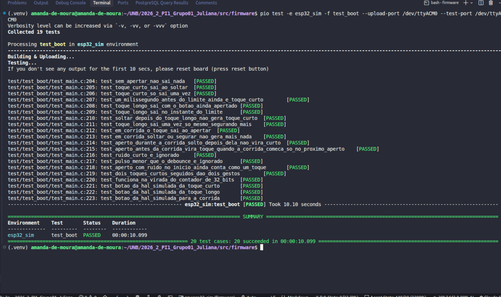

# Testes de Integração

!!! warning "Registros parciais"
    Os testes 5.1 a 5.8 registram a integração do firmware com o hardware da bancada (Firmware e Eletrônica). Os testes de ponta a ponta com a ponte, o back-end e a web (health-check aprovado na tela, `dip_divergente`, comando `health_check` pela web) e a validação do ambiente `esp32_real` na placa ainda não foram feitos. As linhas seguintes seguem em branco.

Confiram as regras de avaliação dos testes de integração no [documento do tema do projeto](https://docs.google.com/presentation/d/1hRx0g9mpVGQbTv44gLEoAyf4b4kKM4vnrABTnG8HlUk/edit?usp=sharing).

| **ID** | **Descrição** | **Data de Início** | **Data de Conclusão** | **Subequipes** | **Responsável** | **Resultados Esperados** | **Resultados Obtidos** | **Aprovação Interna (S/N)** | **Aprovação do Orientador (S/N)** | **Observações** |
|:------:|---------------|--------------------|-----------------------|----------------|-----------------|--------------------------|------------------------|:---------------------------:|:--------------------------------:|-----------------|
| 5.1 | Integração do firmware com o DIP switch: o tipo de labirinto lido nas vias 1 e 2 chega ao `tipo_dip` do health-check | 20/11/2026 | 20/11/2026 | Firmware e Eletrônica | Amanda | `00` = 4x4, `01` = 8x4, `10` = 12x4 e `11` = inválido (reprova o health-check); as vias 3 e 4 não mudam o tipo. | Nas 9 combinações testadas o tipo seguiu o esperado, inclusive `1111` como `invalido`. O health-check informou `tipo_dip=4x4` com todas as vias desligadas. | S | N | Bancada `esp32_hc_bancada`. Mapeamento a confirmar com a Eletrônica. Log na seção [Evidências](#log-da-bancada-do-health-check-testes-51-a-54). |
| 5.2 | Integração do firmware com os três ToF VL53L0X (XSHUT, troca de endereço e leitura) | 20/11/2026 | 20/11/2026 | Firmware e Eletrônica | Amanda | Os três sensores iniciam nos endereços `0x30` a `0x32` e medem distâncias. | Só o frontal (GPIO33) iniciou e mediu. Um lateral (GPIO5) responde ao endereço, mas falha ao ler a calibração (`Error 263`); o outro não responde em nenhum GPIO testado. | N | N | Defeito de hardware nos laterais a investigar pela Eletrônica (alimentação, solda de SDA/SCL, fio do XSHUT). Descartados por teste: pinos do XSHUT, tempo de boot, três tentativas de início, clock do I²C (50, 100 e 400 kHz), timeout de leitura (50 e 500 ms), biblioteca (Adafruit e Pololu) e interruptor da bateria ligado ou desligado. Log na seção [Evidências](#log-da-bancada-do-health-check-testes-51-a-54). |
| 5.3 | Integração do firmware com motores, encoders e bateria (autoteste de giro e leitura em mV) | 20/11/2026 | 20/11/2026 | Firmware e Eletrônica | Amanda | Cada roda conta ao menos 50 pulsos em 300 ms a 30 % de potência, com o encoder da mesma roda; a bateria é lida em mV. | Direita: 525 a 530 pulsos. Esquerda: 316 e 340 pulsos, e 33 (reprovada) em uma execução com a bateria atrapalhando a partida. Bateria: 7768 mV. | S | N | Rodas no ar e interruptor ligado. Falta comparar a bateria com o multímetro (erro de até 2 %). Limiar provisório. Log na seção [Evidências](#log-da-bancada-do-health-check-testes-51-a-54). |
| 5.4 | Health-check de 8 itens na placa com os drivers reais, reprovando e nomeando o componente | 20/11/2026 | 20/11/2026 | Firmware e Eletrônica | Amanda | Os 8 itens são avaliados e, havendo reprovação, o componente aparece nomeado. | Reprovou e nomeou `tof_esquerdo` como primeiro reprovado (e `tof_direito`); bateria, `tof_frontal`, motores e encoders passaram. Duração de 815 ms. | S | N | O resultado reprovado decorre do teste 5.2. Log na seção [Evidências](#log-da-bancada-do-health-check-testes-51-a-54). |
| 5.5 | Telemetria do firmware na ESP32 pela serial USB: health-check seguido da `tel`, sem `falha` | 19/11/2026 | 20/11/2026 | Firmware | Amanda | Saem 8 `hc_item` e 1 `hc_resultado` aprovado (`inicio` nova), sem `falha`, e depois a `tel` a 1 Hz com o robô parado; `seq` contínuo. | Saíram os 8 `hc_item`, o `hc_resultado` (`aprovado`, 4x4, `nova`) e a `tel`, sem `falha` e com `seq` contínuo de 0 a 46. Na primeira execução o robô subiu como `success` e `retomada` por causa do estado guardado na NVS; depois de apagar a flash saiu `nova` e `running`. | S | N | Firmware `esp32_sim` (HAL simulada) rodando na placa real. Pendente: robô parte sozinho, sem esperar o `largar`, e a `tel` `running` sai antes do `hc_resultado`, até a máquina de estados ser ligada à navegação. Evidência: [`5.5-telemetria-serial.txt`](evidencias/testes-integracao/firmware-hardware/5.5-telemetria-serial.txt). |
| 5.6 | Máquina de estados do robô e falha por origem: a mesma suíte de 28 testes rodando no PC e na ESP32 real | 20/11/2026 | 20/11/2026 | Firmware | Amanda | Transições de health-check, largada, interrupção e BOOT corretas, e a `falha` da web (sem motivo) e do BOOT (`encerrado_operador`) iguais às linhas do contrato; resultado igual no PC e na placa. | 28 de 28 testes aprovados na ESP32 (`esp32_sim`) e 28 de 28 no PC (`native`). | S | N | Cobre a lógica da máquina e a montagem da `falha`; os gestos do BOOT na placa e a ligação à navegação ainda não foram feitos. Evidência: [`5.6-maquina-estados-esp32.txt`](evidencias/testes-integracao/firmware-hardware/5.6-maquina-estados-esp32.txt). |
| 5.7 | Gestos do botão BOOT (debounce, toque na corrida, toque curto e toque longo de 1,5 s): a mesma suíte de 20 testes rodando no PC e na ESP32 real | 20/11/2026 | 20/11/2026 | Firmware | Amanda | O contato com ruído menor que 30 ms é ignorado; em corrida o toque sai ao apertar; parado, soltar antes de 1,5 s dá toque curto e segurar 1,5 s dá toque longo uma única vez, sem toque curto ao soltar; resultado igual no PC e na placa. | 20 de 20 testes aprovados na ESP32 (`esp32_sim`) e 20 de 20 no PC (`native`). | S | N | Cobre o detector com o tempo injetado e com a HAL simulada; o aperto físico do botão está no teste 5.8. Limiar do toque longo provisório. Evidência: [`5.7-gestos-boot-esp32.txt`](evidencias/testes-integracao/firmware-hardware/5.7-gestos-boot-esp32.txt). |
| 5.8 | Toque físico no botão BOOT da ESP32 (`esp32_real_tof_mock`): toque curto apaga o mapa e toque longo apaga mapa e tipos resolvidos, com a telemetria seguindo | 20/11/2026 | 20/11/2026 | Firmware | Amanda | Com a NVS gravada (`mem_mapa` e `mem_tipos` presentes), o toque curto (menos de 1,5 s) apaga só o mapa e o toque longo (1,5 s ou mais) apaga também os tipos resolvidos; a `tel` continua a 1 Hz sem reinício. | `ao ligar: sim/sim`; depois do toque curto `nao/sim`; depois do toque longo `nao/nao`; `seq` contínuo de 0 a 154 no mesmo `boot` 4. | S | N | Bateria do carrinho desligada, então o health-check reprova bateria, motores e encoders (esperado). Os bipes (1 no curto, 2 no longo) não foram registrados. Limiar de 1,5 s provisório. Evidência: [`5.8-botao-boot-fisico-esp32.txt`](evidencias/testes-integracao/firmware-hardware/5.8-botao-boot-fisico-esp32.txt). |
| 5.9 | | | | | | | | | | |
| 5.10 | | | | | | | | | | |
| 5.11 | | | | | | | | | | |
| 5.12 | | | | | | | | | | |
| 5.13 | | | | | | | | | | |
| 5.14 | | | | | | | | | | |
| 5.15 | | | | | | | | | | |
| 5.16 | | | | | | | | | | |

## Evidências

### Log da bancada do health-check (testes 5.1 a 5.4)

Saída serial do ambiente `esp32_hc_bancada` na ESP32 real, com as rodas no ar e o interruptor ligado. Nela aparecem, em ordem, a inicialização dos ToF (5.2), a leitura do DIP em 9 combinações (5.1), a bateria e o autoteste dos motores (5.3) e o health-check de 8 itens com o resultado reprovado (5.4).

Os logs de texto de cada teste estão em `evidencias/testes-integracao/firmware-hardware/`: [5.1](evidencias/testes-integracao/firmware-hardware/5.1-dip.txt), [5.2](evidencias/testes-integracao/firmware-hardware/5.2-tof.txt), [5.3](evidencias/testes-integracao/firmware-hardware/5.3-motores-bateria.txt) e [5.4](evidencias/testes-integracao/firmware-hardware/5.4-health-check.txt).

### Investigação da falha dos ToF laterais (teste 5.2)

Só o ToF frontal (GPIO33) inicia e mede. O lateral ligado ao XSHUT do GPIO5 responde ao endereço `0x29` e o ID do chip lê `0xEE` (VL53L0X rev. 1.1), mas a inicialização falha ao ler a calibração de fábrica (`PerformRefSpadManagement`), com `Error 263` (timeout de I²C) e `Status -6`. O outro lateral (XSHUT no GPIO4) não responde em nenhum GPIO testado. Para concluir se a causa é de software ou de hardware, cada hipótese foi testada na placa com o mesmo procedimento (comando `v` da bancada, só o sensor do GPIO5 em alto):

| Hipótese de software | Como foi testada | Resultado |
|---|---|---|
| Pino de XSHUT errado ou sem saída | `x` (um GPIO por vez em alto) e `f` (varredura dos GPIOs livres) | GPIO33 e GPIO5 acordam um sensor; o pino funciona. O GPIO4 não acorda nenhum. Log: [`5.2-tof-xshut.txt`](evidencias/testes-integracao/firmware-hardware/5.2-tof-xshut.txt) |
| Tempo de boot depois do XSHUT | 10 ms de espera (datasheet pede 1,2 ms) e três tentativas com reinício do sensor | Falha igual em todas. Log: [`5.2-tof-tentativas-e-interruptor.txt`](evidencias/testes-integracao/firmware-hardware/5.2-tof-tentativas-e-interruptor.txt) |
| Clock do I²C | 50, 100 e 400 kHz | Falha igual nos três. Log: [`5.2-tof-clock-timeout.txt`](evidencias/testes-integracao/firmware-hardware/5.2-tof-clock-timeout.txt) |
| Timeout da leitura de I²C | 50 ms (padrão) e 500 ms | Falha igual: a leitura não completa nem com 10 vezes mais tempo. Log: [`5.2-tof-clock-timeout.txt`](evidencias/testes-integracao/firmware-hardware/5.2-tof-clock-timeout.txt) |
| Biblioteca do sensor | Adafruit e Pololu | Adafruit falha na calibração; a Pololu devolve `init` OK, mas toda leitura dá 0 mm com o mesmo erro. Log: [`5.2-tof-bibliotecas.txt`](evidencias/testes-integracao/firmware-hardware/5.2-tof-bibliotecas.txt) |
| Alimentação pelo lado da bateria | Interruptor ligado e desligado | Falha igual. Log: [`5.2-tof-tentativas-e-interruptor.txt`](evidencias/testes-integracao/firmware-hardware/5.2-tof-tentativas-e-interruptor.txt) |
| Modelo do chip | Leitura do ID (registrador `0xC0`) | `0xEE`, é um VL53L0X; o modelo não é o problema. Log: [`5.2-tof-bibliotecas.txt`](evidencias/testes-integracao/firmware-hardware/5.2-tof-bibliotecas.txt) |

**Conclusão da hipótese:** nenhuma variação de software mudou o resultado, e o sensor frontal funciona com exatamente o mesmo código. A falha é repetível e aparece só no passo que dispara o laser do sensor (a leitura da calibração), com o chip identificado corretamente. Isso aponta para o hardware dos módulos laterais: alimentação insuficiente no pico de corrente, solda de SDA/SCL, ou o próprio módulo; e, no outro lateral, VIN, GND ou o fio do XSHUT. Os módulos estão soldados e não foi possível trocá-los. Ação: a Eletrônica mede o 3,3 V no VIN dos laterais durante a inicialização, confere as soldas e o fio do XSHUT do GPIO4, e a rodada se repete depois. Enquanto isso, o ambiente `esp32_real_tof_mock` permite os testes de ponta a ponta ([ADR-018](decisoes/018-firmware-hal-real-com-tof-mockado.md)).

Logs desta investigação em `evidencias/testes-integracao/firmware-hardware/`: [xshut](evidencias/testes-integracao/firmware-hardware/5.2-tof-xshut.txt), [tentativas e interruptor](evidencias/testes-integracao/firmware-hardware/5.2-tof-tentativas-e-interruptor.txt), [bibliotecas e ID do chip](evidencias/testes-integracao/firmware-hardware/5.2-tof-bibliotecas.txt), [clock e timeout](evidencias/testes-integracao/firmware-hardware/5.2-tof-clock-timeout.txt) e o resumo geral [`5.2-tof.txt`](evidencias/testes-integracao/firmware-hardware/5.2-tof.txt).

### Telemetria pela serial USB (teste 5.5)

Saída serial do `esp32_sim` na ESP32 real em duas execuções: a primeira com o estado antigo guardado na NVS (`success` e `retomada`) e a segunda depois de apagar a flash (`nova` e `running`). Mostra os 8 `hc_item`, o `hc_resultado`, a `tel` a 1 Hz com o robô parado e o `seq` contínuo, sem nenhuma `falha`. Log completo: [`5.5-telemetria-serial.txt`](evidencias/testes-integracao/firmware-hardware/5.5-telemetria-serial.txt).

### Máquina de estados na ESP32 (teste 5.6)

A suíte `test_estados` (28 casos) roda no PC e dentro da ESP32 real: o PlatformIO grava os testes na placa e lê o resultado pela serial USB (`pio test -e esp32_sim -f test_estados`). Ela cobre as transições de health-check, largada (só com o último health-check aprovado), comandos `health_check` e `interromper`, e as reações ao botão BOOT, além da `falha` de cada origem comparada com as linhas do contrato: interrupção pela web (origem `web`, motivo nulo) e BOOT (origem `boot`, `encerrado_operador`). Resultado: 28 de 28 na placa e 28 de 28 no PC. Log: [`5.6-maquina-estados-esp32.txt`](evidencias/testes-integracao/firmware-hardware/5.6-maquina-estados-esp32.txt).

### Gestos do botão BOOT na ESP32 (teste 5.7)

A suíte `test_boot` (20 casos) roda no PC e dentro da ESP32 real (`pio test -e esp32_sim -f test_boot`). Ela cobre o debounce de 30 ms, o toque durante a corrida (sai ao apertar), o toque curto parado (sai ao soltar antes de 1,5 s) e o toque longo (sai aos 1,5 s, com o botão ainda apertado, uma única vez), além da virada do contador de 32 bits e do botão da HAL simulada. Resultado: 20 de 20 na placa e 20 de 20 no PC. Log: [`5.7-gestos-boot-esp32.txt`](evidencias/testes-integracao/firmware-hardware/5.7-gestos-boot-esp32.txt).

### Toque físico no botão BOOT (teste 5.8)

Com o `esp32_sim` gravado antes (ele escreve `mem_mapa` e `mem_tipos` na NVS) e o `esp32_real_tof_mock` rodando, o botão BOOT da placa foi apertado com o firmware já em execução: um toque curto e depois um toque longo. O firmware imprime a presença das chaves antes e depois de cada gesto. O mapa saiu na hora do toque curto, os tipos resolvidos só saíram no toque longo, e a telemetria seguiu sem reinício (mesmo `boot`, `seq` contínuo). O BOOT não reinicia a placa durante a execução, só em reset. Log: [`5.8-botao-boot-fisico-esp32.txt`](evidencias/testes-integracao/firmware-hardware/5.8-botao-boot-fisico-esp32.txt).
