# Testes de Integração

!!! warning "Registros parciais"
    Os testes 5.1 a 5.33 registram a integração do firmware com o hardware da bancada (Firmware e Eletrônica). Os testes de ponta a ponta com a ponte, o back-end e a web (health-check aprovado na tela, `dip_divergente`, comando `health_check` pela web) e a validação do ambiente `esp32_real` na placa ainda não foram feitos. As linhas seguintes seguem em branco.

    **Nomes dos ambientes:** nos testes 5.1 a 5.21, `esp32_real` e `esp32_real_tof_mock` são o firmware só com o health-check, que depois passou a se chamar `esp32_real_hc` e `esp32_real_hc_tof_mock`. Desde o teste 5.22, `esp32_real` é o firmware completo no robô (navegação e movimento), com as variantes `esp32_real_tof_mock`, `esp32_real_bt` e `esp32_real_bt_tof_mock`.

Confiram as regras de avaliação dos testes de integração no [documento do tema do projeto](https://docs.google.com/presentation/d/1hRx0g9mpVGQbTv44gLEoAyf4b4kKM4vnrABTnG8HlUk/edit?usp=sharing).

| **ID** | **Descrição** | **Período** | **Equipe** | **Resp.** | **Aprov. interna** | **Aprov. orientador** |
|:--:|---------------|:---------:|----------|:----:|:--:|:--:|
| 5.1 | Integração do firmware com o DIP switch: o tipo de labirinto lido nas vias 1 e 2 chega ao `tipo_dip` do health-check | 20/11/2026 | Firmware e Eletrônica | Amanda | S | N |
| 5.2 | Integração do firmware com os três ToF VL53L0X (XSHUT, troca de endereço e leitura) | 20/11/2026 | Firmware e Eletrônica | Amanda | N | N |
| 5.3 | Integração do firmware com motores, encoders e bateria (autoteste de giro e leitura em mV) | 20/11/2026 | Firmware e Eletrônica | Amanda | S | N |
| 5.4 | Health-check de 8 itens na placa com os drivers reais, reprovando e nomeando o componente | 20/11/2026 | Firmware e Eletrônica | Amanda | S | N |
| 5.5 | Telemetria do firmware na ESP32 pela serial USB: health-check seguido da `tel`, sem `falha` | 19/11/2026 a 20/11/2026 | Firmware | Amanda | S | N |
| 5.6 | Máquina de estados do robô e falha por origem: a mesma suíte de 28 testes rodando no PC e na ESP32 real | 20/11/2026 | Firmware | Amanda | S | N |
| 5.7 | Gestos do botão BOOT (debounce, toque na corrida, toque curto e toque longo de 1,5 s): a mesma suíte de 20 testes rodando no PC e na ESP32 real | 20/11/2026 | Firmware | Amanda | S | N |
| 5.8 | Toque físico no botão BOOT da ESP32 (`esp32_real_tof_mock`): toque curto apaga o mapa e toque longo apaga mapa e tipos resolvidos, com a telemetria seguindo | 20/11/2026 | Firmware | Amanda | S | N |
| 5.9 | Corrida na ESP32 com `largar`, `interromper` pela web e BOOT físico (`esp32_sim_boot`: HAL simulada, botão real, navegação a 1 Hz) | 20/11/2026 | Firmware | Amanda | S | N |
| 5.10 | Suíte `test_corrida` (máquina de estados, navegação e NVS) rodando no PC e na ESP32 real | 20/11/2026 | Firmware | Amanda | S | N |
| 5.11 | Comando `health_check` na corrida simulada da ESP32 (`esp32_sim_boot`) | 20/11/2026 | Firmware | Amanda | S | N |
| 5.12 | DIP lido pelo health-check depois do boot, na ESP32 com a HAL real (`esp32_real`) | 20/11/2026 | Firmware | Amanda | S | N |
| 5.13 | Suíte `test_sinal` (padrão do LED para cada estado do robô) rodando no PC e na ESP32 real | 20/11/2026 | Firmware | Amanda | S | N |
| 5.14 | LED azul da placa por estado: corrida simulada (`esp32_sim_boot`) e health-check reprovado (`esp32_real`) | 20/11/2026 | Firmware | Amanda | S | N |
| 5.15 | Suíte `test_encoder_soma` (soma dos pulsos do encoder quando o contador de 16 bits do PCNT zera) rodando no PC e na ESP32 real | 21/11/2026 | Firmware | Amanda | S | N |
| 5.16 | Boot do `esp32_real` sem o erro do PCNT depois de tirar a interrupção do encoder | 21/11/2026 | Firmware | Amanda | S | N |
| 5.17 | Suíte `test_corrida` na ESP32 real depois do limite de gravações do mapa na NVS | 21/11/2026 | Firmware | Amanda | S | N |
| 5.18 | Corrida simulada (`esp32_sim_boot`) com a retomada depois de um reset, com o limite de gravações | 21/11/2026 | Firmware | Amanda | S | N |
| 5.19 | Estouro do contador do encoder com o motor girando (bancada `esp32_drivers`, rodas no ar) | 21/11/2026 | Firmware | Amanda | S | N |
| 5.20 | Pulsos do encoder por volta da roda, girando à mão (motores desligados) | 21/11/2026 | Firmware | Amanda | N | N |
| 5.21 | Sentido das rodas e comando de parada na bancada dos drivers depois de inverter só o motor e o encoder esquerdos | 21/11/2026 | Firmware | Amanda | S | N |
| 5.22 | Suíte `test_execucao` (o executor gira e avança, e a corrida completa anda de verdade no mundo simulado) na ESP32 real, e `test_corrida` de novo | 21/11/2026 | 21/11/2026 | Firmware | Amanda | `FRENTE`, `ESQUERDA`, `DIREITA` e `MEIA_VOLTA` levam o robô à célula certa, uma roda travada faz a execução falhar e parar, a corrida completa chega ao objetivo andando, e a falha de movimento vira a `falha` `stuck`. | 11 de 11 testes do `test_execucao` aprovados na ESP32 e 19 de 19 do `test_corrida` com o laço novo; os 11 também passam no PC. | S | N | HAL simulada: os motores e os ToF são os do mundo simulado, o interruptor da bateria não interfere. O print começa no terceiro caso do `test_execucao`. Evidência: [`5.22-execucao-esp32.txt`](evidencias/testes-integracao/firmware-hardware/5.22-execucao-esp32.txt). |
| 5.23 | Corrida simulada andando de verdade na ESP32 (`esp32_sim_boot`): anda e para, parede lateral ao entrar na célula, `largar`, `health_check` e `interromper` | 21/11/2026 | 21/11/2026 | Firmware | Amanda | O robô só parte com o `largar`, percorre o labirinto de verdade (um `passo` por cerca de 1 s por célula reta e 1,5 s com giro), chega ao objetivo, recomeça do (0,0) com um novo `largar`, para com o `interromper` e roda o `health_check` parado, inclusive depois de `failed`. | Corrida de (0,1) por (0,2), (0,3), (1,3), (2,3), (2,2) e (3,2) até o `sucesso` em (3,3), sem atravessar a parede entre (2,3) e (3,3); `health_check` em `success` e depois de `failed` com os 8 itens e a `tel` voltando a `health-check`; `largar` depois do `sucesso` recomeçou em (0,0); `interromper` gerou a `falha` `web` com motivo nulo. | S | N | O BOOT na corrida e o reset com a retomada estão no teste 5.25. O primeiro boot saiu como `retomada` porque os testes na placa deixam o mapa na flash. A `falha` do `interromper` traz a célula seguinte da navegação (0,3), porque a pose é atualizada na decisão. Interruptor da bateria desligado (HAL simulada). Evidência: [`5.23-corrida-simulada-andando-esp32.txt`](evidencias/testes-integracao/firmware-hardware/5.23-corrida-simulada-andando-esp32.txt). |
| 5.24 | BOOT parado (toque curto e longo) e corrida nova do (0,0) na ESP32 (`esp32_sim_boot`) | 21/11/2026 | 21/11/2026 | Firmware | Amanda | Com o robô parado esperando o `largar`, o toque curto apaga o mapa e o longo apaga também os tipos resolvidos, a navegação volta a (0,0) e o próximo `largar` corre do começo; cada apagamento imprime uma linha `# BOOT ...`. | Saíram `# BOOT curto: ...` (2 vezes) e `# BOOT longo: ...`; a `tel` ficou em (0,0) e o boot seguinte já tinha sido `"inicio":"nova"`; o `largar` percorreu (0,1), (0,2), (0,3), (1,3), (2,3), (2,2), (3,2) até o `sucesso` em (3,3), com `tel` a 5 Hz na corrida e 1 Hz parado. | S | N | HAL simulada, BOOT real. O BOOT durante a corrida e o reset com a retomada estão no teste 5.25. Na simulação não há buzzer: o sinal é a linha no monitor e o LED. Evidência: [`5.24-boot-parado-corrida-nova-esp32.txt`](evidencias/testes-integracao/firmware-hardware/5.24-boot-parado-corrida-nova-esp32.txt). |
| 5.25 | BOOT durante a corrida e retomada depois de um reset na ESP32 (`esp32_sim_boot`) | 21/11/2026 | 21/11/2026 | Firmware | Amanda | Um toque no BOOT na corrida para o robô e envia a `falha` com origem `boot` e motivo `encerrado_operador`; depois de um reset, o boot sai como `retomada` na célula da falha e o `largar` continua dela até o `sucesso`. | `falha` `boot`/`encerrado_operador` em (1,3) durante o percurso (0,1), (0,2), (0,3), com a `tel` em `failed`; o reset trouxe `"inicio":"retomada"` com a `tel` em (1,3); o `largar` seguinte retomou por (1,3), (2,3), (2,2), (3,2) até o `sucesso` em (3,3). Os boots anteriores também retomaram em (0,1) depois do `interromper`. | S | N | HAL simulada, BOOT real. A `falha` traz a célula seguinte da navegação (a pose é atualizada na decisão), e a retomada sai dessa mesma célula. Evidência: [`5.25-boot-na-corrida-retomada-esp32.txt`](evidencias/testes-integracao/firmware-hardware/5.25-boot-na-corrida-retomada-esp32.txt). |
| 5.26 | Bluetooth real (SPP "Ratatouille") no robô, sem cabo USB: pareamento no notebook, `rfcomm bind` e as teclas da bancada pelo `/dev/rfcomm0` (`esp32_calibracao_bt`) | 21/11/2026 | 21/11/2026 | Firmware | Amanda | O pareamento e a conexão funcionam, as teclas chegam ao robô e as respostas voltam ao monitor. | O pareamento por `bluetoothctl` e o `rfcomm bind` funcionaram; `t`, `p`, `v` e `a` foram enviados e respondidos pelo enlace (`v` com 1,7% de erro, `APROVADO`; `a` no chão com `concluido` e 1422 a 1424 pulsos). Houve ciclos curtos de `cliente conectado` e `desconectado` no início, até o enlace estabilizar. | S | N | O eco do terminal no `/dev/rfcomm0` fazia o robô tratar a própria saída como comandos (uma roda pulsou); resolvido com o protocolo de uma tecla por linha na bancada (ADR-020). Evidência: [`5.26-bluetooth-spp-calibracao.txt`](evidencias/testes-integracao/firmware-hardware/5.26-bluetooth-spp-calibracao.txt). |
| 5.27 | Alcance e estabilidade do Bluetooth (SPP) em relação ao notebook | 21/11/2026 | 21/11/2026 | Firmware | Amanda | Enlace estável a 3 m do notebook (critério da FIRM-11). | **Não atendido:** a mais de cerca de 3 m o enlace desconecta com facilidade (relato, sem medição de distância). | N | N | Falta medir a distância exata da queda, repetir e investigar a causa (posição da antena da ESP32, obstáculos). A latência (p95 ≤ 3 s) e o pareamento no notebook oficial seguem pendentes. Evidência: [`5.27-bluetooth-alcance-3m.txt`](evidencias/testes-integracao/firmware-hardware/5.27-bluetooth-alcance-3m.txt). |
| 5.28 | Avanço de uma célula (`a`) na bancada de calibração (`esp32_calibracao_bt`), rodas no ar e no chão | 21/11/2026 | 21/11/2026 | Firmware | Amanda | Pulsos por roda dentro da tolerância do avanço e distância medida com régua igual a uma célula (180 mm). | Com 840 pulsos por volta: 6 de 6 `concluido` (1410 a 1424 pulsos de 1416), mas a régua deu 23 a 25 cm, não 18 cm. Com 640 pulsos por volta: 1077 a 1082 pulsos de 1079 e a régua deu cerca de 18 a 20 cm. Com a roda esquerda roçando na bateria: 1070/1075, 1087/1073 e 1078/1080. | N | N | **Válido:** o controle de posição chega ao alvo em pulsos e o erro entre as rodas é pequeno quando não há atrito extra. **Inválido:** os pulsos e os mm dos testes com 840 pulsos por volta (a conversão estava errada por um fator de ~1,3, achado pela régua); as primeiras versões do controle (só proporcional e o integral sobre a trajetória toda), que falharam (`FALHOU`, oscilação); e os avanços feitos com a roda esquerda roçando na bateria (defeito estrutural, atrito variável), que misturam atrito com controle. **Resultado adotado:** com 640 pulsos por volta, cerca de 1079 pulsos por roda e 180 mm pelos pulsos (régua: cerca de 18 a 20 cm); o valor de 640 pulsos por volta é provisório. Evidência: [`5.28-avanco-uma-celula-calibracao.txt`](evidencias/testes-integracao/firmware-hardware/5.28-avanco-uma-celula-calibracao.txt). |
| 5.29 | Giros de 90° e 180° (`g`, `G`, `h`) na bancada de calibração | 21/11/2026 | 21/11/2026 | Firmware | Amanda | Cada roda conta cerca de 571 pulsos (840 por volta) ou 435 (640 por volta) no giro de 90°, com o ângulo dentro de ±1°. | Com 840 pulsos por volta: `g` 90,0°, `G` -90,6°, -89,4° e -90,4° (duas tentativas anteriores com `FALHOU`, 5 pulsos fora da tolerância de 4), `h` 179,4°. Com 640 pulsos por volta: `g` 90,7° (esq -438, dir 439) e `G` -90,4° (esq 441, dir -433). | N | N | **Resultado adotado:** o giro de 90° é de cerca de 90,7° (`g`) e -90,4° (`G`), conforme o log (ângulo calculado pelos pulsos dos encoders e pela bitola de 92,5 mm). **Inválido:** os giros de 571 pulsos (840 por volta), porque a conversão de pulsos estava errada (teste 5.28) e o ângulo real era outro. **Válido:** o sentido dos giros, o controle chegar ao alvo em pulsos, e a tolerância de 6 pulsos (~1°). O `Q` (20 giros) não foi executado. Evidência: [`5.29-giros-90-e-180-graus-calibracao.txt`](evidencias/testes-integracao/firmware-hardware/5.29-giros-90-e-180-graus-calibracao.txt). |
| 5.30 | Dez avanços seguidos (`A`) na bancada de calibração, pelo Bluetooth | 21/11/2026 | 21/11/2026 | Firmware | Amanda | 10790 pulsos por roda (1800 mm), erro final de até 10 mm medido na pista. | 10 de 10 `concluido` com 640 pulsos por volta (esq 10761, dir 10810 pulsos, 1800,1 mm pelos pulsos). Em outra tentativa, com a roda esquerda roçando na bateria, o avanço 7 falhou (esq 1070, dir 1086). Várias tentativas de enviar `A` caíram com `Disconnected ([Errno 5] Input/output error)`. | N | N | **Resultado adotado:** cerca de 1800 mm no total, conforme a soma dos pulsos do log. **Inválido:** o desvio para a esquerda que a Amanda viu a cada avanço, que vem do atrito da roda esquerda na bateria. A queda do Bluetooth durante o `A` não teve causa identificada (distância do notebook ou reinício da placa por queda da bateria). Evidência: [`5.30-dez-avancos-calibracao.txt`](evidencias/testes-integracao/firmware-hardware/5.30-dez-avancos-calibracao.txt). |
| 5.31 | Parada de emergência pelo ToF frontal no avanço (`a`), com uma madeira à frente | 21/11/2026 | 21/11/2026 | Firmware | Amanda | O robô para antes de encostar na madeira, sobrando a margem pedida até ela, e conclui o avanço quando a madeira está além da célula. | Com a margem de 10 mm e 840 pulsos por volta: madeira a 5, 10 e 15 cm, o robô anda um pouco, freia e para com a leitura em 50, 30 e 28 mm. Com a madeira a 25 cm, o robô ia até ela: os pulsos davam 18 cm mas o robô andava 23 a 25 cm. Na última tentativa parou cerca de 1 cm antes do obstáculo (relato). Com a margem de 17 mm só foi testado com a pista livre. | N | N | **Válido:** o freio em curto para o robô a tempo nos casos de perto, e a leitura de ToF (10 ms) não trava o laço. **Inválido:** a primeira versão da regra (comparava a parede com a célula inteira, a leitura era corrigida só em parte do atraso); os testes de 25 cm, porque a conversão de pulsos estava errada (teste 5.28); e a última tentativa, porque a leitura final (61 mm) não bate com os 1 cm medidos, e a madeira estava solta. **Resultado adotado:** margem de 17 mm (`MOV_FRENTE_SOBRA_MM`); nos testes com a margem de 10 mm o freio parou o robô com a leitura em cerca de 28 a 30 mm da madeira. A tecla `v` não usa o freio. Evidência: [`5.31-parada-emergencia-tof-frontal.txt`](evidencias/testes-integracao/firmware-hardware/5.31-parada-emergencia-tof-frontal.txt). |
| 5.32 | Leituras do ToF frontal (`t`) com uma madeira à frente, afastada aos poucos | 21/11/2026 | 21/11/2026 | Firmware | Amanda | As leituras seguem a distância real da madeira e a parede é decidida corretamente. | Madeira a 5 a 6 cm: 64 a 68 mm, subindo de forma contínua até 991 mm; `F=1` até cerca de 131 mm. Sem nada à frente: 1200 mm (fora do alcance). Laterais: `--` (sem leitura). | N | N | **Válido:** o ToF frontal lê a madeira com deslocamento de uns 5 mm de perto. **Inválido:** a leitura com a mão (121 a 143 mm a uns 5 cm), por ser um alvo ruim, e a distância de uns 5 cm foi medida a olho. Os ToF laterais seguem sem resposta (teste 5.2). Com a madeira parada e o robô andando, a leitura oscila de 20 a 30 mm. Evidência: [`5.32-leituras-tof-frontal.txt`](evidencias/testes-integracao/firmware-hardware/5.32-leituras-tof-frontal.txt). |
| 5.33 | PID de velocidade (`v`) e limiar de stuck (`s`) na bancada de calibração | 21/11/2026 | 21/11/2026 | Firmware | Amanda | `v`: média depois da rampa a até 5% de 400 mm/s nas duas rodas (`APROVADO`). `s`: trava detectada em torno de `MOTOR_TRAVADO_MS` (1000 ms). | `v` com as rodas no ar: 407 mm/s nas duas, erro de 1,7%, `APROVADO`. `s`: a roda segurada sem força seguiu girando e não foi detectada em 8 s. | N | N | **Válido:** o `v` com as rodas no ar. **Inválido:** o `v` no chão (o robô andou 3 s e bateu na parede; a tecla não usa o freio) e o `s` (o detector exige o encoder parado por 1 s e a roda foi só segurada, não travada). **Não verificado:** o `s`; o stuck no movimento segue coberto pelos testes no simulador. Evidência: [`5.33-velocidade-e-stuck-calibracao.txt`](evidencias/testes-integracao/firmware-hardware/5.33-velocidade-e-stuck-calibracao.txt). |

## Detalhamento dos testes

Resultados esperados, resultados obtidos e observações de cada teste da tabela acima. Clique no teste para abrir.

??? info "5.1 · Integração do firmware com o DIP switch: o tipo de labirinto lido nas vias 1 e 2 chega ao `tipo_dip` do…"

    **Resultados esperados:** `00` = 4x4, `01` = 8x4, `10` = 12x4 e `11` = inválido (reprova o health-check); as vias 3 e 4 não mudam o tipo.

    **Resultados obtidos:** Nas 9 combinações testadas o tipo seguiu o esperado, inclusive `1111` como `invalido`. O health-check informou `tipo_dip=4x4` com todas as vias desligadas.

    **Observações:** Bancada `esp32_hc_bancada`. Mapeamento a confirmar com a Eletrônica. Log na seção [Evidências](#log-da-bancada-do-health-check-testes-51-a-54).

??? info "5.2 · Integração do firmware com os três ToF VL53L0X (XSHUT, troca de endereço e leitura)"

    **Resultados esperados:** Os três sensores iniciam nos endereços `0x30` a `0x32` e medem distâncias.

    **Resultados obtidos:** Só o frontal (GPIO33) iniciou e mediu. Um lateral (GPIO5) responde ao endereço, mas falha ao ler a calibração (`Error 263`); o outro não responde em nenhum GPIO testado.

    **Observações:** Defeito de hardware nos laterais a investigar pela Eletrônica (alimentação, solda de SDA/SCL, fio do XSHUT). Descartados por teste: pinos do XSHUT, tempo de boot, três tentativas de início, clock do I²C (50, 100 e 400 kHz), timeout de leitura (50 e 500 ms), biblioteca (Adafruit e Pololu) e interruptor da bateria ligado ou desligado. Log na seção [Evidências](#log-da-bancada-do-health-check-testes-51-a-54).

??? info "5.3 · Integração do firmware com motores, encoders e bateria (autoteste de giro e leitura em mV)"

    **Resultados esperados:** Cada roda conta ao menos 50 pulsos em 300 ms a 30 % de potência, com o encoder da mesma roda; a bateria é lida em mV.

    **Resultados obtidos:** Direita: 525 a 530 pulsos. Esquerda: 316 e 340 pulsos, e 33 (reprovada) em uma execução com a bateria atrapalhando a partida. Bateria: 7768 mV.

    **Observações:** Rodas no ar e interruptor ligado. Falta comparar a bateria com o multímetro (erro de até 2 %). Limiar provisório. Log na seção [Evidências](#log-da-bancada-do-health-check-testes-51-a-54).

??? info "5.4 · Health-check de 8 itens na placa com os drivers reais, reprovando e nomeando o componente"

    **Resultados esperados:** Os 8 itens são avaliados e, havendo reprovação, o componente aparece nomeado.

    **Resultados obtidos:** Reprovou e nomeou `tof_esquerdo` como primeiro reprovado (e `tof_direito`); bateria, `tof_frontal`, motores e encoders passaram. Duração de 815 ms.

    **Observações:** O resultado reprovado decorre do teste 5.2. Log na seção [Evidências](#log-da-bancada-do-health-check-testes-51-a-54).

??? info "5.5 · Telemetria do firmware na ESP32 pela serial USB: health-check seguido da `tel`, sem `falha`"

    **Resultados esperados:** Saem 8 `hc_item` e 1 `hc_resultado` aprovado (`inicio` nova), sem `falha`, e depois a `tel` a 1 Hz com o robô parado; `seq` contínuo.

    **Resultados obtidos:** Saíram os 8 `hc_item`, o `hc_resultado` (`aprovado`, 4x4, `nova`) e a `tel`, sem `falha` e com `seq` contínuo de 0 a 46. Na primeira execução o robô subiu como `success` e `retomada` por causa do estado guardado na NVS; depois de apagar a flash saiu `nova` e `running`.

    **Observações:** Firmware `esp32_sim` (HAL simulada) rodando na placa real. Pendente: robô parte sozinho, sem esperar o `largar`, e a `tel` `running` sai antes do `hc_resultado`, até a máquina de estados ser ligada à navegação. Evidência: [`5.5-telemetria-serial.txt`](evidencias/testes-integracao/firmware-hardware/5.5-telemetria-serial.txt).

??? info "5.6 · Máquina de estados do robô e falha por origem: a mesma suíte de 28 testes rodando no PC e na ESP32 real"

    **Resultados esperados:** Transições de health-check, largada, interrupção e BOOT corretas, e a `falha` da web (sem motivo) e do BOOT (`encerrado_operador`) iguais às linhas do contrato; resultado igual no PC e na placa.

    **Resultados obtidos:** 28 de 28 testes aprovados na ESP32 (`esp32_sim`) e 28 de 28 no PC (`native`).

    **Observações:** Cobre a lógica da máquina e a montagem da `falha`; os gestos do BOOT na placa e a ligação à navegação ainda não foram feitos. Evidência: [`5.6-maquina-estados-esp32.txt`](evidencias/testes-integracao/firmware-hardware/5.6-maquina-estados-esp32.txt).

??? info "5.7 · Gestos do botão BOOT (debounce, toque na corrida, toque curto e toque longo de 1,5 s): a mesma suíte de 20…"

    **Resultados esperados:** O contato com ruído menor que 30 ms é ignorado; em corrida o toque sai ao apertar; parado, soltar antes de 1,5 s dá toque curto e segurar 1,5 s dá toque longo uma única vez, sem toque curto ao soltar; resultado igual no PC e na placa.

    **Resultados obtidos:** 20 de 20 testes aprovados na ESP32 (`esp32_sim`) e 20 de 20 no PC (`native`).

    **Observações:** Cobre o detector com o tempo injetado e com a HAL simulada; o aperto físico do botão está no teste 5.8. Limiar do toque longo provisório. Evidência: [`5.7-gestos-boot-esp32.txt`](evidencias/testes-integracao/firmware-hardware/5.7-gestos-boot-esp32.txt).

??? info "5.8 · Toque físico no botão BOOT da ESP32 (`esp32_real_tof_mock`): toque curto apaga o mapa e toque longo apaga…"

    **Resultados esperados:** Com a NVS gravada (`mem_mapa` e `mem_tipos` presentes), o toque curto (menos de 1,5 s) apaga só o mapa e o toque longo (1,5 s ou mais) apaga também os tipos resolvidos; a `tel` continua a 1 Hz sem reinício.

    **Resultados obtidos:** `ao ligar: sim/sim`; depois do toque curto `nao/sim`; depois do toque longo `nao/nao`; `seq` contínuo de 0 a 154 no mesmo `boot` 4.

    **Observações:** Bateria do carrinho desligada, então o health-check reprova bateria, motores e encoders (esperado). Os bipes (1 no curto, 2 no longo) não foram registrados. Limiar de 1,5 s provisório. Evidência: [`5.8-botao-boot-fisico-esp32.txt`](evidencias/testes-integracao/firmware-hardware/5.8-botao-boot-fisico-esp32.txt).

??? info "5.9 · Corrida na ESP32 com `largar`, `interromper` pela web e BOOT físico (`esp32_sim_boot`: HAL simulada, botão…"

    **Resultados esperados:** O robô espera o `largar` em `health-check`, sem nenhum `passo`; com o `largar` passa a `running` e chega ao `sucesso`; um novo `largar` recomeça do (0,0); o BOOT na corrida envia `falha` com origem `boot` e motivo `encerrado_operador`; o `largar` seguinte retoma da mesma célula; o `interromper` envia `falha` com origem `web` e motivo nulo (Tabela 8 do contrato).

    **Resultados obtidos:** Todos os comportamentos esperados observados na placa: `tel` de `health-check` até o `largar`, `running`, `success`, `failed` na falha e na interrupção, `passo` e `sucesso` na ordem do contrato.

    **Observações:** Movimento e sensores simulados; só o BOOT é real. O motivo nulo da falha web é o do contrato: o motivo vem do modal da web. Os 19 casos de `test_corrida` (PC) cobrem a mesma lógica e ainda não rodaram na placa. Evidência: [`5.9-corrida-largar-interromper-boot-esp32.txt`](evidencias/testes-integracao/firmware-hardware/5.9-corrida-largar-interromper-boot-esp32.txt).

??? info "5.10 · Suíte `test_corrida` (máquina de estados, navegação e NVS) rodando no PC e na ESP32 real"

    **Resultados esperados:** Espera do `largar`, `largar` só com health-check aprovado, `interromper` (falha web, motivo nulo), BOOT na corrida (falha `boot`), retomada, toques curto e longo parado, corrida completa até o sucesso e troca do DIP, com o mesmo resultado no PC e na placa.

    **Resultados obtidos:** 19 de 19 testes aprovados na ESP32 (`esp32_sim`) e 19 de 19 no PC (`native`).

    **Observações:** Na placa a NVS é a da flash: o teste apaga `mem_mapa` e `mem_tipos` e deixa o mapa do último caso gravado, então o primeiro boot seguinte sai como `retomada`. Evidência: [`5.10-corrida-esp32.txt`](evidencias/testes-integracao/firmware-hardware/5.10-corrida-esp32.txt).

??? info "5.11 · Comando `health_check` na corrida simulada da ESP32 (`esp32_sim_boot`)"

    **Resultados esperados:** Parado (esperando o `largar` ou depois do `sucesso`), o comando roda os 8 itens e publica o `hc_resultado`; na corrida o comando é ignorado e a corrida segue; `interromper` parado em `success` não gera falha.

    **Resultados obtidos:** Todos observados na placa: `hc_item` ×8 e `hc_resultado` aprovado com o robô esperando e depois do `sucesso`, `tel` voltando a `health-check`; nenhum `hc_item` com o comando enviado na corrida, que seguiu até o `sucesso`; nenhuma `falha` ao interromper em `success`; `falha` web com motivo nulo ao interromper na corrida.

    **Observações:** HAL simulada (sensores e labirinto). O comando depois de `failed` não foi exercitado na placa (está em `test_estados`). Evidência: [`5.11-health-check-comando-esp32.txt`](evidencias/testes-integracao/firmware-hardware/5.11-health-check-comando-esp32.txt).

??? info "5.12 · DIP lido pelo health-check depois do boot, na ESP32 com a HAL real (`esp32_real`)"

    **Resultados esperados:** Cada comando `health_check` relê o DIP e informa o `tipo_dip` da posição atual das vias 1 e 2, sem reiniciar a placa.

    **Resultados obtidos:** Com o DIP trocado entre os comandos, o `hc_resultado` informou `8x4`, `12x4`, `12x4`, `8x4` e `4x4` (boot 1 em `4x4`), conforme as vias.

    **Observações:** O código `11` (inválido) não foi exercitado na placa (está em `test_dip`). O health-check reprova nesta rodada por causa dos ToF laterais (teste 5.2) e, em dois comandos, pelo motor e encoder esquerdos com a bateria atrapalhando a roda; os 3 últimos passaram com a bateria segurada. Evidência: [`5.12-dip-health-check-esp32.txt`](evidencias/testes-integracao/firmware-hardware/5.12-dip-health-check-esp32.txt).

??? info "5.13 · Suíte `test_sinal` (padrão do LED para cada estado do robô) rodando no PC e na ESP32 real"

    **Resultados esperados:** Pisca rápido no health-check, aceso fixo aguardando, pisca lento reprovado, pisca médio na corrida, 3 piscadas e aceso no sucesso, pisca muito rápido na falha; o padrão reinicia ao mudar de estado e aguenta a virada do relógio de 32 bits.

    **Resultados obtidos:** 9 de 9 testes aprovados na ESP32 (`esp32_sim`) e 9 de 9 no PC (`native`).

    **Observações:** O teste cobre o padrão em função do tempo; o LED físico está no teste 5.14. Evidência: [`5.13-sinal-led-esp32.txt`](evidencias/testes-integracao/firmware-hardware/5.13-sinal-led-esp32.txt).

??? info "5.14 · LED azul da placa por estado: corrida simulada (`esp32_sim_boot`) e health-check reprovado (`esp32_real`)"

    **Resultados esperados:** Reprovado: pisca lento (1 s aceso, 1 s apagado). Na corrida simulada, o LED muda com a sequência health-check, aguardando, `running`, `success`, `failed` e health-check de novo.

    **Resultados obtidos:** No `esp32_real`, com o health-check reprovado pelos ToF laterais, o LED fica 1 s aceso e 1 s apagado, como previsto. No `esp32_sim_boot`, o LED seguiu o padrão esperado em cada estado da sequência `health-check`, aguardando, `running`, `success`, `running`, `failed` e `health-check` de novo (o log da sequência está na evidência).

    **Observações:** O LED foi conferido a olho, sem registro em vídeo ou foto; o log registra só a sequência de estados. Evidência: [`5.14-led-por-estado-esp32.txt`](evidencias/testes-integracao/firmware-hardware/5.14-led-por-estado-esp32.txt).

??? info "5.15 · Suíte `test_encoder_soma` (soma dos pulsos do encoder quando o contador de 16 bits do PCNT zera) rodando…"

    **Resultados esperados:** O total de pulsos segue contínuo ao passar de +30000 e de -30000, em várias voltas, e ao ir e voltar perto do limite, sem interrupção.

    **Resultados obtidos:** 6 de 6 testes aprovados na ESP32 (`esp32_sim`) e 6 de 6 no PC (`native`).

    **Observações:** A lógica é testada com o contador simulado; o cruzamento do 30000 com a roda girando de verdade ainda não foi medido. Evidência: [`5.15-encoder-soma-esp32.txt`](evidencias/testes-integracao/firmware-hardware/5.15-encoder-soma-esp32.txt).

??? info "5.16 · Boot do `esp32_real` sem o erro do PCNT depois de tirar a interrupção do encoder"

    **Resultados esperados:** As três linhas `E (...) pcnt: ...` que apareciam em todo boot não aparecem mais.

    **Resultados obtidos:** Boot sem nenhuma linha `pcnt`; restam só o `Error 263` dos ToF laterais (teste 5.2) e o aviso do NVS no primeiro boot.

    **Observações:** Interruptor da bateria desligado no teste. Evidência: [`5.16-pcnt-boot-esp32-real.txt`](evidencias/testes-integracao/firmware-hardware/5.16-pcnt-boot-esp32-real.txt).

??? info "5.17 · Suíte `test_corrida` na ESP32 real depois do limite de gravações do mapa na NVS"

    **Resultados esperados:** Os 19 casos continuam passando com `MEM_GRAVACOES_MAX` e a contagem zerada a cada `mem_carregar`, na NVS da flash.

    **Resultados obtidos:** 19 de 19 testes aprovados na ESP32 (`esp32_sim`).

    **Observações:** O limite é conferido no PC (`test_memoria`, 3 casos novos); aqui a regressão da retomada na flash. Evidência: [`5.17-corrida-esp32-regressao-nvs.txt`](evidencias/testes-integracao/firmware-hardware/5.17-corrida-esp32-regressao-nvs.txt).

??? info "5.18 · Corrida simulada (`esp32_sim_boot`) com a retomada depois de um reset, com o limite de gravações"

    **Resultados esperados:** Depois de `interromper` na corrida e de um reset, o boot sai como `retomada` na célula da falha e o `largar` continua dela até o `sucesso`.

    **Resultados obtidos:** Retomada em (0,2) depois da falha web em (0,2) e do reset; a corrida seguiu por (0,3), (1,3), (2,3) até o `sucesso` em (3,3). O health-check parado e o `largar` depois do `sucesso` também funcionaram.

    **Observações:** HAL simulada, BOOT real. Evidência: [`5.18-corrida-retomada-esp32.txt`](evidencias/testes-integracao/firmware-hardware/5.18-corrida-retomada-esp32.txt).

??? info "5.19 · Estouro do contador do encoder com o motor girando (bancada `esp32_drivers`, rodas no ar)"

    **Resultados esperados:** A contagem continua sem pulo ao cruzar +30000, -30000 e -60000, nos dois motores, e passa do limite do `int16`; frente soma e ré subtrai.

    **Resultados obtidos:** Esquerdo: de 0 até 46475 (cruzou +30000 e passou de 32767), de volta por 0, -30000 e -60000 até -67046, sem salto; direito: cruzou -30000 em ré e voltou até +5018, sem salto. Frente soma, ré subtrai, nos dois.

    **Observações:** Motor a 30%, cerca de 400 pulsos por leitura de 200 ms (bat 7,7 V). Neste teste o sentido físico da roda esquerda estava invertido: `e` (frente) girava a roda para trás do robô e `E`, para a frente; a conferência por roda está na subseção do sentido das rodas. Evidência: [`5.19-encoder-estouro-esp32.txt`](evidencias/testes-integracao/firmware-hardware/5.19-encoder-estouro-esp32.txt).

??? info "5.20 · Pulsos do encoder por volta da roda, girando à mão (motores desligados)"

    **Resultados esperados:** Cerca de 840 pulsos por volta da roda ([EST], a confirmar no datasheet), com o contador somando para a frente e voltando ao zero.

    **Resultados obtidos:** Esquerda: 0 a -588 e de volta a +19; direita: 0 a +633 e de volta a +33. O contador volta ao ponto de partida, mas 588 e 633 não confirmam 840 porque a volta exata não foi medida.

    **Observações:** Não conclusivo: repetir com uma distância medida (rolar o robô 500 mm, esperado cerca de 3930 pulsos por roda, `ENCODER_PULSOS_POR_VOLTA` 840 e roda de 34 mm). Evidência: [`5.20-encoder-volta-manual-esp32.txt`](evidencias/testes-integracao/firmware-hardware/5.20-encoder-volta-manual-esp32.txt).

??? info "5.21 · Sentido das rodas e comando de parada na bancada dos drivers depois de inverter só o motor e o encoder…"

    **Resultados esperados:** `e` e `d` giram a roda para a frente e o encoder sobe; `E` e `D` giram para trás e o encoder desce; `p` para na hora, a cada uso.

    **Resultados obtidos:** Nas duas rodas, `e` e `d` subiram o contador e `E` e `D` o desceram, e cada `p` apareceu como `# comando: p` e parou a roda (4 de 4). O sentido físico das duas rodas foi conferido a olho e está correto.

    **Observações:** A conferência do sentido foi visual, sem vídeo. O `p` que falhou no teste anterior (bancada sem eco) não se repetiu. Depois do upload a placa só falou depois do EN. Evidência: [`5.21-sentido-rodas-parada-esp32.txt`](evidencias/testes-integracao/firmware-hardware/5.21-sentido-rodas-parada-esp32.txt).

## Evidências

### Log da bancada do health-check (testes 5.1 a 5.4)

Saída serial do ambiente `esp32_hc_bancada` na ESP32 real, com as rodas no ar e o interruptor ligado. Nela aparecem, em ordem, a inicialização dos ToF (5.2), a leitura do DIP em 9 combinações (5.1), a bateria e o autoteste dos motores (5.3) e o health-check de 8 itens com o resultado reprovado (5.4).

Os logs de texto de cada teste estão em `evidencias/testes-integracao/firmware-hardware/`: [5.1](evidencias/testes-integracao/firmware-hardware/5.1-dip.txt), [5.2](evidencias/testes-integracao/firmware-hardware/5.2-tof.txt), [5.3](evidencias/testes-integracao/firmware-hardware/5.3-motores-bateria.txt) e [5.4](evidencias/testes-integracao/firmware-hardware/5.4-health-check.txt).

### Investigação da falha dos ToF laterais (teste 5.2)

Só o ToF frontal (GPIO33) inicia e mede. O lateral ligado ao XSHUT do GPIO5 responde ao endereço `0x29` e o ID do chip lê `0xEE` (VL53L0X rev. 1.1), mas a inicialização falha ao ler a calibração de fábrica (`PerformRefSpadManagement`), com `Error 263` (timeout de I²C) e `Status -6`. O outro lateral (XSHUT no GPIO4) não responde em nenhum GPIO testado. Para concluir se a causa é de software ou de hardware, cada hipótese foi testada na placa com o mesmo procedimento (comando `v` da bancada, só o sensor do GPIO5 em alto):

| Hipótese de software | Como foi testada | Resultado |
|---|---|---|
| Pino de XSHUT errado ou sem saída | `x` (um GPIO por vez em alto) e `f` (varredura dos GPIOs livres) | GPIO33 e GPIO5 acordam um sensor; o pino funciona. O GPIO4 não acorda nenhum. Log: [`5.2-tof-xshut.txt`](evidencias/testes-integracao/firmware-hardware/5.2-tof-xshut.txt) |
| Tempo de boot depois do XSHUT | 10 ms de espera (datasheet pede 1,2 ms) e três tentativas com reinício do sensor | Falha igual em todas. Log: [`5.2-tof-tentativas-e-interruptor.txt`](evidencias/testes-integracao/firmware-hardware/5.2-tof-tentativas-e-interruptor.txt) |
| Clock do I²C | 50, 100 e 400 kHz | Falha igual nos três. Log: [`5.2-tof-clock-timeout.txt`](evidencias/testes-integracao/firmware-hardware/5.2-tof-clock-timeout.txt) |
| Timeout da leitura de I²C | 50 ms (padrão) e 500 ms | Falha igual: a leitura não completa nem com 10 vezes mais tempo. Log: [`5.2-tof-clock-timeout.txt`](evidencias/testes-integracao/firmware-hardware/5.2-tof-clock-timeout.txt) |
| Biblioteca do sensor | Adafruit e Pololu | Adafruit falha na calibração; a Pololu devolve `init` OK, mas toda leitura dá 0 mm com o mesmo erro. Log: [`5.2-tof-bibliotecas.txt`](evidencias/testes-integracao/firmware-hardware/5.2-tof-bibliotecas.txt) |
| Alimentação pelo lado da bateria | Interruptor ligado e desligado | Falha igual. Log: [`5.2-tof-tentativas-e-interruptor.txt`](evidencias/testes-integracao/firmware-hardware/5.2-tof-tentativas-e-interruptor.txt) |
| Mau contato que só fecha com o movimento | Carrinho em movimento durante a leitura (tecla `t`), 7 reinicializações dos ToF sem reiniciar a placa (comando `r` da bancada), apertando as soldas e mexendo nos sensores (sem mexer nos fios) | O frontal responde e acompanha o movimento em todas as tentativas; os dois laterais não responderam em nenhuma, com o mesmo `Error 263` de antes. Não houve nenhuma mudança entre as tentativas. Log: [`5.2-tof-reinicio-movimento.txt`](evidencias/testes-integracao/firmware-hardware/5.2-tof-reinicio-movimento.txt) |
| Troca de módulo entre conectores da placa | Troca completa: o módulo que era o esquerdo ligado no conector do frontal, e o que era o frontal ligado no conector do esquerdo | O conector do frontal responde com o módulo que falhava como esquerdo (mede de forma estável, 76 a 82 mm); o conector do esquerdo continua sem resposta (`Error 263` e `NAO respondeu`) mesmo com o módulo que funcionava como frontal. O defeito acompanha o conector da placa, não o módulo. Fotos e log: [`5.2-tof-troca-de-modulo.txt`](evidencias/testes-integracao/firmware-hardware/5.2-tof-troca-de-modulo.txt) e subseção abaixo |
| Modelo do chip | Leitura do ID (registrador `0xC0`) | `0xEE`, é um VL53L0X; o modelo não é o problema. Log: [`5.2-tof-bibliotecas.txt`](evidencias/testes-integracao/firmware-hardware/5.2-tof-bibliotecas.txt) |

**Conclusão da hipótese:** nenhuma variação de software mudou o resultado, e movimentar o carrinho ou reiniciar os sensores sem reiniciar a placa também não (apertar as soldas e mexer nos sensores, sem mexer nos fios), e o sensor frontal funciona com exatamente o mesmo código. A falha é repetível e aparece só no passo que dispara o laser do sensor (a leitura da calibração), com o chip identificado corretamente. Isso apontava para o hardware dos laterais, e a troca de módulo entre conectores (última linha da tabela) localizou o defeito: o módulo que falhava como esquerdo responde quando ligado ao conector do frontal, e o que funcionava como frontal deixa de responder no conector do esquerdo, então os módulos estão bons e o problema está no conector da placa do lateral (solda dos pinos, trilhas de SDA, SCL, XSHUT e VIN, ou o próprio GPIO). Ação: a Eletrônica confere, na placa, o conector do lateral que falha (continuidade e solda dos pinos, 3,3 V no VIN e a trilha do XSHUT), e a rodada se repete depois. Enquanto isso, o ambiente `esp32_real_tof_mock` permite os testes de ponta a ponta ([ADR-018](decisoes/018-firmware-hal-real-com-tof-mockado.md)).

Logs desta investigação em `evidencias/testes-integracao/firmware-hardware/`: [xshut](evidencias/testes-integracao/firmware-hardware/5.2-tof-xshut.txt), [tentativas e interruptor](evidencias/testes-integracao/firmware-hardware/5.2-tof-tentativas-e-interruptor.txt), [bibliotecas e ID do chip](evidencias/testes-integracao/firmware-hardware/5.2-tof-bibliotecas.txt), [clock e timeout](evidencias/testes-integracao/firmware-hardware/5.2-tof-clock-timeout.txt), [movimento e reinício dos ToF](evidencias/testes-integracao/firmware-hardware/5.2-tof-reinicio-movimento.txt), [troca de módulo entre conectores](evidencias/testes-integracao/firmware-hardware/5.2-tof-troca-de-modulo.txt) e o resumo geral [`5.2-tof.txt`](evidencias/testes-integracao/firmware-hardware/5.2-tof.txt).

### Telemetria pela serial USB (teste 5.5)

Saída serial do `esp32_sim` na ESP32 real em duas execuções: a primeira com o estado antigo guardado na NVS (`success` e `retomada`) e a segunda depois de apagar a flash (`nova` e `running`). Mostra os 8 `hc_item`, o `hc_resultado`, a `tel` a 1 Hz com o robô parado e o `seq` contínuo, sem nenhuma `falha`. Log completo: [`5.5-telemetria-serial.txt`](evidencias/testes-integracao/firmware-hardware/5.5-telemetria-serial.txt).

### Máquina de estados na ESP32 (teste 5.6)

A suíte `test_estados` (28 casos) roda no PC e dentro da ESP32 real: o PlatformIO grava os testes na placa e lê o resultado pela serial USB (`pio test -e esp32_sim -f test_estados`). Ela cobre as transições de health-check, largada (só com o último health-check aprovado), comandos `health_check` e `interromper`, e as reações ao botão BOOT, além da `falha` de cada origem comparada com as linhas do contrato: interrupção pela web (origem `web`, motivo nulo) e BOOT (origem `boot`, `encerrado_operador`). Resultado: 28 de 28 na placa e 28 de 28 no PC. Log: [`5.6-maquina-estados-esp32.txt`](evidencias/testes-integracao/firmware-hardware/5.6-maquina-estados-esp32.txt).

### Gestos do botão BOOT na ESP32 (teste 5.7)

A suíte `test_boot` (20 casos) roda no PC e dentro da ESP32 real (`pio test -e esp32_sim -f test_boot`). Ela cobre o debounce de 30 ms, o toque durante a corrida (sai ao apertar), o toque curto parado (sai ao soltar antes de 1,5 s) e o toque longo (sai aos 1,5 s, com o botão ainda apertado, uma única vez), além da virada do contador de 32 bits e do botão da HAL simulada. Resultado: 20 de 20 na placa e 20 de 20 no PC. Log: [`5.7-gestos-boot-esp32.txt`](evidencias/testes-integracao/firmware-hardware/5.7-gestos-boot-esp32.txt).

### Toque físico no botão BOOT (teste 5.8)

Com o `esp32_sim` gravado antes (ele escreve `mem_mapa` e `mem_tipos` na NVS) e o `esp32_real_tof_mock` rodando, o botão BOOT da placa foi apertado com o firmware já em execução: um toque curto e depois um toque longo. O firmware imprime a presença das chaves antes e depois de cada gesto. O mapa saiu na hora do toque curto, os tipos resolvidos só saíram no toque longo, e a telemetria seguiu sem reinício (mesmo `boot`, `seq` contínuo). O BOOT não reinicia a placa durante a execução, só em reset. Log: [`5.8-botao-boot-fisico-esp32.txt`](evidencias/testes-integracao/firmware-hardware/5.8-botao-boot-fisico-esp32.txt).

### Corrida com largar, interromper e BOOT (teste 5.9)

O ambiente `esp32_sim_boot` roda a navegação na ESP32 com a HAL simulada (sensores e labirinto), o botão BOOT físico e uma decisão por segundo, para dar tempo de apertar o botão no meio da corrida. Os comandos foram enviados pela serial. O robô fica em `health-check` sem andar até o `largar`; a corrida chegou ao `sucesso`; um novo `largar` recomeçou do (0,0); o BOOT na corrida gerou a `falha` `boot`/`encerrado_operador` e a `tel` foi para `failed`; o `largar` seguinte retomou da célula da falha; e o `interromper` gerou a `falha` `web` com motivo nulo, como a Tabela 8 do contrato define (o motivo é o escolhido no modal da web). A lógica está também na lib `corrida`, com 19 testes no PC (`pio test -e native -f test_corrida`). Log: [`5.9-corrida-largar-interromper-boot-esp32.txt`](evidencias/testes-integracao/firmware-hardware/5.9-corrida-largar-interromper-boot-esp32.txt).

### Corrida na ESP32 (teste 5.10)

A suíte `test_corrida` (19 casos) roda no PC e dentro da ESP32 real (`pio test -e esp32_sim -f test_corrida`). Ela cobre a lib `corrida`, que junta a máquina de estados, a navegação e a NVS: o robô espera o `largar` em `health-check`, só parte com o último health-check aprovado, trata `interromper` (falha `web` sem motivo) e o BOOT na corrida (falha `boot`), retoma depois da falha e do reset, apaga a NVS com o toque curto e o longo, termina em `sucesso` e recomeça no novo `largar`, e reinicia a navegação quando o DIP muda. Resultado: 19 de 19 na placa e 19 de 19 no PC. Log: [`5.10-corrida-esp32.txt`](evidencias/testes-integracao/firmware-hardware/5.10-corrida-esp32.txt).

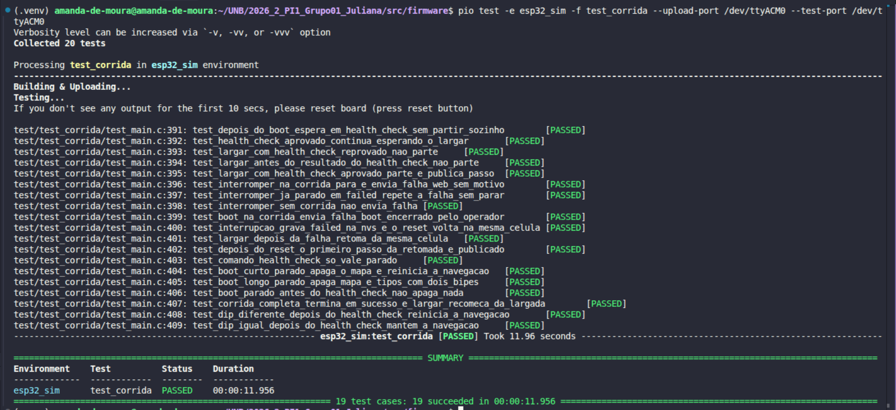

### Comando health_check na corrida simulada (teste 5.11)

No `esp32_sim_boot`, o comando `health_check` enviado com o robô parado rodou os 8 itens e publicou o `hc_resultado`, tanto esperando o `largar` quanto depois do `sucesso` (a `tel` voltou a `health-check`). Enviado com a corrida em andamento, foi ignorado e a corrida chegou ao `sucesso`. O `interromper` com o robô parado em `success` não gerou `falha`, e na corrida gerou a `falha` `web` com motivo nulo. Log: [`5.11-health-check-comando-esp32.txt`](evidencias/testes-integracao/firmware-hardware/5.11-health-check-comando-esp32.txt).

### DIP lido pelo health-check na placa real (teste 5.12)

No `esp32_real`, o DIP foi trocado com a placa ligada e o comando `health_check` enviado a cada troca. O `tipo_dip` do `hc_resultado` acompanhou as vias (`8x4`, `12x4`, `12x4`, `8x4`, `4x4`), então o health-check relê o DIP depois do boot, como a navegação precisa para reiniciar com o tipo novo. O resultado foi reprovado em todos por causa dos ToF laterais (teste 5.2); o motor e o encoder esquerdos também reprovaram em dois comandos porque a bateria atrapalhava a roda, e passaram nos três últimos, com a bateria segurada. Log: [`5.12-dip-health-check-esp32.txt`](evidencias/testes-integracao/firmware-hardware/5.12-dip-health-check-esp32.txt).

### Troca de módulo entre conectores dos ToF (teste 5.2)

Para separar o defeito do módulo e o do conector da placa, os dois módulos foram trocados de lugar: o que era o esquerdo foi ligado no conector do frontal, e o que era o frontal, no conector do esquerdo. Depois da troca, o conector do frontal passou a responder e a medir de forma estável (76 a 82 mm) com o módulo que falhava, e o conector do esquerdo seguiu sem resposta com o módulo que antes funcionava. Como o defeito acompanha o conector, e não o módulo, a verificação passa para a placa: solda dos pinos do conector, trilhas de SDA, SCL, XSHUT e VIN, e o 3,3 V no VIN. O direito não foi trocado nesta rodada. Log: [`5.2-tof-troca-de-modulo.txt`](evidencias/testes-integracao/firmware-hardware/5.2-tof-troca-de-modulo.txt).

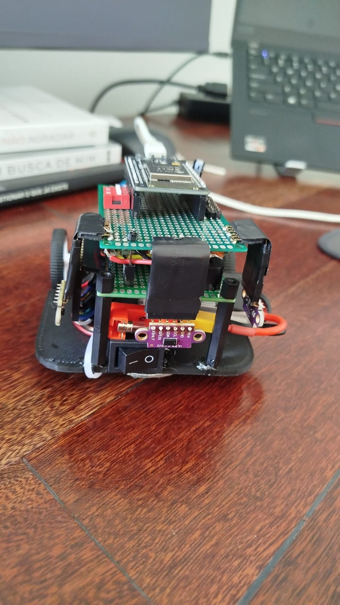

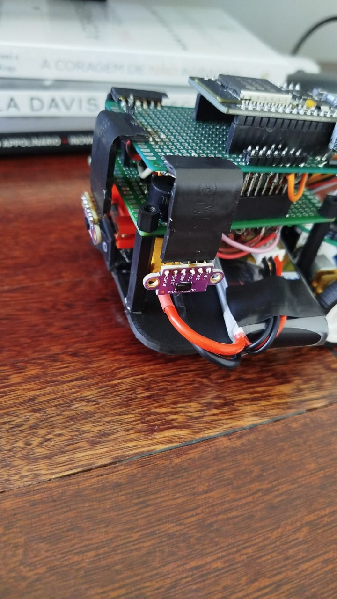

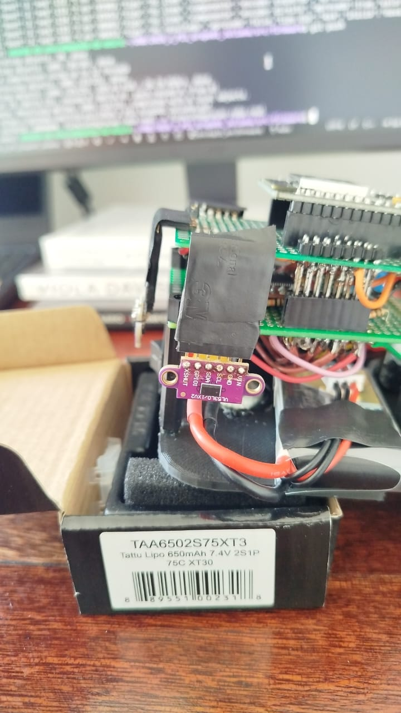

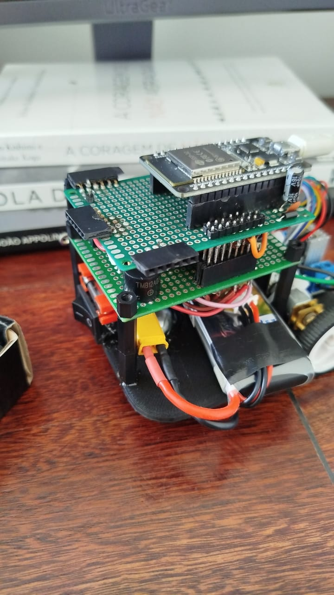

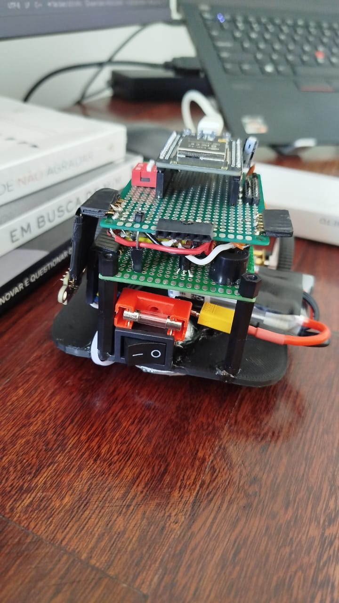

Saídas do monitor depois da troca: o health-check do `esp32_real` com o `tof_frontal` aprovado e os dois laterais reprovados, e a bancada com o boot, o comando `r` e a leitura contínua (`t`), só com a coluna do frontal respondendo.

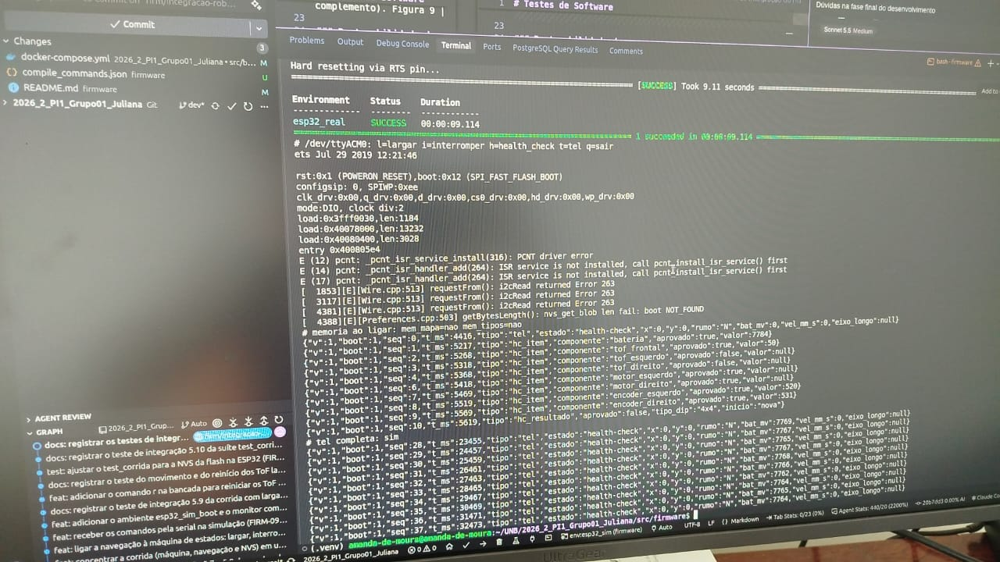

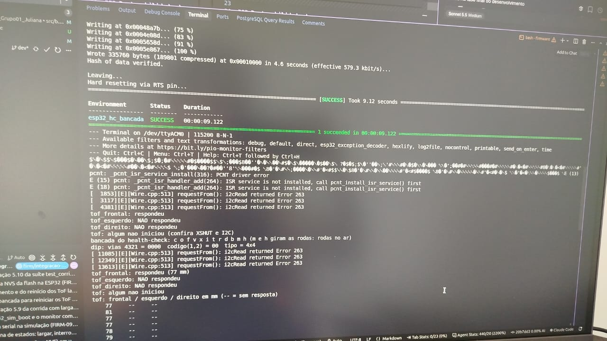

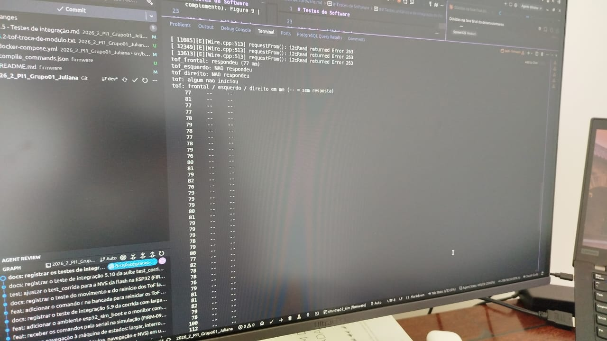

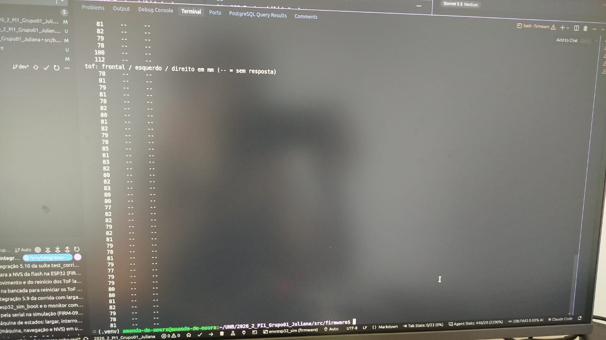

### LED por estado (testes 5.13 e 5.14)

A suíte `test_sinal` (9 casos) confere o padrão do LED de cada estado em função do tempo: pisca rápido no health-check (400 ms, 200 aceso), aceso fixo aguardando o `largar`, pisca lento no reprovado (2 s, 1 s aceso), pisca médio na corrida (1 s, 500 ms aceso), 3 piscadas e aceso fixo no sucesso e pisca muito rápido na falha (200 ms, 100 aceso). O padrão reinicia ao mudar de estado e aguenta a virada do relógio de 32 bits. Resultado: 9 de 9 na placa e 9 de 9 no PC. Log: [`5.13-sinal-led-esp32.txt`](evidencias/testes-integracao/firmware-hardware/5.13-sinal-led-esp32.txt).

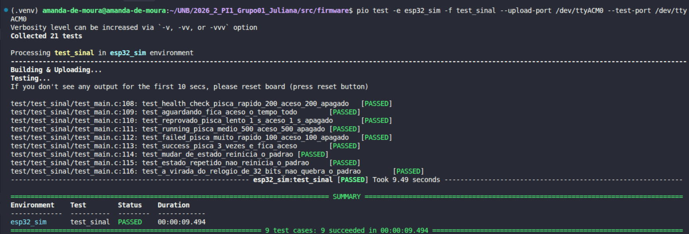

No LED azul da placa (GPIO2), o `esp32_real` com o health-check reprovado pelos ToF laterais (teste 5.2) piscou 1 s aceso e 1 s apagado, o padrão do estado reprovado. No `esp32_sim_boot`, a corrida passou pela sequência de estados `health-check`, `running`, `success`, `running`, `failed` e `health-check` de novo, e o LED seguiu o padrão esperado em cada um. A conferência foi visual; não há foto nem vídeo do LED. Log: [`5.14-led-por-estado-esp32.txt`](evidencias/testes-integracao/firmware-hardware/5.14-led-por-estado-esp32.txt).

### Encoder sem interrupção (testes 5.15 e 5.16)

O contador de 16 bits do PCNT zera em ±30000, e o driver dependia de uma interrupção para somar o estouro, que nunca foi instalada (o erro `pcnt_isr_service_install` em todo boot). O driver agora soma o estouro na própria leitura (`encoder_soma`, lido a 200 Hz no controle). A suíte `test_encoder_soma` (6 casos) cobre a passagem do +30000 e do -30000, várias voltas e o vai e volta perto do limite: 6 de 6 na placa e 6 de 6 no PC. Log: [`5.15-encoder-soma-esp32.txt`](evidencias/testes-integracao/firmware-hardware/5.15-encoder-soma-esp32.txt).

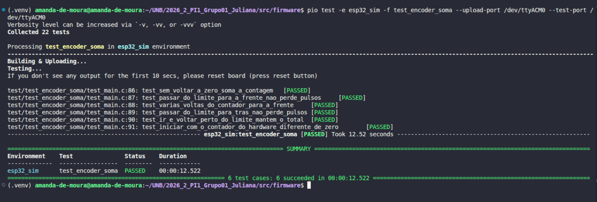

No boot do `esp32_real`, as três linhas de erro do PCNT desapareceram. Log: [`5.16-pcnt-boot-esp32-real.txt`](evidencias/testes-integracao/firmware-hardware/5.16-pcnt-boot-esp32-real.txt).

### Corrida simulada, retomada e regressão da NVS (testes 5.17 e 5.18)

Depois do limite de gravações do mapa (600 por inicialização), a suíte `test_corrida` continua com 19 de 19 na ESP32 (flash real). Na corrida simulada do `esp32_sim_boot`, a falha por `interromper` em (0,2) seguida de reset voltou como `retomada` na mesma célula, e o `largar` continuou dela até o `sucesso`. Logs: [`5.17`](evidencias/testes-integracao/firmware-hardware/5.17-corrida-esp32-regressao-nvs.txt) e [`5.18`](evidencias/testes-integracao/firmware-hardware/5.18-corrida-retomada-esp32.txt).

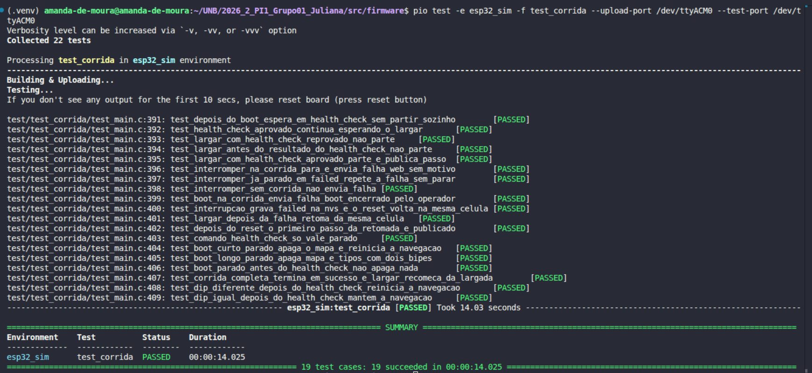

### Encoder: estouro do contador e pulsos por volta (testes 5.19 e 5.20)

Na bancada dos drivers, com as rodas no ar e o motor a 30%, os dois encoders passaram de +30000, -30000 e -60000 sem nenhum pulo (o PCNT zera nesses pontos e o `encoder_soma` soma o estouro na leitura), e o esquerdo foi de 46475 a -67046, bem além do limite do `int16`. Frente soma e ré subtrai nos dois motores. Log: [`5.19-encoder-estouro-esp32.txt`](evidencias/testes-integracao/firmware-hardware/5.19-encoder-estouro-esp32.txt). Girando a roda à mão, o contador voltou ao ponto de partida, mas a volta exata não foi medida (588 e 633 pulsos), então os 840 pulsos por volta seguem sem confirmação; o teste 5.20 fica para repetir rolando o robô por uma distância medida. Log: [`5.20-encoder-volta-manual-esp32.txt`](evidencias/testes-integracao/firmware-hardware/5.20-encoder-volta-manual-esp32.txt).

### Sentido das rodas (achado no teste 5.19)

Na bancada dos drivers, com a configuração original, a roda esquerda girava para **trás** com a potência positiva (`e`) e para a frente com a negativa (`E`), e o encoder contava positivo com a potência positiva. Como o movimento e a navegação assumem que potência positiva e encoder positivo são para a frente, o robô andaria torto. Uma primeira correção inverteu os dois lados, e a conferência seguinte (rodas no ar) mostrou que a esquerda ficou certa e a direita passou a girar ao contrário (`d` para trás, `D` para a frente): a direita já estava certa na configuração original, o que bate com motores espelhados, um de cada lado. A correção final do driver é `invertido` ligado só no motor e no encoder **esquerdos**. A conferência final está no teste 5.21: com só a esquerda invertida, as duas rodas giram para a frente com `e` e `d`, e o encoder sobe para a frente.

Na mesma conferência, o `p` da bancada parou de responder nos comandos do final (a causa não foi identificada; no teste 5.21, com a bancada repetindo cada tecla, o `p` parou a roda 4 de 4 vezes). A bancada passou a repetir cada tecla recebida (`# comando: x`), a parar com qualquer outra tecla (inclusive Enter) e a parar sozinha depois de 20 s sem comando.

### Roteiro dos testes de calibração no robô (FIRM-10)

Testes a registrar nesta tabela quando forem feitos, com a bancada `esp32_calibracao` (ver o [README do firmware](https://github.com/fcte-pi1/2026_2_PI1_Grupo01_Juliana/tree/dev/src/firmware#calibra%C3%A7%C3%A3o-no-rob%C3%B4)). Cada um leva o log do monitor e, quando houver, a foto ou a medida da régua ou do transferidor em `evidencias/testes-integracao/firmware-hardware/`.

| Critério (issue #141) | Comando | Procedimento | Resultado esperado |
|---|---|---|---|
| Avanço de uma célula | `a` | robô no chão, com a régua ao lado | 1079 pulsos por roda (com 640 pulsos por volta, provisório); 180 mm. Registrado no teste 5.28 |
| 10 avanços seguidos | `A` | marque o ponto de partida e meça o final na pista | 1800 mm, erro final de até 10 mm. Registrado no teste 5.30 |
| Giro de 90° | `g` e `G` | meça o ângulo físico com esquadro ou transferidor (o ângulo impresso vem dos encoders) | 435 pulsos por roda (provisório). Registrado no teste 5.29 |
| 20 giros seguidos | `Q` | meça o desvio com o transferidor | volta à posição inicial, desvio acumulado de até 5° |
| PID de velocidade | `v` | rodas no ar ou no chão | média depois da rampa a até 5% de 400 mm/s nas duas rodas (`APROVADO`) |
| Limiar de stuck | `s` | segure a roda até ela parar por completo, por mais de 1 s | detecção em torno de `MOTOR_TRAVADO_MS` (1000 ms). **Não verificado:** com a roda segurada sem força ela seguiu girando e o detector, que exige o encoder parado por 1 s, não disparou (esperado) |
| Limiar de parede | `t` | robô no centro de células com e sem parede | leituras que separam parede de ausência de parede nos três ToF |
| Corredor de 4 células | `esp32_real` | pista de 4 células, ToF laterais funcionando | percorre sem encostar nas paredes |
| Bateria contra o multímetro | `esp32_drivers` | compare a tensão impressa com o multímetro | erro de até 2% (adiado: sem multímetro) |
| Firmware completo | `esp32_real_tof_mock` | pista aberta, depois da calibração | a corrida chega ao `sucesso` ou falha com `stuck` |

### Executor de movimento na ESP32 (teste 5.22)

A suíte `test_execucao` (11 casos) roda no PC e dentro da ESP32: cada ação da navegação leva o robô simulado à célula certa, uma roda travada faz a execução falhar e parar, a corrida completa no labirinto de demonstração chega ao objetivo **andando de verdade** (motores, encoders e ToF do mundo simulado), e a falha de movimento vira a `falha` `stuck`. Na mesma rodada, o `test_corrida` continuou com 19 de 19. Log: [`5.22-execucao-esp32.txt`](evidencias/testes-integracao/firmware-hardware/5.22-execucao-esp32.txt).

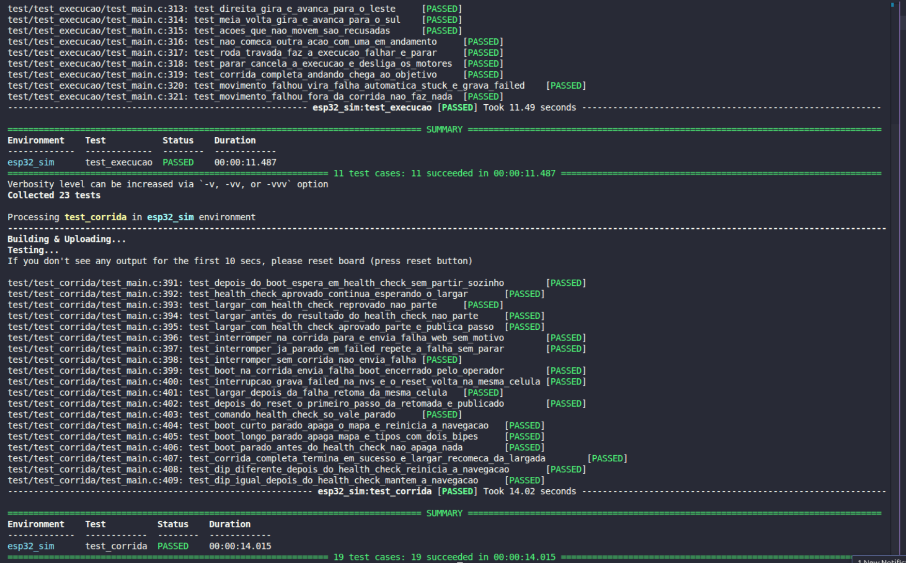

### Corrida simulada andando na ESP32 (teste 5.23)

Com o executor de movimento ligado à navegação, o `esp32_sim_boot` roda a corrida pela física do mundo simulado, sem teletransporte. O robô chegou ao objetivo (3,3) pelo caminho certo do labirinto de demonstração, que desce de (2,3) por (2,2) e (3,2): isso mostra que a parede lateral da célula nova é lida ao entrar, e não no centro (onde o lado aberto dá parede falsa). Cada célula reta levou cerca de 1 s e cada célula com giro, cerca de 1,5 s. O `largar` depois do `sucesso` recomeçou do (0,0), o `interromper` parou a corrida com a `falha` `web` sem motivo, e o `health_check` rodou parado em `success` e depois de `failed`. Log: [`5.23-corrida-simulada-andando-esp32.txt`](evidencias/testes-integracao/firmware-hardware/5.23-corrida-simulada-andando-esp32.txt).

### BOOT parado e corrida nova na ESP32 (teste 5.24)

No `esp32_sim_boot`, o toque curto e o toque longo no BOOT com o robô parado apagaram a memória e voltaram a navegação para (0,0): o app imprimiu `# BOOT curto: ...` e `# BOOT longo: ...`, a `tel` ficou em (0,0) e o `largar` seguinte percorreu o labirinto inteiro até o `sucesso`, com a `tel` a 5 Hz na corrida e a 1 Hz parado. Na simulação não há buzzer; o sinal é a linha no monitor e o LED. Log completo do monitor, desde o boot: [`5.24-boot-parado-corrida-nova-esp32.txt`](evidencias/testes-integracao/firmware-hardware/5.24-boot-parado-corrida-nova-esp32.txt).

### BOOT na corrida e retomada depois do reset (teste 5.25)

No `esp32_sim_boot`, um toque no BOOT no meio da corrida parou o robô e enviou a `falha` com origem `boot` e motivo `encerrado_operador`, com a `tel` em `failed`. Depois do reset, o boot saiu como `retomada` com a posição da falha, e o `largar` continuou dali até o `sucesso` em (3,3), sem voltar ao começo. Isso fecha a corrida simulada com a memória: `largar`, `interromper`, BOOT na corrida, BOOT parado, `health_check` e retomada. Log completo: [`5.25-boot-na-corrida-retomada-esp32.txt`](evidencias/testes-integracao/firmware-hardware/5.25-boot-na-corrida-retomada-esp32.txt).

### Bluetooth: enlace e alcance (testes 5.26 e 5.27)

O `esp32_calibracao_bt` foi pareado com o notebook (`bluetoothctl pair` e `trust`) e aberto em `/dev/rfcomm0` com `rfcomm bind`, sem o cabo USB. As teclas da bancada chegaram ao robô e as respostas voltaram ao monitor, com o robô andando no chão (5.26). O `rfcomm connect` não serve: ele segura a porta e o monitor recebe `Device or resource busy`. O eco do terminal devolvia a saída do robô como comandos, então a bancada aceita só linhas de uma tecla (ADR-020).

**Alcance (5.27):** a mais de cerca de 3 m do notebook o enlace desconecta com facilidade, abaixo do critério de estabilidade a 3 m da FIRM-11. Foi um relato, sem medir a distância da queda, e ainda falta repetir o teste e investigar a causa. Enquanto isso, o notebook deve ficar a menos de 3 m do robô, e a ponte reabre a porta sozinha se a conexão cair.

### Defeito estrutural e resultados invalidados (testes 5.28 a 5.33)

**Roda esquerda roçando na bateria.** A bateria não tem lugar fixo e encosta na roda esquerda, o que dá um atrito que varia de um avanço para o outro: no mesmo ambiente a esquerda ficou curta (1070 de 1079), passou do alvo (1087) e acertou (1078). Foi descartada a correção por software (ganho integral e tolerância maiores), que só esconderia o defeito mecânico; o reparo é fixar a bateria. Até isso ser feito, os avanços, os dez avanços e o recuo da roda esquerda no fim do movimento não são conclusivos.

**Conversão de pulsos em milímetros.** Com 840 pulsos por volta o robô andava 23 a 25 cm quando o código contava 18 cm. O valor passou a 640 (provisório), o que levou o avanço de uma célula de 1416 para 1079 pulsos e o giro de 90° de 571 para 435. Todos os resultados em milímetros ou em pulsos dos testes anteriores a essa troca não valem como medida de distância ou de ângulo.

**Valores de referência dos logs:** avanço de uma célula cerca de 1079 pulsos por roda e 180 mm pelos pulsos; giro de 90° cerca de 90,7° e -90,4°; dez avanços cerca de 1800 mm pelos pulsos; ToF frontal de 64 a 68 mm com a madeira a 5 a 6 cm. Todos calculados pelos encoders ou lidos dos sensores.

