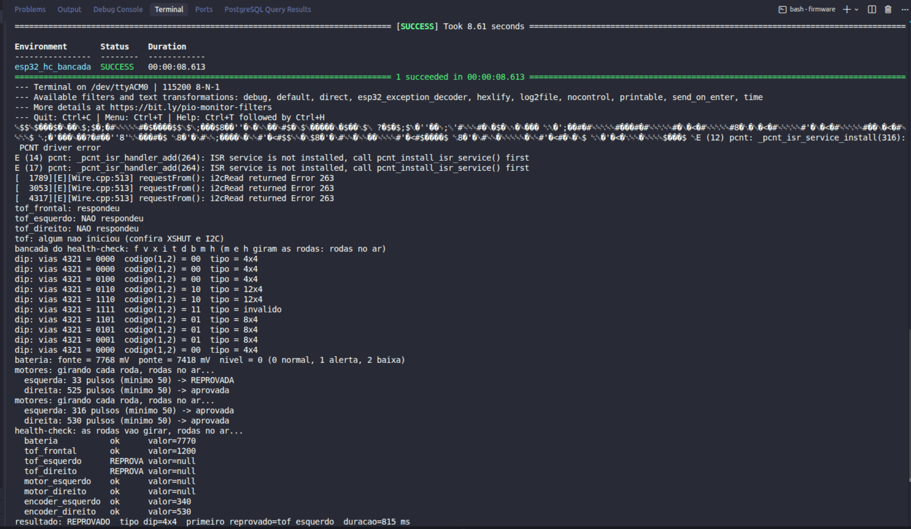

# Testes de Integração

!!! warning "Registros parciais"
    Os testes 5.1 a 5.5 registram a integração do firmware com o hardware da bancada (Firmware e Eletrônica). Os testes de ponta a ponta com a ponte, o back-end e a web (health-check aprovado na tela, `dip_divergente`, comando `health_check` pela web) e a validação do ambiente `esp32_real` na placa ainda não foram feitos. As linhas seguintes seguem em branco.

Confiram as regras de avaliação dos testes de integração no [documento do tema do projeto](https://docs.google.com/presentation/d/1hRx0g9mpVGQbTv44gLEoAyf4b4kKM4vnrABTnG8HlUk/edit?usp=sharing).

| **ID** | **Descrição** | **Data de Início** | **Data de Conclusão** | **Subequipes** | **Responsável** | **Resultados Esperados** | **Resultados Obtidos** | **Aprovação Interna (S/N)** | **Aprovação do Orientador (S/N)** | **Observações** |
|:------:|---------------|--------------------|-----------------------|----------------|-----------------|--------------------------|------------------------|:---------------------------:|:--------------------------------:|-----------------|
| 5.1 | Integração do firmware com o DIP switch: o tipo de labirinto lido nas vias 1 e 2 chega ao `tipo_dip` do health-check | 20/11/2026 | 20/11/2026 | Firmware e Eletrônica | Amanda | `00` = 4x4, `01` = 8x4, `10` = 12x4 e `11` = inválido (reprova o health-check); as vias 3 e 4 não mudam o tipo. | Nas 9 combinações testadas o tipo seguiu o esperado, inclusive `1111` como `invalido`. O health-check informou `tipo_dip=4x4` com todas as vias desligadas. | S | N | Bancada `esp32_hc_bancada`. Mapeamento a confirmar com a Eletrônica. Log na seção [Evidências](#log-da-bancada-do-health-check-testes-51-a-54). |
| 5.2 | Integração do firmware com os três ToF VL53L0X (XSHUT, troca de endereço e leitura) | 20/11/2026 | 20/11/2026 | Firmware e Eletrônica | Amanda | Os três sensores iniciam nos endereços `0x30` a `0x32` e medem distâncias. | Só o frontal (GPIO33) iniciou e mediu. Um lateral (GPIO5) responde ao endereço, mas falha ao ler a calibração (`Error 263`); o outro não responde em nenhum GPIO testado. | N | N | Defeito de hardware nos laterais a investigar pela Eletrônica (alimentação, solda de SDA/SCL, fio do XSHUT). Descartados por teste: pinos do XSHUT, tempo de boot, três tentativas de início, clock do I²C (50, 100 e 400 kHz), timeout de leitura (50 e 500 ms), biblioteca (Adafruit e Pololu) e interruptor da bateria ligado ou desligado. Log na seção [Evidências](#log-da-bancada-do-health-check-testes-51-a-54). |
| 5.3 | Integração do firmware com motores, encoders e bateria (autoteste de giro e leitura em mV) | 20/11/2026 | 20/11/2026 | Firmware e Eletrônica | Amanda | Cada roda conta ao menos 50 pulsos em 300 ms a 30 % de potência, com o encoder da mesma roda; a bateria é lida em mV. | Direita: 525 a 530 pulsos. Esquerda: 316 e 340 pulsos, e 33 (reprovada) em uma execução com a bateria atrapalhando a partida. Bateria: 7768 mV. | S | N | Rodas no ar e interruptor ligado. Falta comparar a bateria com o multímetro (erro de até 2 %). Limiar provisório. Log na seção [Evidências](#log-da-bancada-do-health-check-testes-51-a-54). |
| 5.4 | Health-check de 8 itens na placa com os drivers reais, reprovando e nomeando o componente | 20/11/2026 | 20/11/2026 | Firmware e Eletrônica | Amanda | Os 8 itens são avaliados e, havendo reprovação, o componente aparece nomeado. | Reprovou e nomeou `tof_esquerdo` como primeiro reprovado (e `tof_direito`); bateria, `tof_frontal`, motores e encoders passaram. Duração de 815 ms. | S | N | O resultado reprovado decorre do teste 5.2. Log na seção [Evidências](#log-da-bancada-do-health-check-testes-51-a-54). |
| 5.5 | Telemetria do firmware na ESP32 pela serial USB: health-check seguido da `tel`, sem `falha` | 19/11/2026 | 20/11/2026 | Firmware | Amanda | Saem 8 `hc_item` e 1 `hc_resultado` aprovado (`inicio` nova), sem `falha`, e depois a `tel` a 1 Hz com o robô parado; `seq` contínuo. | Saíram os 8 `hc_item`, o `hc_resultado` (`aprovado`, 4x4, `nova`) e a `tel`, sem `falha` e com `seq` contínuo de 0 a 46. Na primeira execução o robô subiu como `success` e `retomada` por causa do estado guardado na NVS; depois de apagar a flash saiu `nova` e `running`. | S | N | Firmware `esp32_sim` (HAL simulada) rodando na placa real. Pendente: robô parte sozinho, sem esperar o `largar`, e a `tel` `running` sai antes do `hc_resultado`, até a máquina de estados ser ligada à navegação. Evidência: [`5.5-telemetria-serial.txt`](evidencias/testes-hardware/5.5-telemetria-serial.txt). |
| 5.6 | | | | | | | | | | |
| 5.7 | | | | | | | | | | |
| 5.8 | | | | | | | | | | |
| 5.9 | | | | | | | | | | |
| 5.10 | | | | | | | | | | |
| 5.11 | | | | | | | | | | |
| 5.12 | | | | | | | | | | |
| 5.13 | | | | | | | | | | |
| 5.14 | | | | | | | | | | |
| 5.15 | | | | | | | | | | |
| 5.16 | | | | | | | | | | |

## Evidências

### Log da bancada do health-check (testes 5.1 a 5.4)

Saída serial do ambiente `esp32_hc_bancada` na ESP32 real, com as rodas no ar e o interruptor ligado. Nela aparecem, em ordem, a inicialização dos ToF (5.2), a leitura do DIP em 9 combinações (5.1), a bateria e o autoteste dos motores (5.3) e o health-check de 8 itens com o resultado reprovado (5.4).

Os logs de texto de cada teste estão em `evidencias/testes-hardware/`: [5.1](evidencias/testes-hardware/5.1-dip.txt), [5.2](evidencias/testes-hardware/5.2-tof.txt), [5.3](evidencias/testes-hardware/5.3-motores-bateria.txt) e [5.4](evidencias/testes-hardware/5.4-health-check.txt).

### Telemetria pela serial USB (teste 5.5)

Saída serial do `esp32_sim` na ESP32 real em duas execuções: a primeira com o estado antigo guardado na NVS (`success` e `retomada`) e a segunda depois de apagar a flash (`nova` e `running`). Mostra os 8 `hc_item`, o `hc_resultado`, a `tel` a 1 Hz com o robô parado e o `seq` contínuo, sem nenhuma `falha`. Log completo: [`5.5-telemetria-serial.txt`](evidencias/testes-hardware/5.5-telemetria-serial.txt).
