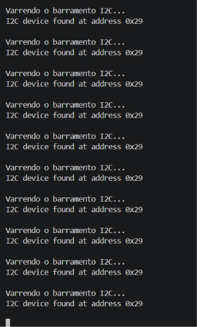

# ELE-09: testes de bancada dos sensores ToF e da telemetria Bluetooth

Programas **à parte** da Eletrônica (Marcus e Fábio), seguindo o roteiro de testes da Dupla 3 (Sensores e Comunicações). Não são o firmware do robô: não usam a HAL nem entram no `pio run` padrão nem no CI. Cada teste tem um ambiente próprio no `platformio.ini`.

Os pinos são os mesmos de `include/config/pinos.h`: `SDA = 21`, `SCL = 22`, `LED_STATUS = 2`.

## Como rodar

No Git Bash, dentro de `src/firmware`:

```bash
export PATH="$HOME/.platformio/penv/Scripts:$PATH"   # se o pio não for encontrado
pio run -e ele09_teste1 -t upload                     # troque por ele09_teste2 ou ele09_teste3
pio device monitor -b 115200
```

Os Testes 2 e 3 usam a biblioteca **Adafruit VL53L0X**, que o PlatformIO baixa sozinho (`lib_deps`).

## Ligação

| VL53L0X | ESP32 |
|---|---|
| VIN | **3V3** (nunca 5 V: os pull-ups do I²C do módulo levariam 5 V aos pinos da ESP32) |
| GND | GND |
| SDA | D21 |
| SCL | D22 |
| XSHUT, GPIO1 | soltos |

Testes 2 e 3: **D2 → resistor de 1 kΩ → perna longa do LED; perna curta → GND**.

O sensor fica no lado do módulo com o texto `VL53L0/1XV2` e as duas janelinhas. Esse lado precisa ficar virado para onde se quer medir.

## Testes

| Teste | Ambiente / pasta | O que faz | Registro pedido no roteiro |
|---|---|---|---|
| 1 | `ele09_teste1` / `teste1_i2c_scanner` | Varre o barramento a cada 3 s | Print do monitor com `I2C device found at address 0x29` |
| 2 | `ele09_teste2` / `teste2_filtro_limiar` | Média móvel das últimas 5 leituras; LED aceso abaixo de 100 mm | Vídeo do LED na marca de 10 cm da régua + print do gráfico |
| 3 | `ele09_teste3` / `teste3_bluetooth` | Envia a distância filtrada pelo Bluetooth (`Ratatuli_ToF`) a 10 Hz | Gravação de tela do celular recebendo os dados |

### Detalhes

- **Diagnóstico no Teste 1:** além da varredura, o scanner lê os registros de identificação do sensor (`0xC0 = 0xEE`, `0xC1 = 0xAA`, `0xC2 = 0x10` num VL53L0X). Quando não acha nada, ele testa o SDA e o SCL com o pull-down interno da ESP32. A linha só lê HIGH se o pull-up do módulo estiver chegando, então dá para achar fio solto sem multímetro.
- **Fora de alcance:** quando nada está na frente, o VL53L0X devolve `RangeStatus = 4`. O código conta essa leitura como 2000 mm, para a média subir e o LED apagar.
- **Leitura com falha:** se a medição falha (erro de I²C), ela é descartada. Antes, o código repetia o último valor e o gráfico parecia travado.
- **I²C a 50 kHz e nova tentativa no início:** os pinos do sensor estão sem solda e ligados por emendas de jumper. Com 50 kHz a comunicação tolera melhor esse contato, e o `setup()` tenta encontrar o sensor de novo a cada 1 s em vez de travar.
- **Gráfico (Teste 2):** o PlatformIO não tem o Plotter Serial da Arduino IDE. O código imprime `>bruto:…`, `>filtrado:…` e `>limiar:100`, que a extensão **Teleplot** do VS Code desenha. Feche o monitor serial antes de abrir a Teleplot, porque só um programa usa a porta.
- **10 Hz (Teste 3):** um `delay(100)` puro somaria o tempo de leitura do sensor (cerca de 30 ms) e daria cerca de 7,5 Hz. O laço usa `millis()` para fechar 100 ms por ciclo. No app *Serial Bluetooth Terminal*, o horário das mensagens (*Settings → Terminal → Timestamp*) mostra o intervalo.
- **Celular:** o Bluetooth do ESP32 aqui é o clássico (SPP). Ele funciona com Android; **o iPhone não conecta**.

## Resultados

Testes feitos em 25/10/2026 por Marcus e Fábio, com a ESP32 DevKit V1 alimentada pelo USB.

| Teste | Data | Resultado | Evidência |
|---|---|---|---|
| 1 | 25/10/2026 | **Aprovado.** Sensor encontrado em `0x29` em 10 varreduras seguidas. | [`teste1_scanner.png`](evidencias/teste1_scanner.png), [`teste1_scanner_estavel.png`](evidencias/teste1_scanner_estavel.png) |
| 2 | 25/10/2026 | **Aprovado.** O LED acende abaixo de 10 cm e apaga acima. No vídeo, a mão faz o papel do obstáculo, e a distância medida aparece ao mesmo tempo no gráfico da Teleplot na tela do notebook. No gráfico, a curva filtrada cruza o limiar de 100 mm e segue a bruta sem os picos: a variação entre leituras seguidas caiu de 2,4 mm (bruta) para 0,75 mm (filtrada). | [`teste2_teleplot.png`](evidencias/teste2_teleplot.png), [`teste2_video_led_aceso.jpg`](evidencias/teste2_video_led_aceso.jpg), [`teste2_montagem_led.jpeg`](evidencias/teste2_montagem_led.jpeg), vídeo `video teste 2.mp4` |
| 3 | 25/10/2026 | **Aprovado.** O celular recebeu a distância filtrada pelo `Ratatuli_ToF`. Pelo horário das mensagens, 33 leituras chegaram em 3,2 s (intervalo médio de 0,10 s, ou seja, 10 Hz), com valores acompanhando a mão de 2000 mm até menos de 100 mm. | [`teste3_bluetooth_10hz.jpg`](evidencias/teste3_bluetooth_10hz.jpg), vídeo `video teste 3.mp4` |

Os vídeos não estão no repositório por causa do tamanho.

### Evidências

**Teste 1:** sensor respondendo em `0x29` em todas as varreduras.



**Teste 2:** curvas bruta (vermelha), filtrada (azul) e limiar de 100 mm (verde) na Teleplot, com a mão descendo de ~14 cm até ~4 cm.


**Teste 2:** LED aceso com a mão a menos de 10 cm do sensor, com o gráfico da Teleplot na tela ao fundo.


**Teste 3:** celular recebendo a distância filtrada pelo Bluetooth, com o horário de cada leitura (intervalo de ~0,1 s).


